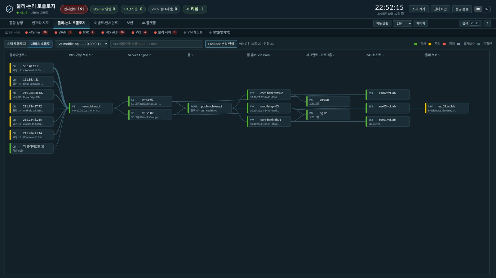
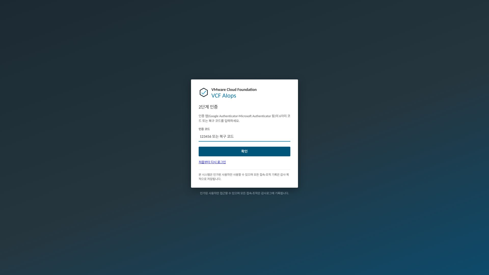
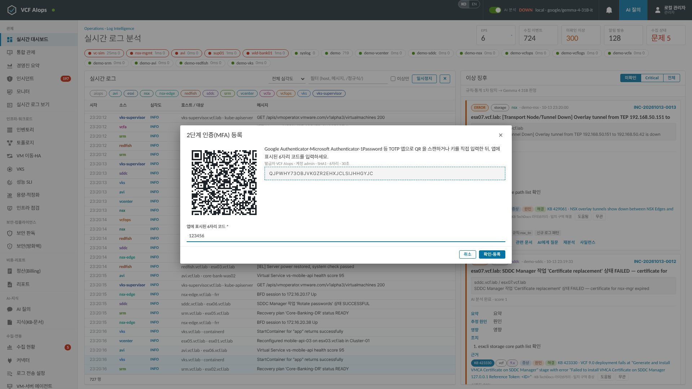
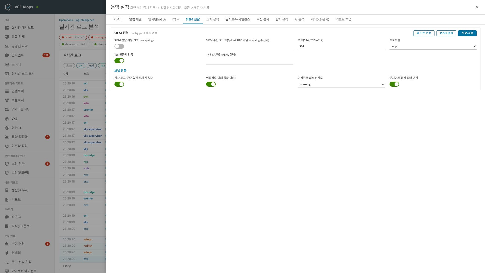
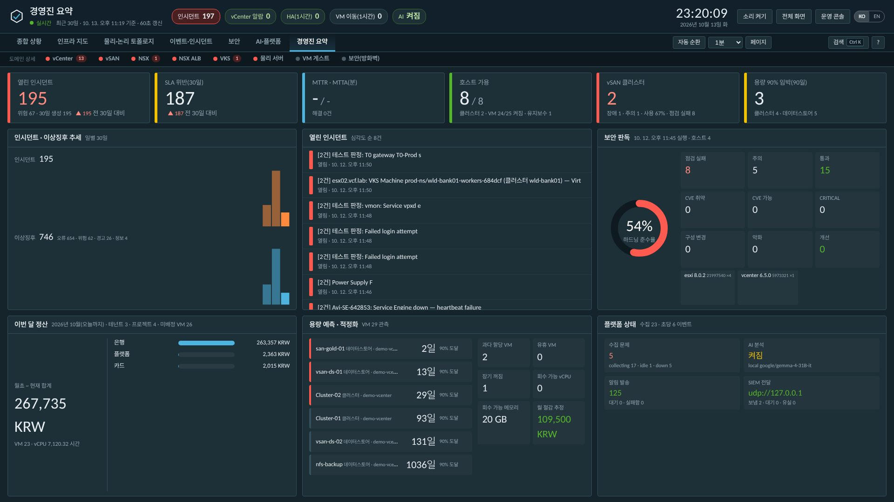
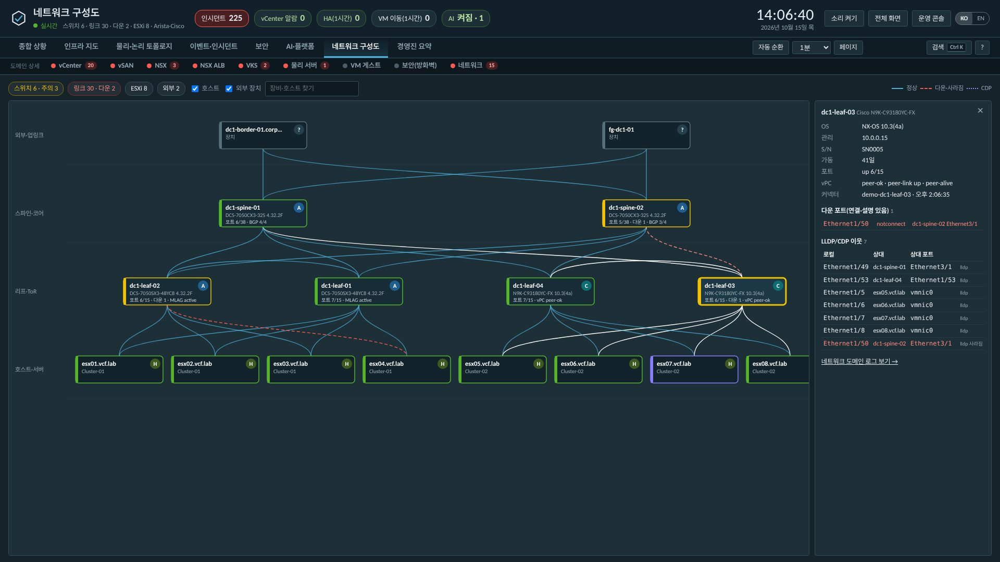
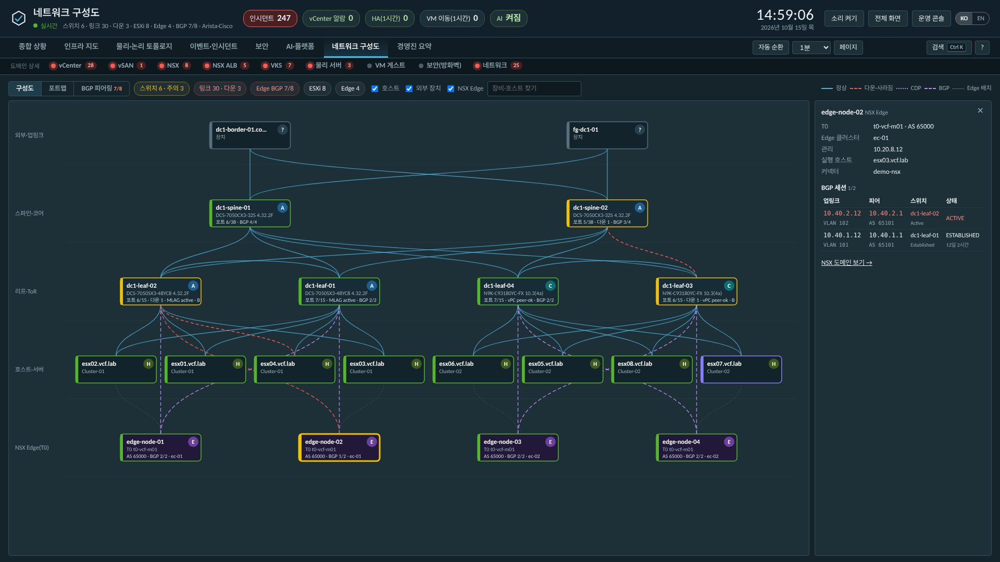
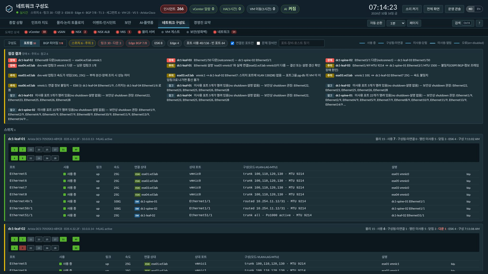
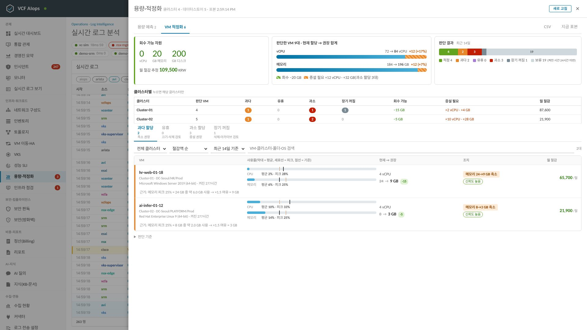

<div align="center">

# VCF AIops

**Unified NOC, real-time log anomaly detection and KB-grounded private-AI analysis for VMware Cloud Foundation**

Collects logs and state from vCenter/ESXi, NSX, NSX ALB (Avi), VKS, SDDC Manager, VCF Operations, SRM, server BMCs (UCS, iLO, iDRAC), FortiGate and guest agents,
narrows them down with rules and statistics, then explains root cause and command-level remediation using **your on-prem LLM (VMware Private AI Services)**
grounded in a **Broadcom KB / TechDocs archive**. Version 2.0 added **billing (showback/chargeback), security assessment (hardening, KISA, VMSA/CVE),
capacity forecasting, VM rightsizing and vSAN Health**; 2.1 adds **MFA (TOTP), OIDC SSO, SIEM (CEF/syslog) forwarding, PagerDuty/Opsgenie on-call,
per-token IP allow-lists and an executive summary wall page**; 2.2 adds **Arista/Cisco network collection with a full network diagram** and stability features (self-check, persistent sessions, alert routing, request guards); 2.3 adds **NSX Edge ↔ physical switch BGP**, a **per-device port map** (switch ports ↔ ESXi vmnics with redundancy/speed/cabling checks) and a redesigned **VM rightsizing** view — all in the same appliance.

 
 


[한국어 README](README.md) · [Feature spec (KO)](docs/FEATURES.md) · [Operations guide (KO)](docs/GUIDE.md) · [Changelog (KO)](CHANGELOG.md)


<sub>Service flow: client → VIP → Service Engine → pool → member VMs/Pods → segment → ESXi → physical server. Screenshots use simulated devices, a test LLM and fictitious KB articles.</sub>

</div>

> The UI, documentation and detection texts are in Korean with a built-in English switch (KO/EN) for the UI. This file is a condensed English overview; the Korean README is the full reference.

## What it does

| | |
|---|---|
| **Collect** | syslog (UDP/TCP/TLS), SNMP traps v1/v2c/v3, HTTP ingest (Fluent Bit), Redfish event push, REST/SOAP/XML polling — one event model. Collector accounts are **read-only**. |
| **Detect** | 113 rules + novel log patterns + burst detection (EWMA z-score); identical fingerprints merge; each pattern is sent to the LLM once. |
| **Explain** | Local LLM (PAIS / vLLM, OpenAI-compatible), Claude or Gemini routed per task. Answers cite the **Symptoms / Cause / Resolution / Workaround sections of KB articles** and the versions you actually run; KB numbers without evidence are flagged. |
| **Connect** | Physical (fabric interconnect → chassis → blade) to logical (ESXi → VDS → Edge/SE → **VM / Pod** → T0/T1 → segment → virtual service) topology and a **service-flow diagram** from client to VIP to pool-member VM to physical server. |
| **Account** | **Billing** — 5-minute VM samples × tenant/project × rate card (utilization-weighted), monthly statements. **Security assessment** — ESXi/vCenter hardening, KISA HV-01~25 mapping, VMSA/CVE verdicts by build, **configuration-drift tracking**. |
| **Plan** | **Capacity** — cluster/datastore trends with days-to-80%/90%; **VM rightsizing** — oversized, undersized, idle and long-powered-off VMs with estimated monthly savings; **vSAN Health** checks and space efficiency. |
| **Operate** | OVA appliance, Ed25519-signed web patches with rollback, AD/LDAP + RBAC, hash-chained audit log, read-only MCP server for AI agents. |

## Feature overview

### Collection and detection
- Receivers: syslog 514 (UDP/TCP) and 6514 (TLS), SNMP trap 162 (incl. v3 USM), `POST /api/ingest` (token scope `ingest`), Redfish push.
- Connectors (read-only): vCenter (pyVmomi events/alarms/inventory + REST health, 8.x/9.x), SDDC Manager, NSX (Policy/Manager API), NSX ALB (all tenants, per-tenant metrics), VKS/Kubernetes (event watch), VCF Operations/Logs/Automation, SRM, Cisco UCS Manager, Redfish BMCs, FortiGate.
- Detection: 113 signatures (vSphere, vSAN, NSX, Avi, VKS, SDDC, BMC, FortiGate, Arista/Cisco switches, Linux/Windows guest OS, Oracle/PostgreSQL/MySQL, SLI breaches), template-based novel patterns, bursts, suppression regexes and custom rules.

### AI analysis and knowledge library
- Pattern reuse, GPU/queue governor, pseudonymised external calls (IPs/hostnames masked), `[UNTRUSTED_LOG]` isolation against prompt injection.
- Verdicts: summary, anomaly yes/no, severity, probable cause, ordered remediation steps (`[change]`-tagged risky steps), referenced documents; incident-level RCA; chat with `[R#]` citations.
- Knowledge library: indexes a Markdown archive of Broadcom KB/TechDocs (SQLite FTS5 + optional vectors), infers Symptoms/Cause/Resolution/Workaround sections for articles without headings, matches `error_signatures` verbatim, weights by product/version/doc type/language, auto-links related KB to anomalies and incidents, re-analyses patterns once the knowledge generation changes. Upload md files/folders/zips from the UI.
- MCP server (`POST /mcp`, Streamable HTTP, API token only, read-only tools): `knowledge_search`, `knowledge_get`, `open_anomalies`, `noc_status`.

### NOC (wall display) and console
- `/noc` overview with domain slots (vCenter, **vSAN**, NSX, NSX ALB, VKS, physical servers, VM guests, security), 60-minute timeline, event river, AI situation brief.
- Topology page: stack view with VMs by exact name, Pods under VKS node VMs, segments/port groups; **service-flow tab** resolving Avi pool members to VMs/Pods by IP and expanding top end-user client IPs.
- VIP detail: **throughput** (rx/tx bytes and packets, connections, 2xx/4xx/5xx, SSL, latency, Apdex) and **end users** (application-log sample: unique clients, top IPs, OS/browser/device/location, URIs, p95/p99 latency), pool members.
- Domain detail pages with gap-free live stream, pattern grouping, entity drawer (status, anomalies, topology path, related KB). vSAN page shows vSAN-only logs, **vSAN Health check results**, hosts/disk groups, datastores and a separate section for non-vSAN datastores (local VMFS, shared SAN, NFS, vVols).
- Console: live dashboard, incidents (SLA, MTTA/MTTR, RCA, ServiceNow), performance SLI, VKS (architecture diagram with live per-object health, downstream-impact propagation, and a per-object panel for events, pod logs, change history and related incidents/VMs), infrastructure checks, inventory, VM activity (migrations, HA, create/clone/delete/rename, power, reconfigure, snapshots, risk signals: off-hours/bulk delete/protected VM/short-lived, per-VM lifecycle timeline, per-user view, CSV; VM changes before each incident fed to AI/RCA, before→after reconfig, change-window in/out, repeated-move detection, report section), monitors, support requests (vendor-template SR report for Broadcom/AWS/Azure built from incident/anomaly/VKS evidence, email draft incl. Outlook .eml, server-side PDF with embedded Korean font, log bundle, expiring self-hosted share links; Korean + English bilingual by default — rule-based English for system-generated text, AI translation with pseudonymization for free text, untranslated text flagged as (KO)), log downloads from every log view (CSV/TXT/NDJSON/ZIP, secrets masked), firewall security, agents, SNMP traps, AI chat, reports, patching, users/tokens, audit log. Left menu grouped into NOC · Infrastructure & workloads · Security & compliance · Cost & reports · AI & knowledge · Collection & integration · System & admin.

### Billing
- Every 5 minutes the vCenter inventory is sampled (power, vCPU, memory, provisioned disk, CPU/memory utilisation) and aggregated hourly (400 days).
- Tenants → projects matched by cluster, VM folder path, tag or VM name (OR; priority VM > tag > folder > cluster), evaluated per hour so moves and re-tagging are honoured.
- Rate cards: per-hour prices for vCPU, GB memory, GB disk, optional utilisation weighting with minimum weight, disk-only billing for powered-off VMs, versioned price changes with effective dates.
- Reports for MTD / 7d / 30d / month / custom range, drill-down to VMs, unassigned VMs, CSV, printable monthly statement (PDF via browser print), tenant users restricted to their own tenant.

### Security assessment
- Read-only collection (System.Read): ESXi advanced settings, services, firewall policy, lockdown mode, NTP, vSwitch and distributed port-group security policies, VM advanced settings, snapshots, versions/builds.
- ~40 hardening checks (PASS/FAIL/WARN/MANUAL/N/A with expected/current values and remediation), KISA virtualisation checklist HV-01~25 mapping, VMSA/CVE verdicts against running builds (NVD CVE API 2.0 sync or offline JSON import; "vulnerable" when a fixed build is known, "possible" when only the CPE version/update matches), CSV and printable report, 24-hour schedule, history.
- **Change tracking (2.0)**: diff against the previous run — hosts added/removed, version/build, advanced settings, services, lockdown, NTP, firewall, vSwitch/DVPG policies, VM settings — plus verdict regressions/improvements; emitted as events (warnings for security-relevant changes).

### Capacity planning and VM rightsizing (2.0)
- Cluster CPU/memory and shared-datastore usage sampled every 5 minutes, hourly aggregation; least-squares trend over the last 30 days gives %/day, days to 80%/90%, projected usage at +30/+90 days, GB/day growth and N-1 host memory headroom.
- Rightsizing from billing samples (last 14 days, powered-on hours): oversized (peak CPU < 25% / memory < 30% → recommended size = peak × 1.5), undersized (avg CPU ≥ 75% / memory ≥ 85%), idle (peak CPU < 3% and memory < 10%), long powered-off (≥ 7 days), reclaimable vCPU/memory/disk and estimated monthly savings from the default rate card. Thresholds in `capacity.*`.

### vSAN Health (2.0)
- Uses the vSAN management API (`/vsanHealth`) through the bindings bundled with pyvmomi ≥ 8.0.3 — no extra SDK, read-only. Cluster health summary (overall, groups, individual checks, healthy/total entities, risk if not fixed), space usage (total/free, dedup/compression ratio, usage by object type), object health counts. Health changes become events (red = error, yellow = warning, recovery = info). API version negotiated from `/sdk/vsanServiceVersions.xml`.

### MFA and SSO (2.1)

- **MFA (TOTP, RFC 6238)** for local, AD/LDAP and SSO accounts: enroll from the user menu (QR via pure-Python `segno` or manual key), confirm once, receive **8 single-use recovery codes** (hashes only). Replay of the same code is rejected. `auth.mfa.required_roles: [admin]` forces enrollment for a role (console opens the enrollment dialog; other APIs return 403 `mfa_enroll` until done). Admins can reset a lost authenticator from the user list.
- **Two-step login**: after password (or SSO) the server returns a 5-minute `mfa_token` instead of a session; `POST /api/auth/mfa/verify` with the TOTP or a recovery code issues the cookie. Five wrong codes invalidate the token.
- **OIDC SSO**: Authorization Code + **PKCE (S256)**, state/nonce in an HMAC-signed cookie, id_token verified against the IdP JWKS (RS256/ES256; `alg=none`/HS rejected; one JWKS refresh on key rotation), iss/aud/exp/nonce checks. Roles from `role_claim` (default `groups`, nested `realm_access.roles` supported) mapped through `group_role_map` (highest role wins), optional `default_role`; groups only in userinfo (Okta) are fetched automatically. Users are upserted as `source=oidc`. Works with Keycloak, Entra ID, Okta, ADFS; `POST /api/auth/oidc/test` checks discovery/JWKS/callback URL.

<p align="center"> </p>

### SIEM and on-call (2.1)

- **SIEM forwarding** — audit log, anomalies (≥ configurable severity) and incident create/status events as **ArcSight CEF** over **syslog RFC 5424 (UDP/TCP/TLS)** for Splunk, QRadar, ArcSight, Sentinel, Elastic. Async queue (5,000, oldest dropped and counted), TCP/TLS reconnect keeps unsent lines, status in the settings tab, the executive page and `GET /api/settings/siem/status`; "Send test" emits one CEF line from the unsaved form values.
- **PagerDuty** (Events API v2, `dedup_key=aiops-<anomaly id>`, severity mapping, custom_details) and **Opsgenie** (Alert API, `GenieKey`, `alias` dedupe, P1–P5) as alert channel formats next to Teams/Slack/generic/SMTP — all through the same durable outbox.
- **API token IP allow-list** — per token CIDR/IP list; mismatches are refused and audited as `ip_denied`.

<p align="center"></p>

### Executive summary (2.1)

`/noc/exec` — a one-page, 60-second-refresh view for executives and service owners (also in the wall rotation): open incidents with 30-day deltas, SLA breaches, **MTTR/MTTA**, host availability, vSAN cluster health, capacity items nearing 90 % within 90 days, incident/anomaly daily trend, top open incidents, hardening compliance ring with CVE and config-change counts, month-to-date billing by tenant, rightsizing savings, and platform status (collection issues, AI, alert outbox, SIEM).

<p align="center"></p>

### Network — Arista & Cisco (2.2)

- Connectors: `arista` (EOS eAPI JSON-RPC `runCmds` on `/command-api`), `cisco` (auto-detects NX-OS NX-API `/ins` → IOS-XE RESTCONF → SNMP; or fix `platform`), `nxos`, `iosxe`, `snmp-switch` (SNMP v2c/v3: IF-MIB, LLDP-MIB, CISCO-CDP-MIB). Read-only (show/GET only).
- Collected: hostname, model, OS/version, serial, uptime, interface state/description/speed, LLDP/CDP neighbors, MLAG (Arista) / vPC (NX-OS), BGP peers across VRFs. Changes become events: interface down/up, neighbor lost/changed, MLAG/vPC and BGP state, OS version change.
- Syslog from switches is classified as `arista`/`cisco` (registered device address, Arista agent names, `%FAC-SEV-MNEMONIC`), using the mnemonic severity (… up → info, … down / Established→Idle → warning) and extracting the interface as the entity; NX-OS/IOS non-standard headers are parsed. 15 new detection rules (113 total).
- **Full network diagram** `/noc/network`: tiers (external/uplink → spine/core → leaf/ToR → ESXi/servers) placed automatically from connector `role`, name hints or neighbor structure; switch-to-switch links merged from both sides; ESXi matched by vCenter host name; down/lost links in red dashed lines (kept 24 h); LAG/MLAG shown as ×N; hosts grouped above 36; device drill-down. New NOC domain **Network** (`/noc/d/net`).

<p align="center"></p>

### NSX Edge BGP, port map and rightsizing view (2.3)

- **NSX Edge ↔ physical BGP**: the NSX connector reads Tier-0 BGP every 2 minutes via the Policy API (`/policy/api/v1/infra/tier-0s/{t0}/locale-services/{ls}/bgp`, `/bgp/neighbors`, `/bgp/neighbors/status` — per-Edge `connection_state`, `source_address`, prefix counts, uptime; `INTER_SR` excluded — and `/interfaces` for uplink addresses/VLANs). Each session is matched to the switch whose BGP summary lists the Edge uplink address (or whose L3 address equals the neighbor); unknown peers become "BGP peer" nodes. The diagram gains an **NSX Edge (T0)** tier with purple dashed BGP links (red when not Established on either side) and grey dotted lines to the ESXi host running each Edge VM. Leaving ESTABLISHED raises a critical event. New views: **Diagram · Port map · BGP peering** (T0 Edge × peer matrix and session table).
- **Port map**: per switch, a front-panel port strip (connected / up without neighbor / down with cable or description / unused / admin down) and a port table; per ESXi host, vmnic → switch/port with the owning vSS/vDS. Combines switch LLDP/CDP with **ESXi-side LLDP/CDP** (`HostNetworkSystem.QueryNetworkHint`, every 15 min, `net_hint_interval`). Findings: all uplinks of a virtual switch on one physical switch (no redundancy), uplink down, mixed uplink speeds, switch port vs vmnic speed mismatch, ESXi and switch disagreeing on the port (cabling record mismatch), lost neighbors.
- **VM rightsizing view**: reclaimable vCPU/memory/disk and monthly savings → current allocation vs recommended totals (reclaim / scale-up) → assessment distribution → per-cluster table → VM rows with average/peak/threshold gauges, `current → recommended` with deltas, action text, a plain-language **reason** and a confidence level; cluster filter and sorting. CSV adds action, reason and confidence.

<p align="center"></p>
<p align="center"></p>
<p align="center"></p>

### Stability (2.2)

Pre-flight config/environment checks; self-check (daily DB `quick_check`, automatic WAL checkpoint, latest-backup `integrity_check`, memory/open files/volume/certificate expiry) with a System page panel and Prometheus metrics; sessions persisted across restarts and patches (admin revoke, "My sessions"); alert routing by severity/source/time window/day (`alerting.routes`); request guards (8 MB body cap → 413, per-session write rate limit → 429, slow-request logging).

### Reports (2.0)
- Daily / weekly / **monthly** / custom HTML reports with AI summary; weekly, monthly and custom reports append billing totals, capacity forecast, VM rightsizing and security assessment sections. Scheduled e-mail delivery (`reports.daily|weekly|monthly`).

## Quick start

**OVA (recommended)** — deploy `vcf-aiops-2.3.0.ova` in vSphere Client, fill the vApp properties (FQDN, IP, DNS, NTP, admin passwords, PAIS URL/key, optional CA), power on, wait for `Status: READY` on the console, then open `https://<fqdn>:8630`.

**Ubuntu 24.04**
```bash
sudo bash scripts/linux/install.sh --fqdn aiops.example.local --ntp 10.0.0.1 \
  --pais-url https://pais.example.local/v1 --pais-key '<API key>'
vcf-aiopsctl status
```

**Docker / demo without devices**
```bash
cp config.example.yaml config.yaml && cp .env.example .env
docker compose up -d --build          # :8630, 514/udp+tcp, 6514/tcp, 162/udp
# or: pip install -r requirements.txt && AIOPS_DEMO=1 python -m app.serve
```

| URL / port | Purpose |
|---|---|
| `https://<host>:8630/` | Operations console (web, REST, WebSocket on one port) |
| `https://<host>:8630/noc` · `/noc/topology` · `/noc/d/<domain>` | NOC wall (`?rotate=60`), topology & service flow, domain detail (`vc` `vsan` `nsx` `avi` `vks` `srv` `vmg` `sec`) |
| `https://<host>:8630/mcp` | MCP server (API token, scope `read`) |
| `/healthz` · `/readyz` · `/api/docs` · `/metrics` | Health, readiness, OpenAPI, Prometheus |

## Upgrade

```bash
# build (signing key lives outside the repo, default ~/.vcf-aiops/patch-signing.key)
bash appliance/patch/build-patch.sh --version 2.3.0 --out ./out
# apply: console › System & patch › upload → signature/integrity/version check → apply (backup, health check, auto rollback)
sudo vcf-aiopsctl patch vcf-aiops-patch-2.3.0.tgz
```

Any 1.x (1.3 or later) or 2.x appliance upgrades to 2.3.0 with a single patch (the bundle carries the dependency wheels for air-gapped sites); new tables are created on first start and no configuration changes are required. Billing and capacity samples start accumulating right after the upgrade, so trends appear after about 7 days and rightsizing after 1 day.

## Configuration (excerpt)

```yaml
llm:
  base_url: ${PAIS_BASE_URL}            # OpenAI-compatible /v1 (VMware Private AI Services, vLLM …)
  api_key: ${PAIS_API_KEY}
  model: google/gemma-4-31B-it
  external_mask: true                   # pseudonymise IPs/hostnames for external providers
connectors:
  - {type: vcenter, name: vc-m01, host: vc-m01.example.local, username: svc-aiops-ro@vsphere.local, password: "${VC_MGMT_PASS}"}
  - {type: nsx,     name: nsx-m01, host: nsx-m01.example.local, username: svc-aiops-ro, password: "${NSX_PASS}"}
knowledge: {paths: [/mnt/kb-archive], vendors: [vmware], languages: [en, ko]}
billing:    {enabled: true, retention_days: 400, currency: KRW}
capacity:   {enabled: true, forecast_days: 30, rightsizing_days: 14}
assessment: {enabled: true, interval_hours: 24, nvd: {enabled: false, proxy: "", api_key: ""}}
reports:    {monthly: {enabled: true, day: 1, time: "08:50", recipients: [it-mgmt@corp.local]}, extended: true}
```

Full reference: [config.example.yaml](config.example.yaml).

## Security design

Read-only collectors (write-capable connectors are registered separately and gated by preview → blockers → 4-eyes approval → re-measure), admin credentials used for provisioning are never stored, secrets encrypted at rest and masked everywhere, pseudonymised external AI calls, MCP accepts API tokens only, zip uploads guarded against path traversal, Ed25519-signed patches verified by root, AD/LDAP + OIDC SSO (PKCE, JWKS verification) + RBAC, TOTP MFA with per-role enforcement and recovery codes, per-token IP allow-lists, CSRF/CSP/HSTS, SHA-256 hash-chained audit log with optional real-time CEF copy to an external SIEM. The only optional outbound call is the NVD sync for the security assessment (off by default; sends product CPE strings only). See [SECURITY.md](SECURITY.md).

## RBAC

| Permission | Viewer | Auditor | Operator | Admin |
|---|:-:|:-:|:-:|:-:|
| view (NOC, console, knowledge search, billing/capacity/assessment read) | ● | ● | ● | ● |
| audit.view | | ● | | ● |
| operate (ack, re-analyse, incidents, silences, reports, connection tests, on-demand samples/assessment) | | | ● | ● |
| action.request / action.approve (4-eyes) | | | ● / | ● |
| settings (connectors, alerting, SIEM, rules, knowledge, billing tenants/rates, advisories) · users (incl. MFA reset, token IP lists) · system (patches) | | | | ● |

## Development

```bash
pip install -r requirements.txt -r requirements-dev.txt
python -m pytest -q      # 139 tests; vCenter provisioning paths run when govmomi vcsim listens on 127.0.0.1:8989
```

Layout: `app/connectors/` (collectors), `engine.py`/`detect.py` (pipeline), `llm.py`/`aiqueue.py`/`knowledge.py`/`rag/`/`mcp_server.py` (AI & knowledge), `noc.py`/`stack.py`/`topology.py`/`vsan.py` (NOC & topology), `billing.py`/`capacity.py`/`assess.py` + `api_*.py` (billing, capacity, assessment), `static/` (console and NOC wall, Korean strings with `i18n-en.js`), `appliance/` (OVA build, first-boot provisioning, signed patches), `scripts/` (Linux/Windows install), `deploy/` (agents, VKS manifests), `tests/`.

## License and notices

Apache License 2.0 ([LICENSE](LICENSE)), [NOTICE](NOTICE), third-party components in [THIRD_PARTY_NOTICES.md](THIRD_PARTY_NOTICES.md) / [THIRD_PARTY_LICENSES.txt](THIRD_PARTY_LICENSES.txt), appliance OS packages in [docs/OSS-APPLIANCE-PACKAGES.md](docs/OSS-APPLIANCE-PACKAGES.md). Billing and security assessment were implemented from scratch, referencing the design concepts of [postout7979/vcf-billing](https://github.com/postout7979/vcf-billing) and [postout7979/infra_assessment](https://github.com/postout7979/infra_assessment) (no code or data copied — those repositories carry no license). This product uses the NVD API but is not endorsed or certified by the NVD.

<sub>VMware, VMware Cloud Foundation, vSphere, vSAN, NSX and Avi are trademarks of Broadcom Inc.; Cisco UCS, Fortinet/FortiGate and others belong to their owners. This project is not an official Broadcom/VMware product and is not supported by them. KB article content is copyrighted by Broadcom and is not included in the repository.</sub>
