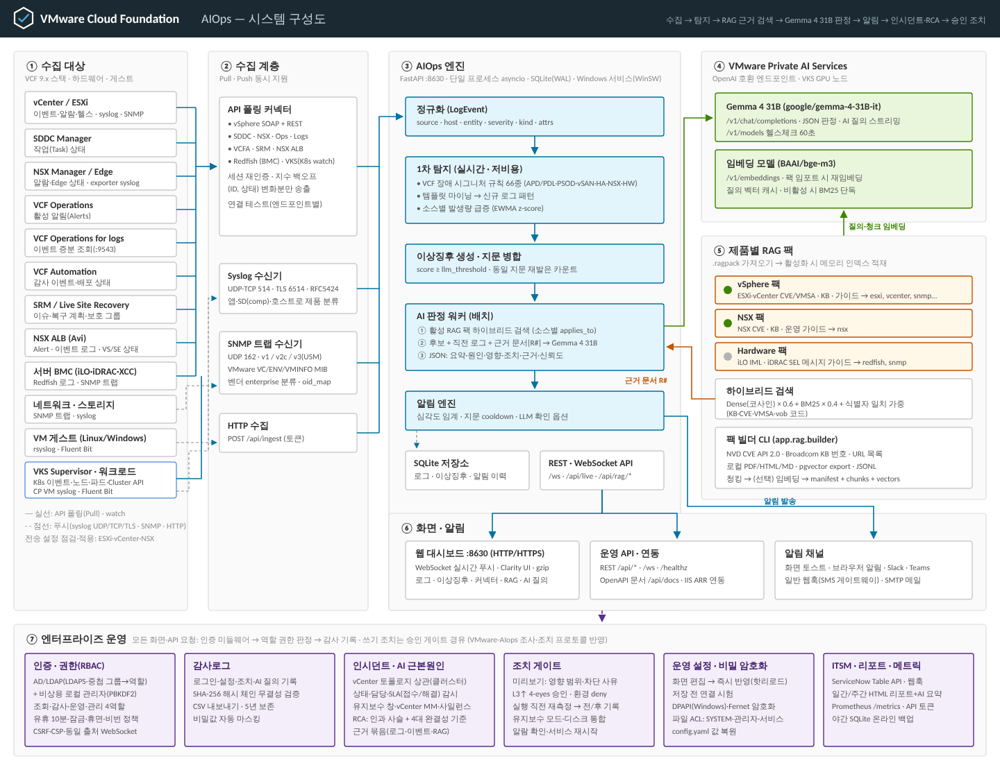

# VCF AIops 운영 가이드

> 설치·구성·운영 상세 문서입니다. 개요와 빠른 시작은 [README](../README.md), 버전별 변경은 [CHANGELOG](../CHANGELOG.md).

VCF 9.x 스택(vSphere/ESXi·vCenter, SDDC Manager, NSX Manager·Edge, VCF Operations, VCF Operations for logs, VCF Automation, SRM, NSX ALB(Avi), VKS Supervisor·워크로드 클러스터)과
서버 BMC(iLO/iDRAC/XCC, Redfish), ESXi·VM 게스트 syslog 를 실시간 수집해 좌측에 스트리밍하고,
우측에 이상징후를 추려 **VMware Private AI Services 의 Gemma 4 31B** 로 판정·원인·조치를 붙인 뒤 알림을 보냅니다.

```
 폴링 커넥터(REST/SOAP)          푸시 수집
 vCenter·SDDC·NSX·Ops·Logs·      syslog UDP/TCP 514 (ESXi·vCenter·NSX·VM)
                                 SNMP 트랩 UDP 162 (v1/v2c/v3: ESXi·vCenter·iLO·스위치·스토리지)
 VCFA·SRM·Avi·Redfish            HTTP /api/ingest (Fluent Bit·스크립트)
            └──────────────┬──────────────┘
                     정규화(LogEvent)
                           │
            1차 탐지: 규칙(VCF·VKS·서버·게스트 OS·DB 시그니처 + 플랫폼 자체 감시, 98종 — 필수 키워드 사전 필터) + 신규 패턴 + 발생량 급증(EWMA z)
                           │ score ≥ llm_threshold
            이상징후(지문 기반 중복 병합) ──► Gemma 4 31B 배치 판정(JSON)
                           │                     요약·추정원인·영향·조치·신뢰도
              WebSocket 대시보드 ◄──────────── 알림: 화면 토스트/브라우저/Slack/Teams/웹훅/메일
```

## 1. 배포 구조 (운영)

```
 브라우저 ──HTTPS:8630──►  VCF-AIOps (Windows 서비스 · WinSW)
                           └ python.exe -m app.serve  ← conda 환경 vcf-aiops
                              · FastAPI + uvicorn(httptools, websockets) 단일 프로세스
                              · 웹 대시보드·REST·WebSocket·SSE 단일 포트
                              · syslog UDP/TCP 514 · SNMP UDP 162 수신기 내장
                              · SQLite(WAL) data\ · 로그 logs\ (크기 순환)
```
- **단일 프로세스가 정답인 이유**: 수신기(514·162 포트)와 이상징후·WebSocket 상태가 메모리에 있어 워커를 늘리면 포트 충돌·상태 분산이 생깁니다. I/O는 asyncio로 동시 처리되고 무거운 LLM·임베딩 연산은 PAIS(GPU)가 담당합니다.
- **적용된 최적화**: httptools C 파서 · gzip 응답 압축(SSE 제외) · 정적 파일 ETag 재검증(304)과 폰트 30일 캐시 · 접근 로그 off · `-O` 바이트코드 사전 컴파일 · syslog UDP **전용 수신 스레드**(버퍼 16MB) · 탐지 규칙 **필수 키워드 사전 필터**(정규식 비용 약 1/5) · 우선/일반 처리 큐 · 로그 250ms 배치 WebSocket 전송 · SQLite WAL write-behind(읽기·쓰기 연결 분리). 실시간·장애 대응 구조는 [9장](#9-실시간안정성-설계).
- **Windows 서비스(WinSW v2.12.0, MIT, 동봉)**: 자동(지연) 시작, 실패 시 5s/30s/60s 재시작, Ctrl+C 정상 종료(20초), stdout/stderr 20MB×10 순환. 작업 스케줄러·NSSM·IIS 불필요.

## 1-0. Windows Server 설치

관리자 PowerShell, 프로젝트 폴더(예: `D:\vcf-aiops`)에서:
```powershell
Set-ExecutionPolicy -Scope Process Bypass -Force
.\scripts\windows\setup.ps1 -InstallMiniforge -DisableSnmpTrapService     # conda 환경·패키지·설정·방화벽·포트 점검
notepad config.yaml ; notepad .env                                           # PAIS·임베딩·커넥터 접속 정보
.\scripts\windows\run.ps1 -Demo                                            # 콘솔 점검(장비 없이 합성 로그) → Ctrl+C
.\scripts\windows\export-cert.ps1 -Thumbprint <사내 CA 인증서 지문>          # (선택) HTTPS
.\scripts\windows\service.ps1 install                                      # Windows 서비스 등록·시작(data·certs·config ACL 강화)
type .\data\initial-admin.txt                                               # 초기 관리자 비밀번호 → 로그인 후 변경 강제 → 파일 삭제
```
첫 로그인 후 **운영 설정**에서 커넥터·알림·ITSM 을 화면으로 등록할 수 있습니다(저장 즉시 반영, 비밀값 암호화). AD 로그인은 `config.yaml` 의 `auth.ldap` 설정 후 서비스 재시작.
| 스크립트 | 하는 일 |
|---|---|
| `setup.ps1` | conda 탐색(없으면 `-InstallMiniforge`) → `environment.yml`로 `vcf-aiops`(Python 3.12, conda-forge) 생성/갱신 → import 검증·바이트코드 컴파일 → `config.yaml`·`.env` 생성 → UDP 514/162·TCP 8630/514 점유 점검 → 방화벽(Domain·Private). 선택: `-DefenderExclusion`(data·logs 실시간 검사 제외), `-HighPerformancePower` |
| `run.ps1` | 콘솔 포그라운드 실행(설치 점검·데모). 운영은 서비스로 |
| `service.ps1` | `install`·`uninstall`·`start`·`stop`·`restart`·`status`·`logs`. `-Account LocalService` 지정 시 최소 권한 계정 + 폴더 ACL 자동 부여 |
| `export-cert.ps1` | `LocalMachine\My` 인증서(개인키 내보내기 허용)를 `certs\aiops.crt`(체인 포함)/`aiops.key` 로 변환, 키 ACL 제한. `-SelfSigned -DnsName <FQDN>,<IP>` 로 임시 인증서 생성. `tls.enabled: auto` 라 파일이 생기면 재시작만으로 HTTPS |

- Windows 기본 **SNMP Trap 서비스(SNMPTRAP)** 가 실행되면 UDP 162를 점유합니다 → `-DisableSnmpTrapService`.
- Windows는 1024 미만 포트 권한 제한이 없어 514·162를 그대로 씁니다(LocalService 계정도 바인드 가능).
- 비밀번호는 `.env` 에만 둡니다(서비스가 `AIOPS_ENV_FILE` 로 직접 읽음).
- 헬스체크: `GET /healthz` · API 문서: `/api/docs`
- 폐쇄망: 인터넷 되는 Windows PC에서 `setup.ps1` → `conda install -n base -c conda-forge conda-pack` → `conda pack -n vcf-aiops -o vcf-aiops-env.zip`. 대상 서버에 Miniforge 설치(`-MiniforgeInstaller <경로>`) 후 `C:\ProgramData\miniforge3\envs\vcf-aiops` 에 압축 해제 → `Scripts\conda-unpack.exe` → `service.ps1 install`.
- 사내 표준이 IIS(443·SSO)라면 `deploy\iis\web.config`(URL Rewrite + ARR, WebSocket) 로 앞단에 둘 수 있습니다. 이때 `server.host: 127.0.0.1`.
- 동봉 WinSW 무결성: `WinSW.NET461.exe` SHA-256 `b5066b7bbdfba1293e5d15cda3caaea88fbeab35bd5b38c41c913d492aadfc4f` (GitHub winsw/winsw v2.12.0 릴리스 자산).

## 1-1. Docker / Linux (참고)

```bash
cp config.example.yaml config.yaml && cp .env.example .env
docker compose up -d --build        # :8630, 514/udp·tcp, 162/udp
# 또는 conda/venv:  AIOPS_DEMO=1 python -m app.serve
```
Streamlit 화면은 기본 배포에서 제외했고 `extras/streamlit/` 에 선택 구성요소로만 남겼습니다.

## 1-2. UI 디자인 / 폰트

- VMware Clarity(라이트) 스타일: 다크 헤더, 세로 내비게이션, 데이터그리드, Clarity 라벨·상태 색상(웹 대시보드 :8630)
- 폰트 스택: `Calibri → Pretendard Variable`. Calibri에는 한글 글리프가 없어 영문은 Calibri, 한글은 Pretendard로 자동 분리 렌더링됩니다.
- Pretendard(OFL-1.1)는 `app/static/fonts`, `static/fonts`에 포함되어 폐쇄망에서도 동작합니다. Calibri는 라이선스상 동봉하지 않고 접속 PC(Windows/Office 설치 Mac)의 로컬 폰트를 사용합니다. Calibri가 없는 PC에서는 영문도 Pretendard로 표시됩니다.
- 로그 원문·타임스탬프는 정렬을 위해 Consolas(고정폭)를 사용합니다. 변경은 `style.css`의 `--mono`.

## 1-2b. 통합 관제 화면 (/noc)

관제실 월 디스플레이용 화면입니다. 좌측 메뉴 **통합 관제**(새 창) 또는 `https://<서버>:8630/noc`.

| 슬롯 | 포함 소스 | 커넥터 | 개체 상태맵 |
|---|---|---|---|
| vCenter | `vcenter`, `esxi` | vcenter | ESXi 호스트(클러스터별): 연결·overallStatus·유지보수 모드 |
| NSX | `nsx`, `nsx-edge` | nsx | Manager 클러스터 상태, Edge 노드(UP/DEGRADED/DOWN) |
| NSX ALB | `avi` | avi / nsx-alb | 서비스 엔진·가상 서비스 oper_status |
| VKS | `vks`, `vks-supervisor` | vks | 노드 Ready·Pressure(클러스터별), VKS 클러스터(Cluster API) |

화면 구성(위에서 아래로)
- **상황 브리핑**: 4개 도메인 집계를 Gemma 4 31B 가 "전체 상황 한 줄 + 문제 도메인별 무엇이·영향·먼저 볼 것"으로 요약합니다. 도메인 간 동시 발생은 '연관 가능성'으로만 표현합니다. 5분 캐시, 슬롯 상태가 바뀌면 1분 이내 갱신(화면을 연 사람이 있을 때만), LLM 비활성·실패 시 규칙 기반 요약. 운영자는 '지금 갱신'.
- **도메인 타임라인(최근 60분)**: 4개 레인에 이상 징후를 심각도 색·반복 횟수 크기로 찍어 도메인 사이 연쇄(예: Edge 장애 직후 VKS 노드 NotReady)를 한눈에 봅니다. 점을 누르면 상세.
- **슬롯**: 상태 판(장애·주의·정상·대기) · **가장 오래된 미확인 위험/오류 경과 타이머**(에스컬레이션 기준을 넘기면 강조) · 위험/오류/경고/활성 인시던트(누르면 목록)/분당 이벤트·60분 그래프 · 커넥터 · **개체 상태맵**(타일 색 = 개체 상태 + 열린 이상 겹침, 숫자 = 열린 이상 건수, 누르면 그 개체 알림만 필터) · 실시간 알림 피드.
- **확대·순환**: 슬롯 이름을 누르거나 키 1~4 로 한 슬롯을 전체 화면 확대(Esc 복귀). **자동 순환**을 켜면 장애·주의 슬롯을 20초마다 차례로 확대합니다.
- **상세**: 알림을 누르면 AI 요약·원인·영향·조치, 탐지 근거, 원문. 운영자 이상은 그 자리에서 **확인 처리·AI 재분석·사일런스**, 인시던트 열기(관제 전용 계정은 조회만).

판정: 최근 `noc.window_minutes`(기본 30분) 안의 미확인·비억제 이상 중 위험, 위험 인시던트, 개체 장애 → 장애 / 오류·경고·활성 인시던트·개체 주의·커넥터 오류/지연 → 주의.
**에스컬레이션**: 위험 등급이 `noc.escalate_minutes`(기본 15분) 동안 미확인이면 알림 채널로 `[에스컬레이션]` 재발송(1회), 화면에 표시, 감사로그 `noc.escalate`. 0 이면 끔.
월 디스플레이 계정: `auth.kiosk_users` — 유휴 만료 없음(절대 만료 `kiosk_absolute_hours`, 기본 7일), 조회자 고정, 콘솔 링크·조치 버튼 숨김, 로그인·조회 감사 기록.
API: `GET /api/noc`(슬롯 집계·개체 상태맵), `GET /api/noc/brief`(`?refresh=1` 운영자 이상). 화면은 `/ws`(anomaly·logs·status·incident·alert·noc_brief)로 갱신하고 1분마다 서버 집계와 동기화합니다.

## 1-3. 수집 현황 (항목별 정상 수집 여부)

좌측 메뉴 **수집 현황**(또는 상단 '수집 상태' 타일)에서 항목마다 로그가 실제로 들어오는지 판정해 보여줍니다. 문제 건수는 메뉴 배지로 표시됩니다.

| 항목 | 판정 근거 |
|---|---|
| API 커넥터 (vCenter·NSX·VCF Ops·Logs·VCFA·SRM·Avi·Redfish·SDDC) | API 폴링 성공 여부 + 이벤트 유입. 알람형 API는 이벤트가 없어도 'API 정상·신규 없음'으로 구분, VCF Operations for logs 처럼 상시 로그형은 10분 무유입 시 '중단' |
| Syslog 송신 장비(호스트별) | 마지막 수신 후 경과 — 7.5분 '지연', 15분 '중단' (`monitoring.max_silence.syslog`) |
| SNMP 트랩 송신 장비(IP별) | 트랩은 간헐적이라 기본 침묵 감시 없음 · 마지막 수신 시각 표시 |
| HTTP 수집(/api/ingest) 송신자 | syslog 와 동일 기준 |
| 수신기(syslog 514 / SNMP 162) | 포트 바인드 실패 시 '오류' |
| 기대 장비(`monitoring.expected`) | 정규식에 맞는 장비가 한 번도 안 들어오면 '미수신' — 설정 누락 장비 탐지 |

각 행: 상태 · 마지막 수신 · 분당 유입(최근 1분/15분 평균) · 최근 30분 추이 · 누적 · 15분 오류 건수 · 판정 사유와 최근 메시지. 행을 누르면 실시간 로그가 해당 항목으로 필터됩니다.
'중단·오류·미수신'으로 바뀌면 `수집 중단: …` 이벤트가 생성되어 이상징후·알림 채널로 나가고, 복구되면 `수집 복구` 이벤트가 남습니다. API: `GET /api/collection`.

## 2. 커넥터별 수집 API (1차 소스 기준)

| type | 인증 | 수집 대상 |
|---|---|---|
| `vcenter` | SOAP 세션(pyVmomi) + REST `POST /api/session` → `vmware-api-session-id` | EventHistoryCollector 이벤트(VM·호스트·HA·태스크), `triggeredAlarmState`, `/api/appliance/health/*` |
| `sddc` | `POST /v1/tokens` → Bearer | `/v1/tasks` 상태 변화 |
| `nsx` | Basic | `/api/v1/alarms?status=OPEN`, `/api/v1/cluster/status`, Edge: `/api/v1/transport-nodes`(EdgeNode) → `/{id}/status` 전환 — Edge 관련 알람·상태는 소스 `nsx-edge` |
| `vcfops` | `POST /suite-api/api/auth/token/acquire` → `OpsToken` | `/suite-api/api/alerts?activeOnly=true` + 리소스 이름 |
| `vcflogs` | `:9543 POST /api/v2/sessions` → Bearer | `/api/v2/events/timestamp/>{ms}` 증분 조회 |
| `vcfa` | provider: `POST /cloudapi/1.0.0/sessions/provider` → `x-vmware-vcloud-access-token` / vmapps: `/tm/oauth/tenant/{org}/token` / aria8 | provider: `/cloudapi/1.0.0/auditTrail`, vmapps·aria8: `/deployment/api/deployments` |
| `srm` | `POST /api/rest/srm/v2/session` → `x-dr-session` (+원격 세션) | SRM 서버 이슈, 복구 계획 상태·이슈, 보호 그룹 상태 |
| `avi`/`nsx-alb` | `POST /login` 쿠키 + `X-CSRFToken`·`X-Avi-Version` | `/api/alert`, 이벤트 로그 `/api/analytics/logs?type=2`, VS·SE `oper_status` |
| `vks` (role `supervisor`/`workload`) | ServiceAccount 토큰, 또는 vSphere SSO `POST https://<Supervisor>/wcp/login` → `session_id`(워크로드는 `guest_cluster_name`) | 이벤트 `GET /api/v1/events`(목록→watch, 기본 Warning), 노드 Ready·Pressure, 파드 CrashLoop·ImagePull·OOM·Unschedulable, `/readyz`, Supervisor 는 Cluster API `clusters`·`machines`(워커 VM 프로비저닝 실패) |
| `ilo`/`idrac`/`redfish` | `POST /redfish/v1/SessionService/Sessions` → `X-Auth-Token` | Managers/Systems LogServices 자동 탐색(IML·IEL·SEL·Lclog), 시스템 Health |

상단 **커넥터 점검** → 개별/전체 **연결 테스트**로 인증과 엔드포인트별 응답을 확인합니다.
알람·알림 계열은 매 폴링마다 같은 목록을 돌려주므로 (ID, 상태) 변화분만 이벤트로 냅니다.

## 3. 실시간 로그 수집 — 제품별 경로

| 대상 | API(폴링·watch) | 로그 푸시(syslog) | 분류 소스 | 전송 설정 자동 적용 |
|---|---|---|---|---|
| ESXi | vCenter 이벤트·알람, `host_logs`(BrowseDiagnosticLog: hostd·vmkernel·vpxa) | `Syslog.global.logHost`(+방화벽 `syslog` 룰셋) | `esxi` | ✔ 승인 조치 |
| vCenter 로그 | 이벤트·알람·어플라이언스 헬스 | `/api/appliance/logging/forwarding`(VAMI 원격 syslog, 최대 3개) | `vcenter` | ✔ 승인 조치 |
| VCF Operations | `/suite-api/api/alerts` | 어플라이언스 원격 syslog | `vcfops` | 안내 + 수신 이력 점검 |
| NSX Manager | 알람·클러스터 상태 | 노드 syslog exporter `/api/v1/cluster/{node}/node/services/syslog/exporters` | `nsx` | ✔ 승인 조치 |
| NSX Edge | Edge 상태 `/api/v1/transport-nodes/{id}/status`·Edge 알람 | `/api/v1/transport-nodes/{edge}/node/services/syslog/exporters` | `nsx-edge`(SD `comp="nsx-edge"`) | ✔ 승인 조치 |
| NSX ALB(Avi) | 알람·이벤트 로그(`type=2`)·VS/SE 상태 | Notifications > Syslog + Alert Action | `avi` | 점검 + 절차 안내 |
| SRM | 서버·복구 계획·보호 그룹 이슈 | 어플라이언스(5480) 원격 syslog | `srm` | 안내 + 수신 이력 점검 |
| VKS Supervisor | 이벤트·노드·파드·`/readyz`·Cluster API | 컨트롤 플레인 VM 은 **vCenter 원격 syslog 를 5분 주기 상속**, 이후 Fluent Bit(`vmware-system-logging/fluentbit-config-custom`) | `vks-supervisor` | vCenter 적용으로 상속 + Fluent Bit 스니펫 |
| VKS 워커 노드·파드 | 이벤트·노드·파드·`/readyz` | Fluent Bit 표준 패키지(`fluent-bit.tanzu.vmware.com`, `fluent_bit.config.outputs`) | `vks` | 설치 점검 + data-values 생성 |

**로그 전송 설정** 메뉴(운영자 이상)가 위 표를 실제 설정과 대조합니다: ESXi 호스트별 logHost·방화벽, vCenter 원격 syslog, NSX Manager/Edge exporter, Avi `alertsyslogconfig`, Supervisor Fluent Bit ConfigMap, 워크로드 Fluent Bit PackageInstall, SRM·VCF Ops 수신 이력. **적용 요청**은 조치 게이트(미리보기 → 사유 → 다른 관리자 승인 → 실행 직전 재측정 → 감사)로 실행되며 기존 전송 대상은 유지하고 이 서버만 추가합니다. 기준 주소는 `syslog.advertise_host`·`advertise_protocol`.

수신: UDP/TCP 514, **TLS 6514**(RFC5425, `certs/aiops.crt` 가 있으면 자동) — TCP/TLS 는 octet-counting·줄바꿈 프레이밍 자동 판별(Fluent Bit·NSX TLS·ESXi `ssl://`). 송신 장비 시계가 5분 이상 앞서면 수신 시각으로 보정(`clock_skew_sec` 기록).
분류: app-name·RFC5424 구조화 데이터(NSX `comp`, Fluent Bit `namespace_name`·`pod_name`)·호스트 이름(Supervisor 컨트롤 플레인 노드 `42…` 32자리)로 자동 판정, 확실히 하려면 `syslog.host_map: [{match: "^wld-bank01-", source: vks}]`.

수동 설정 예:
```bash
# ESXi
esxcli system syslog config set --loghost='udp://<aiops>:514' && esxcli system syslog reload
esxcli network firewall ruleset set --ruleset-id=syslog --enabled=true && esxcli network firewall refresh
esxcli system syslog mark --message "AIOps syslog test"          # 수신 확인
# NSX Manager/Edge CLI(노드별) — API 로는 '로그 전송 설정' 화면에서 일괄 적용
set logging-server <aiops>:514 proto udp level info
# vCenter / SRM / VCF Operations: 어플라이언스 관리 https://<host>:5480 > Syslog 대상 추가
# VM 게스트(Linux)
echo '*.* @<aiops>:514' > /etc/rsyslog.d/90-aiops.conf && systemctl restart rsyslog
```
VKS 워크로드 클러스터 커넥터 권한: `deploy/vks/vcf-aiops-reader.yaml`(읽기 전용 ClusterRole + ServiceAccount 토큰). Supervisor 는 vSphere SSO(`auth: vsphere`)로 접속하며, 클러스터 범위 권한이 없으면 `namespaces` 에 지정한 vSphere 네임스페이스 범위로 자동 전환합니다.
Fluent Bit(Windows VM 등)를 HTTP 로 보낼 때: `[OUTPUT] name http, host <aiops>, port 8630, uri /api/ingest, format json, header Authorization Bearer <scope=ingest 토큰>`
VCF Operations for logs 로 이미 모든 syslog 가 모인다면 `vcflogs` 커넥터만 써도 되고, 둘 다 켜면 같은 로그가 중복됩니다.

### 제품별 탐지 시그니처(1차 규칙, 68종 — 제품 66 + 플랫폼 자체 감시 2)
vCenter(vpxd·vmon 크래시, vPostgres, /storage 파티션, SSO/STS) · ESXi(APD/PDL·경로·vSAN·HA·PSOD·vob·NTP) · NSX(TEP/BFD/BGP, Manager 클러스터) · **NSX Edge**(datapath 크래시·과부하, T0/T1 SR HA 전환, fp-eth 링크, IPSec/VPN, 자원) · **NSX ALB**(VS/Pool/SE down, Controller 쿼럼, health score<50, WAF/DDoS, GSLB) · **SRM**(RPO·복제, 복구 계획, 사이트 페어링, SRA, 테스트·재보호) · **VCF Ops**(노드·컬렉터, 어댑터 수집 중단) · **VKS/Supervisor**(CrashLoopBackOff, ImagePull, OOMKilled, Evicted/DiskPressure, NodeNotReady·PLEG, FailedScheduling, CSI·CNS 마운트, etcd 지연·리더 변경, apiserver, CNI/NCP, Cluster API Machine 실패, WCP·spherelet·VM Operator). 규칙에 걸린 후보는 Gemma 4 31B 판정 + 제품별 RAG 팩(`ragpacks/vks.yaml`·`nsx-alb.yaml`·`srm.yaml`·`vcfops.yaml` 추가)으로 근거를 붙입니다.

## 3-1. SNMP 트랩 수신

`snmp` 섹션(UDP 162, pysnmp 7)으로 v1·v2c·v3(USM) 트랩을 받아 syslog·API 로그와 **같은 탐지 → Gemma 판정 → 알림 파이프라인**으로 처리합니다.

| 트랩 | 해석 |
|---|---|
| VMWARE-VC-EVENT-MIB `vpxdAlarmInfo`(.6876.4.3.0.203) | 대상 객체, 이전→신규 상태(red=critical, yellow=warning), 알람 값 |
| VMWARE-ENV-MIB `vmwESXEnv*` / `vmwEnvIpmiSel*` | 서브시스템, 하드웨어 상태(failed/critical→critical), CIM PerceivedSeverity |
| VMWARE-VMINFO-MIB `vmwVm*` | VM 전원·하트비트 상실 |
| SNMPv2 표준 | coldStart·warmStart·linkDown/Up·authenticationFailure |
| 기타 enterprise | HPE(232)·Dell(674)·Lenovo(19046)→redfish, Cisco·Juniper·Arista·Huawei→network, NetApp·Dell EMC·Pure→storage 로 자동 분류 |

미등록 트랩은 varbind 원문으로 수집되며, 대시보드 **SNMP 트랩** 메뉴에 미등록 OID 목록과 `oid_map` 등록용 YAML이 표시됩니다.

```bash
# ESXi (v2c)
esxcli system snmp set --communities public --targets <aiops>@162/public --enable true
esxcli system snmp test
# ESXi (v3) — engineID 확인 후 config.yaml v3_users.engine_id 에 입력
esxcli system snmp get
esxcli system snmp set --engineid <id> --authentication SHA1 --privacy AES128
esxcli system snmp hash --auth-hash <authpass> --priv-hash <privpass> --raw-secret
esxcli system snmp set --users aiops/<authhash>/<privhash>/priv --v3targets <aiops>@162/aiops/priv/trap --enable true
# vCenter: vSphere Client > vCenter > 구성 > 설정 > 일반 > SNMP 수신기 → 알람 정의의 '트리거 시 SNMP 트랩 전송'
```
162 포트는 root 권한이 필요합니다(컨테이너는 compose에서 162/udp 매핑).

## 3-2. 제품별 RAG 팩

이상징후를 Gemma 4 31B 로 분석할 때, **활성화된 RAG 팩**에서 해당 이벤트 소스에 맞는 지식(KB·VMSA·CVE·가이드)을 검색해 근거로 주입합니다.
분석 결과 카드와 알림, AI 질의 답변에 사용한 근거 문서(제목·링크·팩)가 함께 표시됩니다.



**흐름**: `빌드(.ragpack)` → 대시보드 **RAG 팩 → 가져오기** → **활성화 스위치** → 분석·질의에 자동 반영 (비활성화 즉시 제외)

| 단계 | 내용 |
|---|---|
| 팩 포맷 | `.ragpack`(zip) = `manifest.json` + `chunks.jsonl` + (선택) `vectors.npy`(float16) |
| 가져오기 | 벡터가 없거나 임베딩 모델이 서버 설정과 다르면 백그라운드 재임베딩(진행률 표시). 엔드포인트가 없으면 BM25 검색만 사용 |
| 적용 범위 | `applies_to` 소스에만 적용 — vSphere 팩 → esxi·vcenter·vcfops·vcflogs·syslog·snmp, NSX 팩 → nsx … |
| 검색 | Dense(코사인) × 0.6 + BM25 × 0.4 + 식별자 일치 가중(KB·CVE·VMSA·`vob.*`·`esx.problem.*`) · 문서 단위 중복 제거 |
| 환각 방지 | 프롬프트에서 근거[R#]에 있는 KB·CVE·VMSA·수정 버전만 인용하도록 제한, 사용한 R#만 결과에 남김 |

**vSphere 팩 만들기** (`ragpacks/vsphere.yaml`)
```bash
python -m app.rag.builder build ragpacks/vsphere.yaml      # → dist/vsphere.ragpack
python -m app.rag.builder inspect dist/vsphere.ragpack
```
| 소스 | 수집 내용 |
|---|---|
| `nvd` | NVD CVE API 2.0 — ESXi·vCenter·vSphere CVE, CVSS, CWE, 참조의 VMSA 번호 추출(키 없으면 6초 간격, `api_key` 시 0.7초) |
| `kb` | Broadcom KB 문서 번호 목록(`ragpacks/sources/vsphere_kb_ids.txt`) → `knowledge.broadcom.com/external/article/{id}` |
| `urls` | VMSA 원문·릴리스노트·하드닝 가이드 URL 목록 |
| `local` | 폐쇄망용으로 미리 받아둔 PDF·HTML·MD (`ragpacks/sources/vsphere/`) |
| `pgvector` | 기존 RAG DB(예: `vmware_rag_v2`)에서 SQL export |
| `jsonl` | 다른 수집기 결과 재사용 |

"전체 KB" 팩은 KB 번호 목록 또는 KB 덤프(pgvector·로컬 파일)를 넣어 만듭니다. 빌더는 지정한 문서만 수집하며 사이트 전체를 크롤링하지 않습니다(요청 간격 `delay`, 기본 1~1.5초).
인터넷이 되는 빌드 서버에서 팩을 만들고 `.ragpack` 파일만 폐쇄망 AIOps 서버로 옮겨 가져오는 방식을 권장합니다.

## 4. Private AI (Gemma 4 31B)

- `llm.base_url` 은 OpenAI 호환 엔드포인트의 `/v1` 까지. 기동 시와 60초마다 `GET /models` 로 모델 서빙 여부를 확인(상단 AI 분석 엔진 칩).
- `llm.model` 은 `/v1/models` 의 id 와 일치해야 합니다(HF 원본: `google/gemma-4-31B-it`; PAIS 에 등록한 이름이 다르면 그 이름).
- 후보 6건 단위 배치, 동일 호스트 직전 로그 12줄을 문맥으로 동봉, JSON 스키마로 결과 수신.
- 엔드포인트가 `response_format` 을 거부하면 자동으로 끄고 재시도합니다.
- Gemma 4 thinking 출력이 섞이면 `extra_body: {chat_template_kwargs: {enable_thinking: false}}` 로 끄세요(`<think>` 태그는 파서가 제거).
- 31B BF16 은 약 70GB(4bit QAT 는 약 18GB) — H100/H200 1장 또는 L40S 2장 이상 권장.
- 우측 상단 **AI 질의**: 최근 이상징후·경고 로그를 컨텍스트로 스트리밍 질의.

## 5. 알림

`alerting.min_severity` 이상 + 동일 지문 `cooldown` 내 중복 억제. LLM 분석이 끝난 뒤(최대 90초 대기) 요약·조치가 포함된 상태로 발송합니다.
`require_llm_confirm: true` 면 Gemma 가 `is_anomaly=true` 로 판정한 건만 발송. 채널: 대시보드 토스트·소리·브라우저 알림(🔔), Slack, Teams(Adaptive Card), 일반 JSON 웹훅, SMTP.
**알림 채널 테스트** 버튼으로 전 채널 발송 확인.

## 6. API

인증: 브라우저는 세션 쿠키(HttpOnly·SameSite=Strict) + 변경 요청에 `X-Requested-With: aiops` 헤더(CSRF 방지). 외부 연동은 **API 토큰**(`Authorization: Bearer aiops_…`, 사용자·토큰 화면에서 발급, scope `ingest`·`metrics`·`read`). 권한이 없으면 403 + 감사로그 `auth.denied`.

| 메서드 | 경로 | 설명 |
|---|---|---|
| POST | `/api/auth/login` · `/logout` · `/password` · GET `/api/auth/me` | 로그인(로컬·AD)·로그아웃·비밀번호 변경·내 정보 |
| GET/POST/DELETE | `/api/users` · `/api/users/{id}` · `/api/users/sessions` · `/api/tokens` | 사용자·세션·API 토큰 (admin) |
| GET/POST | `/api/incidents` · `/{id}` · `/{id}/status` · `/assign` · `/comment` · `/rca` · `/investigate` · `/itsm` | 인시던트 처리·AI 근본원인 분석·근거 묶음·ITSM 등록 |
| GET | `/api/investigate?kind=vm\|host\|datastore\|cluster&name=` · `/api/topology/resolve?name=` | vCenter 조사 번들(상태·관련 객체·알람·이벤트 타임라인) |
| GET/POST | `/api/actions/catalog` · `/api/actions/preview` · `/api/actions` · `/{id}/approve` · `/{id}/reject` | 조치 미리보기·요청·승인(4-eyes)·반려 |
| GET/PUT/POST | `/api/settings/schema` · `/api/settings/{key}` · `/{key}/reset` · `/connectors/test` · `/itsm/test` | 운영 설정(즉시 반영·암호화 저장) |
| GET/POST/PUT/DELETE | `/api/maintenance` · `/api/silences` · POST `/api/anomalies/{id}/silence` | 유지보수 창·사일런스 |
| GET | `/api/audit?hours=&user=&action=&q=` · `/api/audit/verify` · `/api/audit/export` | 감사로그 조회·해시 체인 검증·CSV |
| GET/POST | `/api/reports` · `/api/reports/generate` · `/api/reports/{name}` · `/api/backup` · `/api/backup/run` | 리포트·DB 백업 |
| GET | `/metrics` | Prometheus(허용 IP 또는 토큰 scope=metrics) |
| WS | `/ws` | snapshot → logs(250ms 배치)/anomaly/status/alert |
| GET | `/api/logs?minutes=&source=&q=&min_severity=` | SQLite 이력 조회 |
| GET | `/api/live?after_id=` · `/api/alerts/recent?after_seq=` | 폴링형 연동용 증분 조회 |
| GET | `/healthz` · `/api/docs` | 헬스체크 · OpenAPI 문서 |
| GET | `/api/anomalies` · POST `/api/anomalies/{id}/ack` · `/analyze` | 이상징후 |
| GET | `/api/connectors` · POST `/api/connectors/{name}/test` · `/test-all` | 커넥터 상태·점검 |
| POST | `/api/ingest` | 외부 로그 수집(API 토큰 scope=ingest) |
| POST | `/api/chat` | AI 질의(SSE, 활성 RAG 근거 포함) |
| GET/POST/DELETE | `/api/rag/packs` · `/{id}/enable` · `/{id}/disable` · `/{id}/reembed` | RAG 팩 가져오기(본문=.ragpack 바이트)·활성화·삭제 |
| GET | `/api/rag/search?q=&source=&pack=` | RAG 검색 테스트 |

## 7. 운영 메모

- 수집 계정은 읽기 전용 권한으로 충분(vCenter Read-only + 이벤트/알람 조회, NSX Auditor, VCF Ops ReadOnly, Avi read-only, iLO Login 권한).
  조치 기능을 쓰려면 쓰기 권한 계정의 커넥터를 **별도로** 등록하고(예: `vc-mgmt-ops`, `environment` 라벨 지정) 필요한 권한만 부여하세요 — 알람 확인 `Alarm.Acknowledge`, 유지보수 모드 `Host.Config.Maintenance`, VM 디스크 통합 권한, 어플라이언스 서비스 재시작은 VAMI 관리자.
- 기동 후 `warmup_seconds`(기본 5분) 동안은 신규 패턴·급증 판정을 보류해 기준선을 학습합니다.
- 노이즈는 `detection.suppress` 정규식, 사내 시그니처는 `detection.extra_rules` 로 추가.
- **vCenter 9.1.1 이상(pyVmomi 가 모르는 새 형식)**: 이벤트의 `entity` 에 `ContentLibrary` 처럼 9.x 에서 새로 생긴 관리 개체가 오면 pyVmomi 8.x 의 형식 검사(`CheckField`)가 `TypeError: For "entity" expected type vim.ManagedEntity, but got vim.ContentLibrary` 로 그 이벤트 묶음 전체를 버립니다. 1.11.0 부터 형식 이름 값(`EventEx.objectType`)이나 관리 개체 참조의 `type` 속성(`<entity type="ContentLibrary">`)에 모르는 형식이 오면 ManagedEntity 하위 형식으로 등록하고, 그래도 남는 관리 개체 참조끼리의 형식 불일치는 값을 그대로 받아들여(`app/connectors/vmomi_compat.py`) 이벤트를 잃지 않습니다. 데이터 개체(`xsi:type`)·SOAP fault 형식은 보정하지 않습니다. 보정이 일어나면 커넥터 점검 '이벤트 해석'에 `ok — SOAP 스키마 밖 형식 보정: ContentLibrary` 처럼 표시됩니다(경고 아님).
- VCF Automation `provider` 모드의 `auditTrail` 과 SRM v2 하위 경로는 버전별 차이가 있으니 **연결 테스트** 결과로 먼저 확인하세요. 실패 시 `api_version`/`api_prefix: /api/rest/srm/v1` 로 조정.

## 8. 엔터프라이즈 운영 기능

| 영역 | 내용 |
|---|---|
| **인증** | AD/LDAP(LDAPS·StartTLS, 다중 DC 장애 조치, 본인 자격증명 bind, 중첩 그룹 `1.2.840.113556.1.4.1941` → 역할 매핑, 매핑 없으면 거부) + 비상용 로컬 계정(PBKDF2-SHA256 600,000회). 로그인 배너·직전 로그인 시각/IP 안내 |
| **권한(RBAC)** | 조회자(viewer) · 감사자(auditor: +감사로그) · 운영자(operator: 확인·재분석·인시던트·사일런스·조치 요청·리포트) · 관리자(admin: 설정·승인·사용자·RAG·백업). 서버 미들웨어에서 경로별 판정(미정의 변경 API는 관리자만), 화면은 권한별 메뉴·버튼 자동 숨김 |
| **세션 보안** | 서버측 세션, HttpOnly·SameSite=Strict(HTTPS 시 Secure) 쿠키, **사용자 입력 기준 유휴 10분**(백그라운드 폴링은 연장하지 않음, 1분 전 경고) · 절대 12시간 · 선택적 동시접속 차단, 5회 실패 잠금 30분, 90일 미사용 잠금, 비밀번호 9자·3종·이력 3개·90일 만료·최초 변경 강제, IP 기준 로그인 속도 제한, CSRF 헤더, CSP·HSTS·X-Frame-Options, WebSocket 동일 출처+세션 검사(로그아웃 시 4401 종료) |
| **감사로그** | 로그인/실패/잠금, 사용자·토큰, 설정 변경(전/후, 비밀값 마스킹), 조치 요청·승인·실행 결과, 인시던트 처리, AI 질의, RAG, 리포트·백업, 권한 거부까지 기록. 각 행은 직전 행 해시를 포함한 **SHA-256 체인** → 화면 '무결성 검증'으로 위·변조 탐지. CSV(Excel 한글) 내보내기, 기본 5년 보존 |
| **인시던트** | `incidents.min_severity` 이상 이상징후를 vCenter 토폴로지로 클러스터까지 해석해 15분 창 안에서 하나로 묶음(토폴로지 밖은 호스트 단위). 신규→접수→조사 중→해결→종료(재개 가능), 담당·코멘트·처리 이력, 심각도별 **SLA(접수·해결)** 초과 표시·알림, MTTA/MTTR 지표. 해결 시 처리 내용 필수 |
| **AI 근본원인 분석** | 근거 묶음(묶인 이상징후 + 전후 로그 타임라인 + vCenter 조사 번들 + 토폴로지 + RAG 문서)을 Gemma 4 31B 에 전달해 **인과 사슬(근본원인→전파→증폭→영향)** 과 **4대 완결성 기준(반증 가능성·충분성·필요성·메커니즘)** 으로 판정. 하나라도 미충족이면 `⚠ INCOMPLETE` 와 추가로 필요한 증거를 표시, 조치 권고는 위험도·승인 필요 여부와 함께 |
| **억제** | 유지보수 창(기간/주간 반복, 호스트 정규식·클러스터·소스 범위), vCenter 유지보수 모드 호스트 자동 억제, 사일런스(이상징후 지문 또는 메시지/호스트 정규식, 기한부). 억제 중에도 기록·화면 표시는 유지하고 알림·ITSM 생성만 중단 |
| **조치 게이트** | 호스트 유지보수 모드 진입/해제(vSAN 은 `ensureObjectAccessibility`), VM 디스크 통합, vCenter 알람 확인, 어플라이언스 서비스 재시작, NSX 알람 확인. ① 읽기 전용 **미리보기**(영향 범위·차단 사유: DRS 비완전자동+실행 중 VM, 클러스터 마지막 호스트, 통합 불필요, 데이터스토어 95% 등) → ② 차단 사유가 있으면 요청 불가 → ③ L3 이상은 **요청자와 다른 관리자 승인**(4-eyes, 유효 4시간 — 단 **admin 역할은 본인 요청도 승인 가능**, 감사로그 `self_approved: true`, `actions.admin_self_approve: false` 로 끔) → ④ 실행 직전 재측정 → ⑤ 작업 완료까지 대기, 전/후 상태·작업 ID를 인시던트 이력·감사로그에 기록. `actions.deny_environments` 의 환경 라벨 커넥터는 쓰기 차단 |
| **운영 설정** | 커넥터·알림 채널·인시던트·SLA·ITSM·조치 정책·유지보수·수집 감시·탐지 규칙·리포트·백업을 화면에서 편집. 저장 즉시 반영(변경된 커넥터만 재시작, syslog/SNMP 수신기는 유지), 저장 전 연결 시험, 정규식 사전 검증, 'config.yaml 값으로 복원'. 비밀값은 **Windows DPAPI**(그 외 OS Fernet)로 암호화 저장, 화면에는 `********` 로만 표시. `python -m app.security.secrets encrypt` 로 config.yaml 비밀값도 암호화 가능 |
| **ITSM** | ServiceNow Table API(`/api/now/table/incident`, Basic 또는 OAuth) 또는 일반 웹훅. `itsm.min_severity` 이상 자동 등록, 상태 변경·코멘트는 work_notes 로 동기화, 해결 시 close_code/close_notes |
| **리포트** | 일간/주간/기간 지정 단일 HTML(인쇄→PDF): 수집량, 이상징후 심각도·소스·유형, AI 오탐 판정 수, 인시던트·MTTA·MTTR·SLA 위반, 상위 호스트, 반복 패턴, 수집 문제, **AI 요약**. 정해진 시각 메일 발송, 180일 보관 |
| **백업·메트릭** | 매일 02:30 SQLite 온라인 백업(서비스 무중단, 14개 보관) + 화면 '지금 백업'. `/metrics` Prometheus: 수집량·EPS·이상징후·활성 인시던트·커넥터 상태/지연·수집 현황·LLM 상태/지연/큐·알림·RAG |
| **설치 보안** | `service.ps1 install` 이 data·certs·config.yaml·.env 상속을 끊고 SYSTEM·Administrators·서비스 계정만 허용(SID 기반) |

### VMware-AIops 반영 내역
[vmware-skills/VMware-AIops](https://github.com/vmware-skills/VMware-AIops)(MIT) 의 운영 원칙을 이 포털 구조에 맞게 재구현했습니다(코드 복사 아님).
- **프롬프트 인젝션 방어**: 장비·로그에서 온 텍스트는 제어문자 제거·길이 제한 후 `[UNTRUSTED_LOG]`/`[UNTRUSTED_DOC]` 경계로 감싸고, 위조된 경계 표식은 제거, 모델 출력에 섞인 표식도 제거 (`app/sanitize.py`)
- **조사 프로토콜**: 인과 사슬 + 4대 완결성 기준, 불완전하면 명시 (`app/llm.py RCA_PROMPT`, 인시던트 화면)
- **조사 번들**: 대상 상태 + 관련 객체 + 발생 알람 + 이벤트 타임라인(최신순, EventHistoryCollector `latestPage`→`ReadPreviousEvents`) (`VCenterConnector.investigate`)
- **확인 게이트**: 미리보기 → 차단 사유 → 확인 실행, 실행 전 재측정, 장기 작업 재실행 금지 → 승인 워크플로·감사로 확장 (`app/actions.py`)
- **환경 라벨 deny 정책** → `actions.deny_environments`

## 9. 실시간·안정성 설계

### 9-1. 처리 경로 — 어느 한 곳이 느려져도 나머지는 멈추지 않는다
```
 syslog UDP ─► 전용 수신 스레드(커널 버퍼를 루프 부하와 무관하게 비움, 1024건 묶음)
 syslog TCP/TLS · SNMP · 폴링 커넥터 · HTTP ingest
        │  submit() — 비차단, 즉시 반환
        ▼
 ┌ 우선 큐(20,000) ← 경고 이상 · 알람 · 플랫폼 이벤트 · (적체 시) 위험 키워드 포함 info 로그(ESXi vmkernel 은 대부분 info 로 송신)
 └ 일반 큐(100,000) ← 그 외. 90% 이상 차면 수신기가 '파싱 전' info 원문을 버려 CPU 확보(건수 집계·플랫폼 경고)
        │  처리 워커: 우선 큐 먼저, 15ms마다 양보(HTTP·WebSocket 응답성 유지), 1건 오류가 파이프라인을 멈추지 않음
        ▼
 탐지 → 이상징후(메모리) ──► 화면 즉시 푸시(신규·심각도 상향은 바로, 재발 카운트는 1초에 1회)
        │                └► 게시 워커: 억제 판정 · 인시던트 상관 · 저장 · 외부 알림(DB·외부 지연과 분리, id 단위 병합)
        ├► LLM 워커(서킷 브레이커) — 위험은 기다리지 않음, 그 외 최대 30초 대기 후 규칙 결과로 진행, 대기 만료 스위퍼
        └► DB write-behind(읽기 연결 분리, 실패 시 배치 보존·재시도, 디스크 가드)
 WebSocket 허브: 화면별 송신 큐 — 느린 화면은 흐름 메시지(logs·status)부터 생략, 그래도 밀리면 그 화면만 끊고 재접속·스냅샷
```

### 9-2. 장애 상황별 동작 (주입 시험·단위 시험 결과)
| 장애 | 시스템 동작 | 화면·알림 | 시험 결과 |
|---|---|---|---|
| syslog 폭주(처리 용량 초과) | 우선 큐 보존, info 원문부터 파싱 전 폐기·집계 | 플랫폼 경고 "수집 과부하 — N건 폐기" | 10,000 EPS(용량 약 2.5배): 위험 48/48 전달(p50 0.38초·p95 0.68초), 우선 폐기 0, 커널 유실 0 |
| 느린·멈춘 브라우저 | 그 화면 송신 큐만 적체 → 흐름 메시지 생략 → 가득 차면 1013 종료 | 그 화면이 자동 재접속·스냅샷 | 다른 화면 상태 메시지 30/30 순번 연속 수신(단위 시험) |
| 메시지 누락(seq 건너뜀) | 클라이언트가 `resync` 요청 → 서버가 스냅샷 재전송 | "재동기화 중" 표시 | 단위 시험 |
| 서버·네트워크 끊김 | 1012(재시작) 종료 → 지수 백오프+지터 재접속, 탭 복귀·네트워크 복구 시 즉시 | 5초 이상 끊기면 **화면 흑백 처리 + 빨간 배너 "HH:MM:SS 기준 정보"**(멈춘 화면을 실시간으로 오인 방지) | 중지 후 7초 내 배너, 재기동 후 5초 내 실시간 복귀 |
| 서버 재배포(정적 파일 교체) | 재접속 시 빌드 지문 비교 | 열려 있던 관제 화면이 **자동 새로고침** | 확인 |
| 반쯤 끊긴 연결(TCP 유령) | 서버 1초 status 하트비트, 10초 무수신 시 클라이언트가 끊고 재접속 / 서버는 프로토콜 ping/pong(20초) 무응답·송신 15초 초과 시 정리 | "응답 없음 — 재연결" | 확인 |
| LLM(PAIS) 장애 | 연속 3회 실패 → 60초 호출 차단, 대기 중·신규 이상징후는 규칙 탐지로 즉시 인시던트·알림 → 반개방 시험 후 복구 | 플랫폼 경고 "LLM 응답 없음 — 규칙 탐지로 운영 중" | 6초 만에 차단, 차단 중 신규 이상 0.00초 처리, 복구 후 자동 재개 |
| 웹훅·메일 장애 | 내구성 발송함(outbox): 30초·2분·5분·15분·30분·1시간 재시도, 채널 3회 실패 시 보류, 8회 초과 '최종 실패' | 화면 경고 + 플랫폼 장애 "알림 발송 최종 실패", **플랫폼 상태 > 재발송** | 재시도→복구 후 발송, 최종 실패→수동 재발송 전량 성공 |
| 응답 없는 장비 API | 폴링 1회 전체에 시간 상한(`poll_timeout`, 기본 max(60초, 3×주기)), 지터 백오프 | 커넥터 down "폴링 시간 초과", 슬롯 "데이터 수신 기록 없음/지연" | 다른 기능 영향 없음(healthz 2.5ms) |
| DB 잠김·쓰기 실패 | 배치를 버리지 않고 재시도, 수집·탐지·화면 푸시는 계속 | 플랫폼 장애 "DB 쓰기 실패" | 20초 잠금 중 위험 0.21초 화면 반영, 해제 후 2,001건 무손실 기록 |
| 디스크 부족 | `storage.min_free_mb` 미만 시 원본 로그 저장 중지(이상징후·감사·인시던트는 계속) | 플랫폼 장애 "디스크 여유 N MB" | 기준 상향 주입: 원본 로그 저장 0건·이상징후 저장 계속·`/readyz` 정상 유지 |
| 내부 작업 비정상 종료·정체 | 감독자가 지수 백오프(1→60초)로 재기동, 하트비트 3주기 무신호는 '정체' | 플랫폼 장애 "내부 작업 정지" · `/readyz` 503 | 단위 시험(3회차 정상 기동, 정체 감지) |
| 프로세스 멈춤(살아 있으나 무응답) | Windows 워치독(작업 스케줄러 1분): `/healthz` 3분 무응답 또는 `/readyz` 5분 실패 → 서비스 재시작(10분 쿨다운·일 6회 한도, 이벤트 로그 9100) | logs\watchdog.log | 503 5회 연속 시 재시작 확인 |
| 프로세스 종료 | WinSW 5초·30초·60초 재시작 → 기동 시 최근 이상징후·중복제거 지문·60분 추이 복원, outbox 미발송분 이어서 발송 | — | 확인 |
| 노드 장애(이중화) | standby 가 primary 무응답 30초 후 알림 리더 인계, primary 마지막 정상 응답 이전 알림은 정리(중복 방지)·이후분은 발송 | `[HA] 대기 노드가 알림 리더를 인계` 알림·감사 `ha.takeover` | 인계 7.1초, 복구 후 반납 8.1초, 정상 시 중복 발송 0 |

### 9-3. 플랫폼 자체 감시
- 5초마다 이벤트 루프 지연·처리 대기/폐기·DB 기록·디스크·내부 작업·LLM 차단·외부 알림 지연/실패·이중화 상대를 점검합니다. **상태가 바뀔 때만** `source=aiops` 이벤트(`플랫폼 경고:`/`플랫폼 장애:`)를 발생시켜 일반 이상징후와 같은 경로(화면·인시던트·알림)로 올리고, 정상화되면 해당 이상징후를 자동 확인 처리합니다.
- 운영 콘솔 **플랫폼 상태** 메뉴: 준비 상태, 이상 항목, 처리 지연 p99·대기열·폐기·DB 기록 대기·디스크·화면 연결·발송함·LLM 차단·이중화, 내부 작업 16종(재기동 횟수·마지막 신호), 발송함 이력과 최종 실패 재발송, 커넥터별 연속 실패·시간 초과.
- 통합 관제 상단 **플랫폼 정상/주의/장애** 표시(클릭 시 상세), 슬롯은 데이터가 `noc.stale_minutes`(10분) 넘게 없으면 '데이터 지연'으로 주의 — **끊긴 슬롯이 정상으로 보이지 않습니다**.

### 9-4. 헬스 엔드포인트 (로드밸런서·감시 연동)
| 경로 | 인증 | 용도 |
|---|---|---|
| `GET /healthz` | 없음 | 생존 — 프로세스·이벤트 루프 응답 여부 |
| `GET /readyz` | 없음 | 준비 — 핵심 작업 정지·DB 쓰기 60초 이상 실패·루프 p99 5초 이상이면 **503**(사유 코드만 노출). Avi/F5 헬스 모니터는 이 경로, 응답 코드 200 |
| `GET /api/health` | 조회자 | 상세 — 작업·파이프라인·DB·WebSocket·발송함·브레이커·HA·커넥터 |
| `GET /api/outbox` · `POST /api/outbox/retry` | 조회자 · 운영자 | 외부 알림 발송함 조회·최종 실패 재발송 |
| `GET /api/ha/peer` | HMAC 서명 | 이중화 상대 노드 확인 전용 |
| `GET /metrics` | 허용 IP/토큰 | 추가 지표: `aiops_loop_lag_ms`, `aiops_pipeline_queue/dropped_total/lag_ms`, `aiops_store_backlog/write_errors_total/batch_ms`, `aiops_disk_free_mb`, `aiops_ws_clients/kicked_total`, `aiops_outbox*`, `aiops_breaker_open`, `aiops_job_restarts_total/healthy`, `aiops_ready`, `aiops_ha_leader` |

### 9-5. 이중화(선택) 구성
```
          ESXi·vCenter·NSX·Fluent Bit ──syslog 동시 송신──► aiops-01(primary)  ◄─HMAC 상호 확인─►  aiops-02(standby)
          (ESXi logHost "udp://a01:514,udp://a02:514" · vCenter 원격 syslog 최대 3대 · NSX exporter 복수 · Fluent Bit output 복수)
          폴링 커넥터는 두 노드 모두 동일하게 등록(읽기 전용 계정) — 각자 DB·화면 운영
          외부 알림·ITSM 자동 등록·에스컬레이션·리포트 메일 = 알림 리더 1대만
          화면 접속: Avi/F5 VIP(헬스 모니터 /readyz) 또는 노드별 주소
```
1. 두 노드 `config.yaml` 에 `ha.enabled: true`, `role`(primary/standby), `peer_url`(상대 주소), 같은 `shared_secret`(`.env` `AIOPS_HA_SECRET`).
2. 장비 syslog 대상에 두 노드를 모두 등록(로그 전송 설정 화면의 '설정 방법' 참고) — 한 노드가 죽어도 수집 공백이 없습니다.
3. 두 노드 사이 TCP 8630 허용(상호 `/api/ha/peer`).
4. 설계 원칙: 네트워크 분리로 서로를 못 보면 두 노드 모두 리더가 될 수 있습니다 → 알림이 **누락 대신 중복** 되는 쪽을 택했습니다. 이력(인시던트·감사)은 노드별로 저장됩니다.

### 9-6. 용량 기준 (측정)
2 vCPU 시험 VM(부하 발생기 동시 실행), Python 3.13, 규칙 68종:
| 조건 | 결과 |
|---|---|
| 3,000 EPS + 멈춘 브라우저 3개 | 전량 처리, 위험 로그→화면 p50 **3ms** · p95 14ms, HTTP p50 4ms (개선 전 p50 3.2초 · p95 4.8초, HTTP 346ms) |
| 10,000 EPS(용량 초과) | 위험 48/48 전달 p50 0.38초 · p95 0.68초, info 87,004건 앱 내 폐기·집계, 우선 폐기 0, 커널 유실 0 |
| 2,000 EPS 10분 연속(120만 건) + 2초마다 위험 로그 | 전량 처리·저장(폐기 0), 위험 299/299 화면 전달 p50 3.7ms · p99 17.7ms, 메모리 139→142MB 평탄, 루프 지연 p99 ≤ 12ms, 내부 작업 재기동 0 |
- 지속 처리 용량은 CPU 1코어 성능에 비례합니다(단일 프로세스·GIL). 상시 유입이 5,000 EPS 를 넘으면 VM 게스트 등 대량·저가치 로그는 VCF Operations for logs 에서 걸러 보내거나 `detection.suppress` 로 줄이세요.
- 시험 스크립트: `tests/`(단위, `python -m pytest -q tests`). Linux 에서는 `net.core.rmem_max` 가 UDP 버퍼 상한입니다(Windows 는 해당 없음).

## 10. 물리 서버·VM 내부 로그 실시간 감시

| 대상 | 경로 | 실시간성 | 화면 |
|---|---|---|---|
| 서버 BMC(iLO·iDRAC·XCC) | Redfish 이벤트 **push**(BMC→`/api/redfish/events/<토큰>`, 구독 자동 생성) 또는 **SSE**(AIOps→BMC 상시 연결), 보완 조회(300초) | 이벤트 발생 즉시(시험 0.1초) | 관제 '물리 서버' 슬롯 — ESXi 이름으로 타일 합침, 모델·S/N·BIOS·BMC 펌웨어·이상 부품 |
| 서버 부품 | Thermal·Power(이중화)·Storage(드라이브)·CPU·메모리 Health (120초, 바뀐 부품만 이벤트) | 2분 이내 | 같은 타일 |
| VM 게스트·물리 서버 OS | Fluent Bit(journald·파일·Windows 이벤트 로그 → HTTPS `/api/ingest`, gzip·디스크 버퍼·60초 하트비트) 또는 rsyslog(RFC5424 + 하트비트 타이머) | 1초 배치 | 'VM 게스트'·'물리 서버' 슬롯, **VM·서버 에이전트** 화면 |
| VM 하이퍼바이저(vmx) | ESXi syslog 경유(`vmx.log.destination=syslog-and-disk`, `vmx.log.syslogID=vmx-<VM>`) | 즉시 | VM 이름으로 표시 |

- **에이전트 등록**: 콘솔 › VM·서버 에이전트 › 에이전트 등록 → 수집 전용 토큰 + Linux(Fluent Bit·rsyslog)·Windows 설치 명령 생성. 설치 스크립트는 서버·토큰을 먼저 시험하고 실패 원인을 표시한 뒤 중단합니다(`deploy/agents/`).
- **퇴역·등록 삭제·차단**: '퇴역'은 무응답 감시에서만 빼고 기록은 남깁니다(다시 수신되면 자동 복귀). '삭제'(행 버튼 또는 '퇴역 N건 삭제'·'무응답 N건 삭제')는 목록·DB 에서 지우고 **차단 목록**(`agent_blocks` 테이블)에 넣습니다(1.11.1). 차단된 호스트는 HTTP 수집·syslog·하트비트 모두 등록·저장·분석하지 않고 수신 시도·보낸 주소·경로만 기록하며, 화면 '삭제·차단한 호스트'에 경로별 제거 방법(Fluent Bit 제거 `uninstall-linux.sh`, rsyslog `90-vcf-aiops.conf`, ESXi `vmx.log.destination`)이 나옵니다. API: `DELETE /api/agents/{host}?purge=true[&block=false]`, `POST /api/agents/purge {"hosts":[…]}|{"state":"retired"|"stale"}`, 차단 해제 `DELETE /api/agents/blocks/{host}`(감사 `agent.delete`·`agent.unblock`).
- **무응답 감시**: 로그·하트비트가 `agents.stale_seconds`(300초) 없으면 경보 → 복구 시 자동 확인. **미설치 VM 확인** 은 vCenter 전원 켜진 VM 과 비교해 수집 사각지대를 보여 줍니다.
- **탐지 규칙 98종**: 게스트 OS(Linux 커널·파일시스템·OOM·스토리지·서비스 / Windows 41·6008·1001·7031·디스크·보안·클러스터·SQL Server) · DB(Oracle ORA-·PostgreSQL·MySQL) · vmx 추가. VM·서버·BMC 이상징후는 **호스트별로** 구분됩니다(같은 오류라도 서버마다 별도).
- **실시간 로그 보기**: 콘솔 메뉴 또는 `/#tail/<호스트>` — 서버측 필터(호스트·소스·등급·문자열)로 전체 표본과 무관하게 그 호스트의 로그를 빠짐없이 전달, 일시정지·최근 1시간 불러오기·재접속 시 필터 자동 재등록.

## 11. Ubuntu 설치

Ubuntu Server 24.04 LTS(22.04 지원) VM 구축부터 커넥터·에이전트·이중화·백업·장애 대응까지는 **[docs/INSTALL-UBUNTU.md](INSTALL-UBUNTU.md)**(A–Z) 를 따르세요. 요약:

```bash
sudo bash scripts/linux/install.sh --fqdn aiops.vcf.lab --ntp 10.10.0.1,10.10.0.2 --pais-url https://pais.vcf.lab/v1 --pais-key '<키>'
vcf-aiopsctl status
```

- systemd `Type=notify` + **워치독 60초**(이벤트 루프 정지·5분 이상 준비 안 됨 → 재시작), 하드닝(ProtectSystem=strict·NoNewPrivileges·514/162 바인드 권한만), `/opt`(프로그램, 읽기 전용) · `/etc/vcf-aiops`(설정·키) · `/var/lib/vcf-aiops`(데이터) 분리.
- 망분리: 인터넷 Ubuntu 에서 `scripts/linux/build-offline.sh --with-agents` → `install.sh --offline <번들>`.
- 사내 CA: `scripts/linux/make-cert.sh --csr` → `install.sh --cert/--key`.

## 12. OVA 어플라이언스 (배포 즉시 자동 구성)

`vcf-aiops-<버전>.ova` 를 vCenter 에 배포하면서 **배포 크기**(소 4vCPU·8GB·60GB / 중 8·16·250 / 대 8·32·700)와 **vApp 속성**(FQDN·IP·DNS·NTP·OS/웹 비밀번호·PAIS·사내 CA 인증서)만 입력하면, 첫 부팅에 네트워크·데이터 디스크(XFS)·계정·인증서·NTP·방화벽·서비스까지 자동 구성되고 콘솔에 `READY` 가 표시됩니다. 상세: **[docs/OVA.md](OVA.md)**.

```bash
sudo bash appliance/build-ova.sh --version 1.2.0 --out ./out      # Ubuntu 24.04 빌드 PC, 약 10분 → out/vcf-aiops-1.2.0.ova
```

- Ubuntu 24.04 LTS 최소 구성 · UEFI 보안 부팅(Canonical 서명 shim·grub·커널) · PVSCSI·VMXNET3 · vmx-17 · 앱·venv 사전 설치(망분리 배포 가능).
- 비밀값은 이미지에 없음: SSH 호스트 키·machine-id·설정 암호화 키·인증서는 VM 마다 첫 부팅에 생성, 비밀번호는 최초 로그인 시 변경 강제.
- 배포 후 vApp 속성(IP·FQDN·NTP·시간대·SSH)을 바꾸고 재부팅하면 반영, `vcf-aiopsctl ovf | provision-log` 로 확인.

## 13. 성능 SLI · Isvara 연동 (isvara.io)

[Isvara](https://isvara.io/)(VCF·vSphere·vSAN 성능 운영 가이드·co-pilot)에서 쓸 수 있는 기능을 포털에 넣었습니다. 화면: **성능 SLI**.

| Isvara 기능 | 포털 반영 | 방식 |
|---|---|---|
| Defined good(4대 경합 지표) | vCenter 커넥터가 5분마다 전원 켠 VM 의 실시간 카운터(20초) 최근 5분 p99 → 신호별 점수 | CPU ready 2.5%(`cpu.ready.summation` ÷ (20,000ms × vCPU)) · 메모리 latency 1%(`mem.latency.average`) · 디스크 latency 10ms(`virtualDisk.totalRead/WriteLatency` 중 디스크·읽기/쓰기 최악) · dropped packets 0(`net.droppedRx+Tx`) |
| Operations Score(0~100, 4밴드) | VM 점수 = 4개 신호 중 최저, 밴드 양호 ≥75 · 주의 50–74 · 경고 25–49 · 위험 <25 | `max(0, 100 − 25 × 값 ÷ 기준)` — 공개 밴드 경계(기준 1·2·3·4배)와 예시(14ms→65)에서 도출. dropped packets 는 기준이 0 이라 포털 규칙(`drop_budget`) |
| Cluster KPI | 평균 대신 VM 별 신호, 빨강 1 = 초록 8 가중(1·2·4·8) + 밴드별 VM 수 · 신호별 최악 VM | 공개 설명 "a single red weighs as much as eight greens" |
| Failover Capacity | 클러스터별 가장 큰 호스트 N대 장애 시 CPU·메모리 사용률(현재값)·판정, HA 승인 제어 표시 | N = HA `failoverLevel` 또는 `sli.failover_hosts` |
| 경보 | 밴드가 `alert_band`(기본 경고) 이하로 바뀌면 `성능 SLI 위반` 이벤트 → 탐지 규칙 `sli_breach` → 이상징후·알림, 회복 시 정보 이벤트 | 변화 시에만, 주기당 최대 30건 + 요약 |
| iO(ask_isvara, MCP) | 화면의 **Isvara iO에게 묻기** + AI 질의 근거 `[I1]`(성능 관련 질문일 때) | `isvara.enabled: true` 일 때만. 전송은 질문 문장뿐 — 카운터·인벤토리를 보내는 `health_check`·`fleet_view` 는 쓰지 않음 |

넣지 않은 것: RVTools 상태 점검·Super Metric Builder·Dashboard Blueprint·SLA Builder 등은 점검 규칙·수식이 공개돼 있지 않거나 VCF Operations 쪽 기능이라 제외했습니다(웹 도구는 isvara.io 에서 직접 사용). 점수 해석은 Isvara 공개 정보와 일치하는 해석이며 Broadcom/VMware 공식 평가가 아닙니다.

## 14. KB·TechDocs 지식 라이브러리 · MCP

Broadcom KB·TechDocs 를 Markdown 으로 수집한 아카이브를 색인해 AI 분석·RCA·AI 질의·관제 개체 상세의 근거로 씁니다(`app/knowledge.py`).

**넣는 방법**
- 폴더: `knowledge.paths`(운영 설정 › 지식(KB·문서) 또는 config.yaml). 하위 폴더 전체를 `scan_interval`(기본 6시간)마다 **증분 색인** — 크기·수정 시각이 바뀐 파일만 해시를 비교해 다시 파싱, 사라진 파일은 색인에서 삭제. 24시간 수집기가 갱신하는 NFS/SMB 아카이브를 마운트해 두면 됩니다.
- md 파일 직접(1.11.2): 좌측 **지식(KB·문서)** › **md 파일 올리기**(여러 개) · **폴더 올리기**(하위 폴더 구조 유지, `_catalog` 등 `_`·`.` 메타 폴더 건너뜀) · 화면의 놓기 영역에 **끌어다 놓기**(파일·폴더·zip). 파일마다 `PUT /api/knowledge/file`(관리자, 감사 `knowledge.file`)로 `data/knowledge/uploads/<묶음>/<상대 경로>` 에 저장하고 **즉시 색인**해 KB 번호·제품·버전·구역을 결과 표에 보여 줍니다. 묶음 = 개별 파일은 `manual`, 폴더는 그 폴더 이름. 같은 묶음·경로는 덮어씀(KB 갱신, 문서 수 그대로). 형식은 md·markdown·mdx·txt, 파일당 `max_file_mb`(기본 8MB). 끝나면 임베딩·통계를 위해 색인 작업을 한 번 돌립니다.
- zip: **zip 묶음 올리기**(기본 최대 4GB, 스트리밍 저장). `data/knowledge/uploads/<zip 이름>/` 에 md·txt 만 풀고 같은 방식으로 색인. 같은 이름 zip 은 묶음 전체를 교체합니다. 수천 개 이상은 zip 이 빠릅니다.
- 형식 점검: `python -m app.knowledge inspect <폴더> --n 10 [--chunks]` — 파일마다 종류·KB·제품·적용 버전·구역 역할·청크 수, 마지막 줄에 '구역 역할 없음'·'버전 미검출' 건수.

**파싱 규칙(형식이 조금씩 달라도)**

| 항목 | 읽는 순서 |
|---|---|
| 제목 | front matter `title` → 첫 `# 제목` → 파일명 |
| KB 번호 | front matter `kb`·`article_id`·`id` → 본문 머리 `Article ID:` → URL `/article/NNNNNN` → 파일명 `kb_NNNNNN` |
| URL | front matter `url`·`source_url`·`link` → 본문 머리 `URL:`·`Source:` → KB 는 `knowledge.broadcom.com/external/article/{번호}` |
| 종류 | URL·경로에 techdocs → TechDocs, KB 번호·knowledge.broadcom.com → KB, 그 외 문서 |
| 제품 | front matter `product` → TechDocs URL 경로 → 제목·본문 키워드(esxi·vcenter·vsan·nsx·avi·vks·vcf·vcfops·vcflogs·vcfa·srm·hardware) |
| 적용 버전 | front matter `version(s)` → TechDocs URL(`8-0` → 8.0) → Environment 구역·본문의 `ESXi 8.0`·`NSX 4.2.x`·`7.x` |
| 구역 | `## Symptoms`·`Issue/Introduction` → 증상, `Cause` → 원인, `Resolution`·`Solution` → 해결, `Workaround` → 우회, `Environment` → 환경. `**Resolution**` 굵은 머리말도 인식. 하위 제목은 상위 역할을 이어받음 |

**수집기 아카이브 형식(1.11.0~)** — 사내 24시간 수집기가 만드는 Broadcom KB·TechDocs Markdown 아카이브를 그대로 읽습니다.

```text
<아카이브>/
  README.md                         목차·수집 통계(색인 제외)
  _catalog/ _changes/ _rag/         수집기 메타(제품 목차·일별 변경 내역·RAG JSONL) — '_'·'.' 로 시작하는 폴더는 항상 제외
  vmware/<제품>/kb/0430xxx/430250.md
  vmware/<제품>/techdocs/<버전>/…/<문서>.md
  ca/ · symantec/ · other/          다른 Broadcom 사업부(순위 낮춤, other 의 Converter 등 VMware 제품은 예외)
```

| front matter | 쓰임 |
|---|---|
| `source: kb\|techdocs` · `article_id` | 종류·KB 번호(3~7자리) |
| `vendor` · `product`(슬러그) · `products`(목록) | 사업부·제품. 슬러그 매핑: `tanzu→vks` `live-recovery→srm` `cloud-director→vcd` `vdefend→nsx` `aria→vcfops` `vrealize-log-insight-8-x→vcflogs` … `products` 에 vCenter·ESXi 처럼 더 구체적인 제품이 있으면 그쪽 |
| `doc_type` | `kb-troubleshooting`(분석·RCA 가중 ×1.1) · `kb-information` · `kb-howto` · `concept`·`release-notes`(분석에서 ×0.85) · `task` · `reference` |
| `summary` | 증상 구역이 없으면 '증상'으로, 검색 결과·문서 보기 상단에 요약 |
| `error_signatures` | **로그 원문 정확 일치** — 숫자·16진수·`<timestamp>`·`*placeholder*` 를 지운 8자 이상 조각이 모두 로그에 있으면 그 KB 를 맨 위로(×1.6, 관련도 100%) |
| `updated` | '최근 갱신 KB' 목록과 갱신일 표시 |

머리말 없는 KB 본문(수집 결과의 약 70%)은 Broadcom KB 페이지 순서 **Issue → Environment → Cause → Resolution → (Workaround) → Additional Information** 을 이용해 구역을 추정합니다.

1. 맨 앞 제품명 줄(제품 메타)과 `> Product:` 인용줄, 끝의 `Yes`/`No` 피드백 꼬리, `CHANGE VERSION` 줄, TechDocs 목차 목록을 지웁니다.
2. 제품명 줄 묶음(또는 `**Products:**`·`**Versions:**` 목록)을 '환경'으로, 그 앞을 '증상'으로 둡니다.
3. 환경 뒤에서 해결 시작점을 찾습니다 — 문장 단서(`To resolve` `To solve` `Fixed in` `Upgrade to` `Broadcom recommends` `Option 1` `please apply` `the administrator needs to` …, 일본어 `回避策` `以下の手順` …) → 없으면 첫 단계(번호 목록·코드 블록·명령형 동사 `Run` `Log in` `Navigate` `Take` `Follow` …, 단 원인 설명일 수 있는 번호 목록·코드는 둘째 문단부터) → 없으면 전부 원인. `To remove the old disk group:` 같은 단계 머리말은 해결 쪽으로 붙입니다.
4. 해결 안에서 `Workaround` 와 `Additional Information`·`Note` 를 나눕니다.

`python -m app.knowledge inspect <아카이브>` 마지막 줄에 '머리말 없는 KB 구역 추정 · 오류 문구 보유 · 일본어 번역본' 건수와 구역별 보유 문서 수가 나옵니다. 측정(아카이브 16,482개): 증상 16,051 · 원인 10,178 · 환경 9,587 · **해결 7,945** · 우회 1,029 · 추가 정보 1,005.

| 설정(`knowledge.*`) | 기본 | 설명 |
|---|---|---|
| `vendors` | `[vmware]` | 우선 사업부. 그 밖은 순위 ×0.7 |
| `languages` | `[en, ko]` | 우선 언어. 일본어 번역본 등은 ×0.8(원문이 없으면 그대로 쓰임) |
| `skip_dirs` | `[]` | 추가 제외 폴더명 |

**검색과 답변**
- BM25(FTS5) · 식별자 정확 일치 · Dense(임베딩 사용 시)를 RRF 로 합치고, 이벤트 소스↔제품(예: `nsx-edge` → NSX), 운영 중 버전(커넥터가 수집한 vCenter·ESXi·NSX·Avi·UCSM 버전) 일치, 의도(분석·질의 = 해결·우회, RCA = 원인), 피드백으로 가중합니다.
- 결과는 문서 단위로 묶고 같은 문서의 [증상]·[원인]·[해결]·[우회]·[환경]을 함께 붙입니다(`max_chars_per_ref`, 기본 2,400자).
- AI 는 원인에 KB 번호를, 조치에 문서의 명령을 순서대로 쓰고, 근거에 없는 KB 번호는 '(근거 문서 없음 — 확인 필요)'로 표시됩니다.
- 피드백: 카드·관련 문서의 '도움됨/무관'은 같은 로그 패턴(소스+템플릿)에만 적용됩니다.
- 지식 공백(`/api/knowledge/gaps`): 근거 없이 판정된 최근 이상징후 패턴과 수집할 키워드.
- 제목 가중: KB 제목은 증상 요약이므로 질의 단어(down·failure 같은 일반어 포함)를 많이 덮을수록 ×최대 1.35.
- **최근 갱신 KB**(`/api/knowledge/recent?days=14&mine=`): front matter `updated` 기준. 운영 중인 버전과 문서 적용 버전이 겹치면 '버전 일치', KB 에 버전 표기가 없고 제품만 같으면 '제품 일치'(TechDocs 는 버전이 맞아야 표시). vSAN·VKS 문서는 vCenter/ESXi 버전, VCF 문서는 vCenter 9.x 번호로 판단합니다.

**자동 연결·재분석(1.11.4)**
- 지식 세대: 문서 추가·변경·삭제(폴더 색인·zip·md 올리기) 때 1 증가(`/api/knowledge` 의 `gen`). 분석 재사용(같은 로그 패턴, 기본 7일)은 근거 없이 분석한 패턴이면 세대가 바뀐 뒤 한 번 다시 분석합니다.
- 이상징후: AI 인용 근거가 없는 미확인 이상징후(최근 24시간)에 원문 로그 기준으로 비슷한 문서를 `knowledge.link_interval`(20초)마다 찾아 `related` 로 저장·표시(관련도 `link_min_relevance` 0.6 이상, `link_top_k` 3건). 포털 자체 감시(`source=aiops`)는 제외.
- 인시던트: 상세 조회 때 묶인 이상징후의 AI 인용 근거(가중 2)·자동 연결(1)·원문 로그별 검색(1)을 KB 번호 단위로 합산(지식 세대·이상징후 수로 캐시). RCA 근거 묶음은 이 목록을 먼저 쓰고 인시던트 문맥 검색을 합칩니다.
- 한국어: 운영 용어 사전(`app/knowledge.py` `KO_EN`)·영문 구(`PHRASES`) 확장은 모든 검색에 적용, AI 질의는 사내 LLM 으로 영문 검색어 1줄을 추가 생성.
- 끄기: `knowledge.auto_link: false`.

**용량 기준**: 문서·청크·식별자는 SQLite(디스크), 벡터는 float16 파일을 memmap 으로 읽습니다. bge-m3(1,024차원) 기준 청크 10만 개 ≈ 벡터 200MB. 질의 1건은 FTS 후보 150 + Dense 상위 150 을 합쳐 재순위합니다.
측정(1.11.0, 4 vCPU 개발 컨테이너, 임베딩 없음): 아카이브 16,482개(98MB) → 청크 61,846개, **전체 색인 45초**, DB 166MB, 질의 10–50ms(프로세스 첫 질의만 오류 문구 캐시 구성으로 0.3–0.5초). 1.10 에서 올리면 색인 스키마가 바뀌어 첫 기동 때 한 번 전체 재색인합니다.

**MCP 서버** — `POST /mcp`(Streamable HTTP, JSON-RPC 2.0, 프로토콜 2025-06-18). 인증은 API 토큰(scope `read`)만 허용합니다.

| 도구 | 설명 |
|---|---|
| `knowledge_search(query, source?, k?)` | 라이브러리 + RAG 팩 검색 — KB 번호·적용 버전·구역·원문 링크 |
| `knowledge_get(doc_id)` | `lib:<번호>` 문서 전문(구역별) |
| `open_anomalies(source?, limit?)` | 미확인 이상징후와 AI 판정·근거 |
| `noc_status()` | 관제 도메인별 상태·사유 |

문서·로그 텍스트는 `<untrusted_document>` 로 감싸 반환합니다(클라이언트 측 프롬프트 인젝션 방지).


## 15. 논리 토폴로지·서비스 흐름도·VIP End user (1.12)

- **물리·논리 토폴로지**(`/noc/topology`): VM 을 이름별로 표시(호스트당 기본 60 — 상단 'VM' 선택에서 20·200·전부·묶음만), VKS 노드 VM 아래 Pod(기본 노드당 25 — '문제만' 선택 시 Running·Succeeded 가 아닌 Pod 만), VM 이 붙은 NSX 세그먼트·포트그룹(→ Tier-1 → Tier-0). VM 이 수천 대면 '클러스터' 선택이나 이름 검색으로 좁혀 보세요.
- **서비스 흐름도**(같은 페이지 탭): VIP 를 고르거나 VM 이름을 넣으면 클라이언트 → VIP → SE → 풀 → 풀 멤버 → 세그먼트 → 게이트웨이 → ESXi → 물리 서버. 풀 멤버는 IP 로 VM(VMware Tools 가 보고한 guest IP)·Pod(podIP)·노드(InternalIP)를 찾습니다. Tools 가 없거나 외부 서버인 멤버는 '미식별 IP'.
- **VIP 상세**(관제 종합 상황 › VIP 트래픽 카드): '처리량'은 Avi 메트릭(5초 실시간, 분석 정책의 실시간 메트릭이 꺼져 있으면 5분 평균), 'End user'는 `GET /api/analytics/logs?type=1&virtualservice=<uuid>&duration=<초>` 로 받은 애플리케이션 로그 표본(기본 1,000건)을 집계합니다. 비중요 로그까지 보려면 VS 분석 정책의 클라이언트 로그(전체 로그)를 켜야 하며, 커넥터 계정은 Avi 의 읽기 역할이면 충분합니다.

## 16. vSAN 관제 (1.12)

- 통합 관제 도메인 'vSAN'(`/noc/d/vsan`): vCenter 이벤트·ESXi syslog 중 vSAN 관련(vsan·CLOM·CMMDS·LSOM·DOM·PLOG·osfs)만 별도로 집계·표시합니다. vCenter 도메인에는 그대로 함께 보입니다.
- 상태 재료(읽기 전용): 클러스터 vSAN 사용 여부, 호스트 vSAN 구성(디스크 그룹·캐시/용량 디스크)·런타임(디스크 문제)·`QueryHostStatus`(노드 역할·health), vSAN 데이터스토어 용량, 이름에 vSAN 이 들어간 vCenter 알람(vSAN Health 알람 포함).
- 화면 아래 'vSAN 이 아닌 데이터스토어' 구역: 로컬 디스크(VMFS, `info.vmfs.local` 또는 호스트 1대 마운트), 외장 스토리지(여러 호스트가 공유하는 VMFS — FC·iSCSI·NVMe-oF), NFS, vVols. 사용률 85% 이상은 주의, 접근 불가는 장애.
- 사용자 정의 `noc.slots` 를 쓰는 환경은 `{id: vsan, name: vSAN, sources: [vcenter, esxi], types: [vcenter], filter: vsan}` 를 추가하세요.

## 17. 정산(Billing) (1.12)

1. 좌측 '정산' › '요율표' › 요율표 추가 — vCPU 1개·시간, 메모리 1GB·시간, 디스크 1GB·시간(할당 기준) 단가. '기본 요율표'로 지정하면 요율을 따로 정하지 않은 테넌트·프로젝트에 적용. 첫 요율표는 이미 쌓인 표본에도 적용됩니다.
2. '테넌트·프로젝트' › 테넌트 추가(테넌트 사용자 계정을 넣으면 그 계정은 자기 테넌트만 조회) › 프로젝트 추가 — 클러스터·VM 폴더 경로(`데이터센터/폴더/하위폴더`)·태그(`카테고리:태그`)·VM 이름을 고르거나 입력(한 줄에 하나, 하나라도 맞으면 포함).
3. '보고서' — 기간을 고르고 테넌트 › 프로젝트 › VM 으로 펼쳐 확인, CSV 내보내기, 테넌트 줄의 '명세서'(월 단위 인쇄용 → 브라우저 인쇄로 PDF).
- 표본은 vCenter 인벤토리 갱신(기본 5분) 값을 씁니다. 어플라이언스가 멈춘 동안은 표본이 없어 과금되지 않으며, 보고서 상단에 '데이터 있는 시간 / 기간 시간'으로 표시됩니다.
- VM 태그는 vSphere Automation REST(`/api/cis/tagging/...`, 읽기)로 수집합니다. 수집 계정의 REST 세션이 실패하면(커넥터 점검 'REST /api/session') 태그 매칭이 동작하지 않습니다.

## 18. 보안 판독 (1.12)

- 좌측 '보안 판독' › '지금 점검'(24시간마다 자동) — 연결된 모든 vCenter 에서 읽기 전용으로 수집해 하드닝·KISA·VMSA/CVE 를 판독합니다. 설정은 바꾸지 않으며, 조치 방법만 안내합니다.
- 읽기 전용 역할로 충분합니다(속성 읽기·`QueryOptions` 는 System.Read). 호스트 로컬 계정·백업 정책 등 vCenter 경유로 확인할 수 없는 KISA 항목은 '수동 확인'으로 남습니다.
- **취약점 목록**
  - 인터넷(프록시) 가능: `assessment.nvd.enabled: true`(필요 시 `proxy`·`api_key`) — 7일마다 NVD CVE API 2.0 에서 ESXi·vCenter CPE 로 조회. 화면의 'NVD 동기화'로 즉시 실행(키 없이 수 분).
  - 폐쇄망: 인터넷 PC 에서 `https://services.nvd.nist.gov/rest/json/cves/2.0?virtualMatchString=cpe:2.3:o:vmware:esxi&resultsPerPage=2000` (vCenter 는 `cpe:2.3:a:vmware:vcenter_server`) 응답을 저장해 '취약점 목록 › JSON 가져오기'. 고정 빌드를 아는 권고는 아래 형식으로 가져오면 '취약/조치됨'을 정확히 판정합니다(형식 설명용 — 빌드 번호 등 실제 값은 해당 VMSA 의 Response Matrix·릴리스 노트에서 옮겨 적으세요).

```json
{"advisories": [{"id": "VMSA-YYYY-NNNN", "title": "…", "severity": "critical", "cvss": 9.8, "published": "YYYY-MM-DD",
  "url": "https://support.broadcom.com/…", "cves": ["CVE-YYYY-NNNNN"],
  "fixes": [{"product": "esxi", "branch": "8.0", "fixed_build": 24585383, "fixed_version": "ESXi 8.0 U3x"},
            {"product": "vcenter", "branch": "8.0", "fixed_build": 24674346, "fixed_version": "vCenter 8.0 U3x"}]}]}
```

- 판정: '취약' = 실행 빌드 < 고정 빌드, '가능' = NVD CPE 의 버전·업데이트(예: 8.0 update_3)가 실행 중인 버전과 같음(같은 업데이트의 패치 빌드인지 VMSA 의 Response Matrix 로 확인).

## 19. vSAN Health · 용량 계획·VM 적정화 · 변경 추적 (2.0)

- **vSAN Health**: vCenter 커넥터가 토폴로지 갱신(5분)마다 vSAN 이 켜진 클러스터의 Health 요약·용량·객체 상태를 `/vsanHealth` 에서 읽습니다(읽기 전용, 추가 설정 없음). 커넥터 점검의 'vSAN Health' 항목에 사용한 API 버전·실패 사유가 표시됩니다. 끄려면 커넥터에 `vsan_health: false`. 결과는 vCenter 의 Health 캐시(기본 1시간 주기 점검)를 읽으므로 vSphere Client 의 'Skyline Health 다시 검사' 직후 값과 최대 1시간 차이가 날 수 있습니다.
- **용량 계획**: 좌측 '용량·적정화'. 표본은 자동으로 쌓이며 7일이 지나면 추세·도달 예상일이 나옵니다. 데이터스토어는 공유(vSAN·FC/iSCSI VMFS·NFS·vVols)만 대상이고, 추세는 직선 적합이라 일회성 급증(대량 배포·백업)은 과대 예측될 수 있으니 '증가(%/일)'와 추세 그림을 함께 보세요.
- **VM 적정화**: 정산 표본을 쓰므로 정산을 꺼 두면(`billing.enabled: false`) 동작하지 않습니다. 피크는 '시간 평균의 최댓값'이라 순간 피크보다 낮습니다 — 권장 크기를 적용하기 전 성능 SLI(CPU ready)와 애플리케이션 특성을 확인하세요. 임계값은 `capacity.*`.
- **변경 추적**: 보안 판독이 돌 때마다 직전 결과와 비교합니다. 패치(빌드 변경)·의도된 설정 변경도 모두 기록되며, 보안 관련 변경(계정·SSH·syslog·방화벽·vSwitch 정책 등)과 판정 악화만 경고 이벤트로 올라가 이상징후·인시던트가 됩니다.
- **월간 리포트**: 리포트 › '월간 생성'(이번 달 1일~지금) 또는 `reports.monthly`(매월 지정일에 지난달 전체). 정산·용량·적정화·보안 판독 절이 붙습니다.

## 20. MFA · SSO(OIDC) · SIEM · 온콜 · 경영진 요약 (2.1)

- **MFA 켜기/필수화**: 기본(`auth.mfa.enabled: true`)은 선택 등록입니다. 관리자에게 강제하려면 `auth.mfa.required_roles: [admin]` 후 재시작 — 해당 역할은 다음 로그인 직후 등록 창이 뜨고 등록 전에는 다른 화면을 쓸 수 없습니다. 등록은 사용자 메뉴 › 2단계 인증(MFA): QR 을 인증 앱으로 스캔(또는 키 직접 입력) → 6자리 코드 → 복구 코드 8개를 안전한 곳에 보관(다시 볼 수 없음). 기기 시간이 30초 이상 어긋나면 코드가 맞지 않으므로 어플라이언스 NTP 를 확인하세요.
- **인증 앱 분실**: 복구 코드로 로그인한 뒤 재등록하거나, 다른 관리자가 사용자·토큰 › MFA '해제'. 마지막 관리자까지 잠겼으면 서버 콘솔에서 `sudo sqlite3 /var/lib/vcf-aiops/aiops.db "DELETE FROM mfa WHERE username='admin'"`(감사 기록 없음 — 비상용).
- **OIDC SSO**: IdP 에 기밀 클라이언트(Keycloak: Client authentication ON, Standard flow, PKCE S256) 또는 공개 클라이언트(PKCE 만)를 만들고 Redirect URI 를 `https://<fqdn>:8630/api/auth/oidc/callback` 으로 등록합니다. 그룹 클레임이 id_token 에 들어가도록 매퍼를 추가(Keycloak 'Group Membership' full path OFF, Entra ID 'groups' 클레임, Okta groups 필터). `auth.oidc.*` 를 채우고 재시작 → 로그인 화면에 'SSO 로그인' 버튼. 설정 점검은 관리자 세션에서 `curl -X POST -H 'X-Requested-With: aiops' --cookie … https://<fqdn>:8630/api/auth/oidc/test`. 역방향 프록시(L7 LB) 뒤라면 `redirect_base` 에 외부 URL. 매핑된 역할이 없으면 로그인이 거부되고 감사 `auth.sso no_role` 에 받은 그룹이 남습니다.
- **SIEM 전달**: 운영 설정 › SIEM 전달에서 수신기 주소·프로토콜·보낼 항목을 넣고 '테스트 전송' 으로 CEF 샘플을 확인한 뒤 저장. Splunk 는 `[udp://514]`/`[tcp://514]` 입력 + `sourcetype=cef`, QRadar 는 로그 소스 유형 'Universal CEF', Sentinel 은 AMA/CEF 커넥터, Elastic 은 CEF integration. TLS(6514)는 수신기 인증서를 사내 CA 로 발급했으면 `ca_file` 지정. 상태(보냄·대기·유실·마지막 오류)는 같은 탭 저장 결과·경영진 요약 '플랫폼 상태'·`/api/settings/siem/status`.
- **PagerDuty / Opsgenie**: 알림 채널 › 웹훅 행에 형식 `pagerduty`(키 = Events API v2 Integration Key) 또는 `opsgenie`(키 = API Integration GenieKey)를 추가하고 URL 은 비웁니다(사내 프록시 경유 등 다른 엔드포인트면 URL 지정). 같은 이상징후의 재발은 PagerDuty `dedup_key`·Opsgenie `alias` 로 한 건에 묶입니다. '알림 테스트' 로 두 서비스에 테스트 알림이 갑니다.
- **API 토큰 허용 IP**: 사용자·토큰 › API 토큰 발급 때 `10.10.0.0/24, 192.168.1.20` 형식으로 입력. 역방향 프록시 뒤라면 어플라이언스가 보는 IP 가 프록시 IP 이므로 프록시 주소를 넣거나 비워 두세요.
- **경영진 요약**: `/noc/exec`(관제 월 탭 · 콘솔 좌측 '경영진 요약'). 정산·판독 구역은 각각 테넌트/요율·보안 판독 실행이 있어야 채워집니다. 월 디스플레이 자동 순환에 넣으려면 탭 줄 '페이지' 에서 선택.

## 21. 네트워크 장비(Arista·Cisco) · 전체 구성도 (2.2)

장비 쪽 준비(예시 — 주소·계정은 환경에 맞게):

```text
! Arista EOS — 읽기 전용 계정 · eAPI(HTTPS 기본) · syslog · LLDP(기본 켜짐)
username aiops-ro role network-operator secret <비밀번호>
management api http-commands
   no shutdown
logging host <AIops 주소>
logging trap informational

! Cisco NX-OS — NX-API · syslog · LLDP/CDP
feature nxapi
feature lldp
username aiops-ro password <비밀번호> role network-operator
logging server <AIops 주소> 6 use-vrf management

! Cisco IOS-XE — RESTCONF(권한 15 필요 — 계정을 AIops 주소에서만 쓰도록 ACL·AAA 로 제한 권장) · syslog · LLDP
username aiops-ro privilege 15 secret <비밀번호>
ip http secure-server
ip http authentication local
restconf
lldp run
logging host <AIops 주소>
logging trap informational

! 구형 IOS·기타 — SNMP 읽기 전용(v3 권장)
snmp-server community <커뮤니티> RO <ACL>
```

- **커넥터 등록**: 수집·연동 › 커넥터 › 추가 → `Arista EOS 스위치` 또는 `Cisco 스위치·라우터`(플랫폼 auto 면 NX-API → RESTCONF → SNMP 순서로 판별, 결과는 연결 테스트 '플랫폼' 항목) 또는 `기타 스위치·라우터(SNMP)`. '구성도 계층'(spine·leaf·core·border·access)을 지정하면 그대로 배치하고, 비우면 이름(spine·leaf·core·tor …)과 이웃 구성으로 추정합니다.
- **ESXi 를 구성도에 연결**: 스위치가 ESXi 를 이웃으로 보려면 ESXi 가 LLDP/CDP 를 광고해야 합니다 — 분산 스위치(vDS) 설정 › 검색 프로토콜 LLDP·작업 '모두(Both)'(표준 vSwitch 는 CDP: `esxcli network vswitch standard set -v vSwitch0 -c both`). 이웃 이름이 vCenter 의 호스트 이름과 같으면(FQDN·짧은 이름 모두) ESXi 노드로 연결되고 클러스터가 표시됩니다.
- **로그 분류**: 커넥터에 등록한 장비 주소에서 오는 syslog 는 모두 해당 벤더 소스로 분류됩니다. 커넥터 없이 syslog 만 보내도 `%LINK-3-UPDOWN` 같은 니모닉과 Arista 에이전트 이름으로 `arista`/`cisco` 를 구분합니다. 관리망 VRF 에서 보내는 경우 송신 주소가 커넥터 주소와 같아야 정확합니다(다르면 `syslog.host_map` 으로 지정).
- **구성도 읽는 법**: 파란 실선 = 정상(점선 보라 = CDP), 빨간 점선 = 인터페이스 다운 또는 LLDP/CDP 이웃이 사라진 링크(24시간 유지), ×N = 같은 장비 쌍의 링크 수(LAG·MLAG). 호스트가 36대를 넘으면 같은 리프 쌍에 붙은 ESXi 를 묶어 'ESXi ×N' 로 표시합니다. 장비를 누르면 다운 포트·이웃·MLAG/vPC·BGP 상세.
- **eAPI 를 켤 수 없을 때(2.4.1)**: 커넥터 '수집 방식' auto(기본)면 eAPI 가 거부될 때 SSH(22)로 자동 전환합니다 — 같은 계정으로 `show … | json` 과 `show running-config` 만 실행. 장비에 `management ssh` 가 관리 VRF 에서 열려 있어야 하고(보통 기본), 처음 본 SSH 호스트 키 지문을 기억해 바뀌면 거부합니다(점검 'SSH 호스트 키'). 처음부터 SSH 로 하려면 '수집 방식' ssh, 포트는 `ssh_port`.
- **Arista 연결 안 될 때(2.3.2)**: 연결 테스트의 단계 진단을 보세요 — TCP 실패(거부·시간 초과) = eAPI 꺼짐 또는 관리 VRF: `management api http-commands` › `no shutdown`, 관리 인터페이스가 VRF 에 있으면 그 아래 `vrf MGMT` › `no shutdown`(VRF 이름은 장비에 맞게), eAPI ACL 에 AIops 주소 허용 · HTTP 401/403 = 계정·ACL · 'JSON 이 아님' = 다른 웹 서비스·리디렉션 · 'eAPI 1002/1003' = 해당 명령 미지원(나머지는 수집 계속). 장비에서 `show management api http-commands` 로 Enabled·HTTPS·VRF 를 확인하세요.
- **구형 TLS 장비(2.3.1)**: NX-API·eAPI·RESTCONF 가 TLS 1.0/1.1 만 허용하면(연결 테스트 '③ TLS 표준: 실패 UNSUPPORTED_PROTOCOL', '④ TLS 구형 호환: ok TLSv1') 커넥터가 자동으로 구형 호환으로 접속합니다(점검 'TLS' 주의 표시). 가능하면 장비 쪽을 올리세요 — NX-OS: `nxapi ssl protocols TLSv1.2`(필요 시 `TLSv1.1 TLSv1.2`), 구형 암호군만 있으면 `nxapi ssl ciphers weak` 는 피하고 NX-OS 업그레이드를 권장.
- **권한**: 모든 수집은 show 명령·GET 만 사용합니다. IOS-XE RESTCONF 는 Cisco 문서상 권한 15 계정이 필요하므로, 계정 사용 출발지를 AIops 주소로 제한하세요.

### 21-1. NSX Edge ↔ 물리 스위치 BGP (2.3)

- **추가 설정 없음**: 기존 NSX 커넥터(읽기 전용 Auditor)가 2분마다 Tier-0 BGP 를 가져옵니다 — `GET /policy/api/v1/infra/tier-0s/<T0>/locale-services/<LS>/bgp/neighbors/status`(Edge 별 세션)·`/bgp/neighbors`·`/bgp`·`/interfaces`(업링크 주소·VLAN). 끄려면 커넥터 설정 `bgp: false`, 간격은 `bgp_interval`. 연결 테스트에 'GET Policy tier-0s(BGP)', 점검 화면에 'T0 BGP' 가 보입니다.
- **스위치와 짝 맞추기**: Edge 업링크 주소(BGP `source_address`)가 스위치의 BGP 피어 목록(`show ip bgp summary vrf all`)에 있으면 그 스위치와 연결합니다. VRF 를 나눠 쓰면 해당 VRF 도 요약에 포함되어야 합니다(eAPI·NX-API 모두 `vrf all`). 스위치를 커넥터로 등록하지 않았으면 'BGP 피어 <주소>' 노드로 표시됩니다.
- **읽는 법**: `/noc/network` › 구성도 — 맨 아래 'NSX Edge(T0)' 줄, 보라 점선 = BGP Established(양쪽), 빨간 점선 = NSX 나 스위치 중 하나라도 Established 아님, 회색 점선 = Edge VM 이 실행 중인 ESXi. **BGP 피어링** 보기 = T0 별 Edge × 물리 피어 행렬(세션마다 업링크 → 피어, 경로 수, 수립 시간, VLAN)과 세션 표('스위치가 보는 상태'가 NSX 와 다르면 '불일치' — 한쪽 설정·BFD·MTU·ACL 을 확인).
- **이벤트**: 세션이 ESTABLISHED 에서 벗어나면 위험(이상징후·인시던트·알림), 복구되면 정보. 기존 `nsx_bgp`(NSX 로그)·`net_bgp_down`(스위치 로그) 규칙과 함께 보면 어느 쪽에서 먼저 끊겼는지 알 수 있습니다.

### 21-2. 장비별 포트맵 (2.3)

- **자료**: 스위치 LLDP/CDP(커넥터) + **ESXi 쪽 LLDP/CDP** — vCenter 커넥터가 `HostNetworkSystem.QueryNetworkHint` 로 15분마다(`net_hint_interval`, 0 = 끔) vmnic 이 받은 LLDP/CDP 를 읽습니다(읽기 전용 역할로 가능). vDS 의 검색 프로토콜이 LLDP '수신' 이상이어야 ESXi 가 받습니다(스위치가 ESXi 를 보려면 '광고'·'모두').
- **화면**: `/noc/network` › **포트맵** — 위 '점검 결과', 스위치마다 전면 포트 패널(초록 = 연결됨, 청록 = up 이지만 이웃 정보 없음, 빨강 = 연결·설명 있는데 다운, 회색 = 미사용, 점선 = 관리상 꺼짐; 포트를 누르면 아래 표의 행 강조)과 포트 표, 아래 ESXi 카드(vmnic → 스위치·포트, 소속 vSS/vDS, 출처). '연결된 포트만'·'문제 장비만'·검색.
- **점검 항목과 조치**: '이중화 없음'(같은 vDS 업링크가 모두 한 스위치) → 두 번째 업링크를 다른 리프로 · '업링크 다운' → 케이블·트랜시버·스위치 포트 · '속도 혼재'/'속도 불일치' → 포트 속도·자동 협상·트랜시버 · 'ESXi·스위치 불일치' → 케이블 기록(포트 설명)과 실제 결선 확인 · '연결된 스위치 포트를 모름' → vDS LLDP 와 스위치 LLDP 켜기.

## 22. 안정성 기능 (2.2)

- **자가 점검**: 시스템·패치 › 자가 점검 — DB quick_check(매일)·WAL·최신 백업 integrity_check·메모리·열린 파일·볼륨·인증서. '지금 점검'은 quick_check·checkpoint·백업 검증을 즉시 실행(감사 기록). 무결성 실패가 나오면 서비스를 멈추고 최신 정상 백업으로 복원하세요(`vcf-aiopsctl backup` 으로 받은 파일 또는 `data/backup/aiops-*.db`).
- **기동 전 점검**: 설정 오류(범위 밖 값·웹훅 URL/키 누락·OIDC 필수값 누락 등)는 기동 로그 `[preflight]` 와 플랫폼 상태에 표시되며 기동은 계속됩니다.
- **세션 유지**: 패치·재시작 뒤에도 로그인이 유지됩니다(유휴·절대 만료는 그대로). 사용자·토큰 › 접속 세션에서 강제 종료, 사용자 메뉴 › 내 접속 세션에서 다른 기기 세션 종료.
- **알림 라우팅**: 운영 설정 › 알림 채널 › 라우팅 정책 — 예) `심각도 critical · 시간대 18:00-09:00 → pagerduty, smtp`, `소스 arista,cisco → teams-infra`. 첫 일치 규칙만 적용, 어느 규칙에도 안 맞으면 기본 채널(비우면 전 채널).
- **요청 보호**: 일반 API 요청 본문은 8MB(`server.max_body_mb`)까지, 세션당 변경 요청은 분당 240회(`auth.write_rate_per_min`)까지. 자동화 스크립트는 API 토큰(GET)을 쓰세요.

## 23. VM 적정화 화면 읽는 법 (2.3)

좌측 **용량·적정화 › VM 적정화**.

1. **회수 가능 자원** — 과다 할당 축소분 + 유휴 VM 전체 + 장기 꺼짐 디스크, 기본 요율표가 있으면 월 절감액.
2. **현재 할당 → 권장 합계** — 판단한 VM 의 vCPU·메모리 합계가 권장대로 바꾸면 얼마가 되는지(초록 빗금 = 회수, 주황 빗금 = 과소 VM 증설).
3. **판단 결과** — 적정·과다·유휴·과소·장기 꺼짐·보류(켜진 시간 24시간 미만) 분포. 색 막대·범례를 누르면 해당 목록.
4. **클러스터별** — 어느 클러스터에서 회수·증설이 큰지. 행을 누르면 그 클러스터만.
5. **VM 목록** — 게이지(막대 = 평균, 세로선 = 피크, 점선 = 기준), `현재 → 권장` 과 증감, 조치, **근거 문장**(예: `CPU 피크 18% = vCPU 16 중 약 2.9개 사용 → ×1.5 여유 = 5 vCPU`), 판단 신뢰도(관측 7일 이상 '높음').

적용 전 확인: 피크는 1시간 평균의 최댓값이라 순간 피크보다 낮습니다 — 배치·월말 작업 VM, 메모리 예약·대형 페이지를 쓰는 DB 는 업무 주기와 성능 SLI(CPU ready)를 함께 보세요. 임계값은 `capacity.*`(oversized_cpu_pct·headroom 등).

## 24. 전체 구성도·running-config (2.4)

- **한 장 구성도**: `/noc/network` › 구성도 — 위에서 아래로 물리(외부·스파인·리프·ESXi) → Edge·Avi SE·컨트롤러 → Edge 클러스터·SE 그룹·NSX Manager·VPC 프로젝트 → T0·Avi VS → T1·VPC → 세그먼트·포트그룹·VPC 서브넷 → VM → Pod. 상단 체크박스로 NSX·VPC·Avi·VM·Pod 계층을 켜고 끄고, 'VM 12' 로 호스트당 VM 수, '배치선' 으로 ESXi → VM·SE 실행 위치 선을 표시합니다. 노드를 누르면 오른쪽에 속성과 연결 목록(누르면 그 노드로 이동).
- **필요한 커넥터(모두 읽기 전용)**: vCenter(호스트·VM·포트그룹), NSX(T0·T1·세그먼트·Edge·VPC — Auditor), Avi(컨트롤러·SE·VS·풀), VKS(Pod), 스위치(Arista·Cisco). NSX 4.1 이하처럼 VPC API 가 없으면 VPC 계층만 비어 있습니다.
- **스위치 전면 포트**: 스위치 노드의 작은 칸이 실제 포트입니다 — 초록 = 사용 중, 주황 = 구성됨(설명·VLAN·LAG·IP)인데 링크 없음, 점선 = 구성 없이 열린 미사용 포트, 회색 = shutdown, 빨강 = 오류·사라진 이웃. 물리 선은 해당 포트에서 나갑니다. 스위치를 누르면 큰 패널·포트별 모드/VLAN/LAG·상대·최근 구성 변경, 'running-config 보기'(운영자 이상, 비밀값 가림).
- **구성 수집 권한**: Arista `network-operator` 로 `show running-config` 가능, NX-OS `network-operator` 는 `show running-config` 가능(일부 버전은 `network-admin` 필요 — 연결 테스트 '구성(running-config)' 항목 확인), IOS-XE RESTCONF 는 권한 15. 끄려면 커넥터 `config: false`, 간격 `config_interval`(초).
- **점검 결과 읽기(포트맵 › 점검 결과)**: '미사용 포트 N개가 열려 있음' → 사용하지 않는 포트 `shutdown` · '설명과 실제 연결이 다름' → 결선 또는 description 갱신 · 'MTU 불일치' → 양 끝 MTU 통일 · 'Port-Channel 멤버 구성이 다름' → 멤버 VLAN·모드·MTU 통일 · '스위치 포트에 VLAN … 없음' → 해당 포트 `switchport trunk allowed vlan add …`(vDS 포트그룹 VLAN) · 'access 포트' → ESXi 업링크는 trunk 권장.

## 25. VM 액티비티 — 이동·HA·생성·삭제 (2.4.2)

좌측 메뉴 **VM 액티비티**(이전 'VM 이동·HA')에서 VM 에 일어난 일을 한 목록으로 봅니다. 기존 vCenter 커넥터(읽기 전용 계정)의 이벤트 수집으로 동작하며 추가 설정·권한은 없습니다.

| 유형 | vCenter 이벤트 | 표시 |
| --- | --- | --- |
| VM 생성 | `VmCreatedEvent` | 도착 호스트·데이터스토어·작업 사용자 |
| VM 복제 | `VmClonedEvent` | 원본 VM |
| 템플릿 배포 | `VmDeployedEvent` | 템플릿 |
| VM 등록 | `VmRegisteredEvent` | (.vmx 등록) |
| VM 삭제·등록 해제 | `VmRemovedEvent` | 마지막 호스트 → (삭제됨) |
| VM 이름 변경 | `VmRenamedEvent` | 이전 이름 |
| 생성 실패 | `VmCloneFailedEvent`·`VmDeployFailedEvent` | 대상 이름·원본 — 이상징후로도 올라감 |
| 새 VM 감지 / VM 사라짐 감지 | (인벤토리 비교) | 이벤트를 놓친 경우 보완. 다른 vCenter 로 옮겨진 VM 도 '사라짐'으로 보일 수 있음 |

- 인벤토리 비교는 토폴로지 갱신(`topology_interval`, 기본 5분)마다 직전과 비교합니다. 앱 재기동 직후 첫 수집과 대량 변화(직전의 20% 넘게 사라짐 등 — 부분 조회·재연결 의심)는 건너뛰고, 최근 1시간 안에 이벤트로 기록된 VM 은 중복 기록하지 않습니다.
- 화면: KPI(VM 생성·삭제·실패 — 누르면 그 유형만 표시), 시간대별 차트(이동·생성·삭제·HA·실패), 필터(생성·삭제·이름 변경·이동·HA·실패), **생성·삭제** 탭(유형별 건수·순증감·생성/삭제한 사용자).
- 통합 관제 상단 'VM 이동(1시간)' 칸·VM 액티비티 패널, 관제 월 피드, 인벤토리 VM 상세에도 같은 기록이 나옵니다. 일반 생성·삭제는 기록만 하고 이상징후로 만들지 않습니다.
- API: `GET /api/vm/moves?type=created,cloned,removed` · `GET /api/vm/moves/summary`(`created_total`·`deleted_total`·`creators`·`deleters`·`series[].create/delete`). 보존: 최소 90일.

### 25-1. 전원·구성·스냅샷 · 위험 신호 · 일대기 (2.5.0)

**추가 기록**: 전원(켬·끔·일시 중단·리셋·게스트 종료/재시작 — vCenter 커넥터 `activity_power: false` 로 끔), 구성 변경(`VmReconfiguredEvent` 의 configSpec 으로 `vCPU 8, 메모리 32 GB, 디스크 추가 200 GB, NIC 제거` 처럼 요약 — configSpec 에 없으면 vSphere 6.5+ 의 `configChanges`), 스냅샷 생성·삭제·모두 삭제·되돌림. 스냅샷은 vCenter 가 작업을 만들 때 남기는 `TaskEvent`(상태는 항상 queued)로 기록하므로 실패한 요청도 포함될 수 있습니다.

**위험 신호**(행에 배지, '위험 신호' 탭·KPI):

| 신호 | 기본 기준 | 이상징후 |
| --- | --- | --- |
| 업무 외 | 09:00–18:00·월–금·휴일 목록 밖에서 사람이 한 생성·삭제·구성·스냅샷·전원 끔·수동 이동 | 없음(표시만) |
| 대량 삭제 | 한 사용자가 10분 안에 5대 이상 삭제 | 위험(critical), 같은 창은 1회 |
| 대량 전원 끔 | 10분 안에 10대 이상 전원 끔 | 오류(error) |
| 보호 VM | 이름 패턴(예: `*-prod-*`, `corebank-*`)에 맞는 VM | 삭제=위험, 전원 끔·스냅샷 되돌림=오류, 구성·이름 변경·스냅샷 모두 삭제=경고 |
| 단명 VM | 생성 후 24시간 안에 삭제(수명 표시) | 없음(표시만) |

- DRS·HA 처럼 사용자가 없는 작업과 서비스 계정(기본: `*vpxd-extension*`·`com.vmware.*`·`*svc-*` 등)은 업무 외·대량 판정에서 제외합니다.
- **규칙 수정**: VM 액티비티 › **위험 신호 규칙**(관리자) — 업무 시간·요일·시간대·휴일(공휴일·대체휴일·회사 휴무일)·임계·보호 VM 패턴·서비스 계정. 저장 즉시 새 기록부터 적용되고 DB 에 남습니다(감사로그 `vm_activity.rules`). 초기값은 `config.yaml` 의 `vm_activity`.
- **VM 일대기**: 표의 VM 이름(또는 인벤토리 VM 상세 '일대기 보기') → 오른쪽 패널에 현재 위치·자원, 태어난 방식(생성/복제 원본/템플릿·사용자·나이), 이름 변경 이전 이름까지 이어 붙인 타임라인(최근 90일), 이 VM 에서 복제한 VM.
- **사용자별**: 사용자마다 건수·분류 분포·업무 외·위험·대상 VM 수. 사용자를 누르면 그 사용자 이력만.
- **CSV**: 머리글 'CSV' — 현재 기간·필터 그대로(최대 50,000행, Excel 에서 바로 열림). 내려받기는 감사로그(`vm_activity.export`)에 남습니다.

### 25-2. 변경 관리·장애 분석 연계 (2.6.0)

- **직전 VM 변경(인시던트)**: 인시던트 상세 › '직전 VM 변경' — 발생 6시간 전부터 마지막 이상까지, 대상 VM › 같은 호스트 › 같은 클러스터 순으로 VM 변경을 보여 줍니다(발생 몇 분 전/후, 사용자, 변경 내용, 변경 창 안/밖). 시스템이 한 전원 켬·게스트 재시작과 인벤토리 감지는 뺍니다. **AI 근본원인 분석**은 이 목록을 번들(`vm_changes`)로 받아 변경을 원인 후보로 검토하고, 이상징후 **AI 판정**은 직전 2시간 변경(`recent_vm_changes`, 최대 8건)을 받습니다. 시간만 겹치고 인과 근거가 없으면 원인으로 단정하지 않도록 지시되어 있습니다(외부 AI 사용 시 기존과 같이 가명 처리).
- **이전 → 이후**: 구성 변경은 직전 인벤토리 값과 비교해 `vCPU 4 → 8, 메모리 16 → 32 GB` 로 보여 줍니다(인벤토리 갱신 전 같은 VM 의 연속 변경도 이어서 비교).
- **변경 창**: 설정 › **유지보수 창**에 등록한 창(기간·주간 반복·대상 호스트 정규식·클러스터)을 승인된 변경 창으로 봅니다. 창 안의 사람 변경은 '변경 창 안'(창 이름)으로 표시하고, 위험 신호 규칙의 **변경 창 점검**을 켜면 창 밖 변경은 '변경 창 밖'(위험 신호)으로 표시합니다. 판정 대상: 생성·복제·배포·등록·삭제·구성·이름 변경·스냅샷 되돌림/모두 삭제·전원 끔·리셋·일시 중단·수동 이동.
- **반복 이동**: 한 VM 이 60분 안에 4회 이상 옮겨지면(DRS·vMotion·HA 재시작) '반복 이동' 표시와 경고 이상징후(경로 포함)를 올립니다 — DRS 규칙(VM-호스트 친화성)·자원 경합(성능 SLI) 확인용. 규칙에서 횟수·시간 조정, 0 이면 끔.
- **리포트**: 일간·주간·월간 리포트에 'VM 액티비티' 절(분류별 건수·순증감·위험 신호 15건·업무 외 변경 10건·사람 사용자 상위 10명)이 붙고 AI 요약 입력에도 들어갑니다. 끄려면 `reports.vm_activity: false`.
- **보관**: 규칙의 'VM 액티비티 보관'(기본 400일, 90~3650일).

### 14-1. AI 질의 근거 정확도 (2.6.1)

- **질문 대상 인식**: 질문에 개체 이름(`esx08.rangers.lab`, 짧게 `esx08`, VM·데이터스토어·클러스터 이름, 로그에 보인 장비)이 있으면 그 개체의 상태·최근 6시간 이상징후·로그(경고 이상 우선)·vCenter 알람을 '질문 대상' 절로 먼저 넣고, 답변은 이 근거를 우선합니다.
- **KB 검색어**: 개체 이름·FQDN·IP·숫자는 검색어에서 뺍니다(도메인 조각 `lab` 이 'Hands-on Lab' 문서와 맞는 문제 방지). "issues", "문제 확인해줘" 처럼 일반어만 남으면 질문 문장 대신 대상의 실제 증상(경고 이상 로그·이상징후 원문, 서로 다른 문구 최대 4개)으로 검색해 결과를 합칩니다. 답변 아래에 실제 KB 검색어가 표시됩니다.
- **관련도 기준**: 라이브러리 문서는 relevance 0.5(`knowledge.chat_min_rel`), RAG 팩은 점수 0.3(`knowledge.chat_min_pack_score`) 미만이면 근거에서 뺍니다. 답변 아래에 **인용한 근거**와 **검색됐지만 인용하지 않은 문서**를 나눠 보여 줍니다.
- 근거 KB 가 계속 비면: ① 지식(KB·문서) 화면에서 문서 수·임베딩 비율 확인(임베딩이 켜져 있으면 낱말이 달라도 의미로 찾음) ② 대상 장비의 경고 로그가 실제로 수집되는지(실시간 로그 보기) ③ 그 증상의 KB 가 아카이브에 있는지(지식 화면 검색)를 차례로 봅니다.

### 14-2. AI 질의 웹 검색 · PAIS 에이전트 (2.7.0)

**웹 검색 근거** — 운영 설정 › **웹 검색**
1. 공급자 선택: **SearXNG**(권장 — 사내에 설치, 키 불필요. `settings.yml` 의 `search: formats:` 에 `json` 을 추가해야 `/search?format=json` 이 403 이 아님), **Brave Search API**(API 키), **Tavily**(API 키).
2. 어플라이언스가 인터넷에 직접 못 나가면 '외부 접속 프록시'에 사내 프록시를 넣습니다. **검색 시험**으로 결과가 나오는지 확인 후 저장.
3. 검색 시점: 자동(사내 KB 근거가 2건 미만일 때) · 항상 · 수동(AI 질의 화면 아래 **웹 검색** 체크 시). 화면 체크가 모드보다 우선합니다.
- 밖으로 나가는 것은 장비·VM 이름, FQDN, IP, UUID/MAC, 이메일, 숫자, 일반어를 뺀 검색어뿐이며 답변 아래 '웹 검색어'로 보입니다. 검색 결과 페이지 본문은 공개 주소만 읽고(사설·루프백 주소 차단), 웹 내용은 사내 KB·로그보다 낮은 신뢰의 근거로 `[W#]`·URL 과 함께 인용됩니다. 웹 검색마다 감사로그 `ai.web_search` 에 검색어가 남습니다.
- 우선 도메인(knowledge.broadcom.com·techdocs.broadcom.com 등)의 결과를 먼저 쓰고, '우선 도메인 결과만 사용'을 켜면 그 밖은 버립니다.

**PAIS Agent Builder 에이전트** — 운영 설정 › AI 분석 › **+ PAIS 에이전트**
1. 주소에 PAIS 화면의 `base_url_for_agents` 를 그대로 붙여 넣습니다(예: `https://kr-pais.rangers.lab/api/v1/compatibility/openai/v1/agents/<agent-id>`). API 키에 PAIS 인증 토큰. 모델은 비워 두면 됩니다(API 가 쓰지 않음).
2. **시험** → 짧은 응답이 오면 정상. 사내 인증서면 JSON 편집에서 `verify_tls: false` 또는 사내 CA 신뢰 구성.
3. 작업별 공급자 › **AI 질의**를 이 에이전트로 지정. 에이전트는 기본으로 AI 질의·관제 브리핑·리포트 요약에만 쓰이고, JSON 판정이 필요한 자동 이상징후 판정·근본원인 분석은 기존 모델이 계속 맡습니다(쓰려면 JSON 편집에서 `tasks` 에 추가).
- 에이전트가 system 역할을 받지 않으면 문맥을 사용자 메시지 앞에 붙여 자동 재시도하고, 스트리밍을 지원하지 않으면 답을 한 번에 보여 줍니다.

## 26. VCF Operations 메트릭 (2.8.0)

기존 **VCF Operations** 커넥터(읽기 전용 계정)가 알림과 함께 메트릭을 모읍니다. 새로 설치할 것은 없고, 커넥터 설정의 '메트릭 수집'이 기본 켜짐입니다.

1. 좌측 메뉴 **VCF Ops 메트릭** — 커넥터별 마지막 수집 시각·소요·사용 API·오류, 종류(ESXi 호스트·VM·클러스터·데이터스토어) 탭, 이름 검색, 열 머리를 눌러 정렬(예: VM 을 CPU Ready 높은 순), 행을 누르면 지표별 24시간 추세(호스트·클러스터·데이터스토어).
2. **메트릭 선택**(관리자) — VCF Ops 카탈로그(statkeys)에서 키·이름으로 검색해 종류별 최대 40개를 고릅니다. 저장 즉시 다음 수집부터 적용되고, **지금 수집**(운영자)으로 바로 확인할 수 있습니다. 고르지 않은 종류는 카탈로그에 실제로 있는 기본 지표(호스트: CPU 사용률·코어 사용률·메모리 Active/Consumed …)를 씁니다. '값이 오지 않은 지표' 경고가 보이면 그 종류에 없는 키이므로 바꾸세요.
3. **CSV / JSON** — 현재 종류·검색 그대로 내려받기(CSV 는 Excel 에서 바로 열림, JSON 은 지표 이름·단위 `metric_info` 포함). 값은 VCF Ops 원래 단위입니다(화면에서만 KB → MB/GB 표시).
- 수집 방식: 개체 목록 `GET /suite-api/api/resources?resourceKind=…&adapterKind=VMWARE` → 최신 값 `POST /suite-api/api/resources/stats/latest/query`(요청당 500개, 구버전은 `GET /resources/stats/latest`) → 지표 이름 `…/resourcekinds/{kind}/statkeys`. 주기는 커넥터 `metric_interval`(기본 300초), 종류는 `metric_kinds`.
- 보관: 호스트·클러스터·데이터스토어 추세 14일(`ops_metrics.retention_days`), VM 은 최신 값만.
- 연계: AI 질의에서 호스트·VM 을 물으면 같은 이름의 VCF Ops 지표가 '질문 대상' 근거로 들어가고, 인벤토리 상세에도 'VCF Ops 지표'가 보입니다.

## 27. VKS 구성도 (2.9.0)

VKS 화면 › 클러스터 카드 선택 › **구성도** 탭(기본)에서 그 클러스터의 Kubernetes 구성을 한 장으로 봅니다. 그리는 방식은 [Awesome-Kubernetes-Architecture-Diagrams](https://github.com/philippemerle/Awesome-Kubernetes-Architecture-Diagrams)에 정리된 도구들의 관례를 따릅니다(네임스페이스 묶음, Kubernetes Icons Set 형태의 약어 아이콘).

- **읽는 법**: 네임스페이스 상자 안에서 왼쪽부터 외부 VIP → Ingress → Service → 워크로드 → PVC, 오른쪽 공용 영역에 PV → StorageClass. 선 색: 보라 = Ingress → Service, 파랑 = Service 셀렉터, 주황 = LoadBalancer VIP, 회색 = 볼륨 마운트, 초록 = PVC ↔ PV ↔ StorageClass. 테두리 색은 상태(초록 정상·노랑 일부 준비·빨강 장애), 빨간 점은 문제 파드가 있다는 뜻입니다.
- **VCF 연결**: VIP 가 Avi 가상 서비스 VIP 와 같으면 VS 이름을, 노드 이름과 같은 vCenter VM 이 있으면 ESXi 호스트·vSphere 클러스터를, StorageClass 는 vSphere 스토리지 정책을 보여 줍니다(아래 '노드 → vSphere VM → ESXi' 줄).
- **조작**: 네임스페이스 선택, '시스템 네임스페이스 포함'(kube-·vmware-system-·tkg- 등은 기본 숨김), 이름 검색(맞는 리소스와 이웃만), 리소스를 누르면 연결 강조 + 오른쪽 상세(이미지, 실행 노드, ConfigMap·Secret 이름, ServiceAccount, HPA).
- **전체 구성도**: VKS 화면 위 '전체 구성도'를 펼치면 Supervisor → vSphere 네임스페이스 → VKS 클러스터·VM Service VM. 클러스터를 누르면 그 구성도로 이동합니다.
- **내보내기**: SVG(화면 그대로), Mermaid(`flowchart LR`, 네임스페이스 subgraph — 위키·Confluence·Git 문서에 붙여 넣기).
- **권한**: 구성도용 목록 권한(apps·batch·networking.k8s.io·storage.k8s.io·autoscaling, Supervisor 는 vmoperator·run.tanzu)을 읽기 전용 ClusterRole 에 추가했습니다 — `deploy/vks/vcf-aiops-reader.yaml` 을 다시 적용하거나 커넥터 화면의 자동 프로비저닝을 다시 실행하세요. Secret·ConfigMap 은 조회하지 않습니다(파드 spec 의 이름 참조만). 읽지 못한 리소스는 구성도 위에 표시됩니다. 수집 주기는 커넥터 `topology_interval`(기본 300초), 끄려면 `topology: false`.

### 27-1. 구성도에서 상태 보기와 개체 상세 (2.10.0)

- **상태 읽기**: 채움·테두리 색 = 개체 자신의 상태(초록 정상 · 노랑 주의 · 빨강 장애 · 회색 중지). 워크로드 칸 아래 작은 칸은 파드 하나하나의 상태, 그 옆 글자는 가장 심각한 문제 한 줄입니다. ⚡n = 최근 1시간 경고 이벤트, ↻n = 최근 1시간 변경.
- **영향**: 백엔드(워크로드·볼륨)가 장애면 그 위 Service·Ingress·VIP 는 **점선 테두리**로 '영향'을 표시합니다. 백엔드가 모두 장애면 장애, 일부면 주의. 문제 개체로 가는 선은 움직이는 점선입니다.
- **찾기**: 구성도 위 요약 숫자와 문제 목록(누르면 그 개체로 이동·패널 열림), **문제 경로만**(이상·영향 개체와 이웃만).
- **개체 패널**: 개체 또는 아래 노드 줄을 누르면 오른쪽 패널 — 상태 · 이벤트(Kubernetes API 실시간, Normal 포함 — 쿠버네티스는 이벤트를 기본 1시간만 보관) · 로그(파드·컨테이너, CrashLoop·OOM 은 **이전 컨테이너**를 켜서 죽기 직전 로그 확인) · 변경 이력 · 연관(인시던트·노드 → VM → ESXi·VM 액티비티). Esc 또는 ✕ 로 닫습니다. **AI에게 묻기**는 상태·경고 이벤트·최근 변경을 넣은 질문으로 AI 질의를 엽니다(외부 AI 로 보낼 때는 기존 가명화 규칙 적용).
- **변경 이력**은 2.10.0 적용 후부터 쌓입니다(구성 5분·파드 상태 1분 주기 비교, 30일 보관 — `vks_observe.retention_days`). 앱 재기동 직후 첫 수집은 기준으로만 쓰고 기록하지 않습니다.
- **로그 가림**: 파드 로그는 화면에 보이기 전에 password·token·api_key·secret·Authorization 헤더·JWT·`://user:pass@` 형태를 `<가림>` 으로 바꿉니다.
- 자동 갱신(30초)은 체크박스로 끕니다(브라우저별 기억).

## 28. 지원 요청(SR)과 로그 내려받기 (2.11.0)

### 28-1. SR 초안 만들기

- **어디서**: 인시던트 상세 › **SR 초안**, 대시보드 이상징후 카드 › **SR 초안**, VKS 구성도 개체 패널 › **SR 초안**, 또는 메뉴 **지원 요청(SR)** › **+ 새 SR**(직접 작성 — 제목·증상·관련 호스트·기간).
- **고르는 것**: 제출 대상(Broadcom·AWS·Azure·일반 — 양식과 심각도 이름이 바뀜), 언어(한국어·English), 심각도(비우면 근거로 자동: 인시던트 critical → 1, error → 2, warning → 3).
- **자동으로 채워지는 것**: 발생 시각(최초·최근·탐지·지속 여부), 환경(vCenter·ESXi 버전/빌드·하드웨어, Kubernetes 버전, VCF AIOps 버전), 영향 개체, 증상(오류 원문), 최근 환경 변경(VM 액티비티·VKS 변경 이력), 확인한 내용(인시던트 기록·조치·AI RCA·자동 점검), 관련 KB·TechDocs(제목·번호·URL), 타임라인, 로그 발췌. VKS 는 문제 파드의 현재·이전 컨테이너 로그를 바로 수집해 둡니다(파드가 사라져도 첨부에 남음).
- **직접 보완할 것**: **업무 영향**(서비스·사용자 수·거래 영향 — P1 은 Broadcom 포털에서 필수), 요청 사항, 확인한 내용 추가, 포털 입력값(Site ID·계정 ID 등은 '기본 정보'에 한 번 저장).
- **AI로 다듬기**: 제목·요약·업무 영향·요청 사항 제안을 현재 값과 나란히 보여 주고, 적용을 눌러야 바뀝니다. 외부 AI 를 쓰면 개체 이름·IP·FQDN 은 가명화되어 나갑니다.
- **근거 다시 모으기**: 로그·이벤트·KB 를 다시 수집합니다(직접 고친 제목·요약·영향·요청·포털 값·연락처는 유지).

### 28-2. 보내기

- **이메일**: '본문 복사'·'메일 앱으로 열기'(본문이 길면 일부만 — 이때는 .eml 사용)·**.eml(첨부 포함)** — Outlook 에서 보내지 않은 초안으로 열리고 PDF·로그 묶음(10MB 이하)이 첨부됩니다.
- **PDF**: 서버에서 만들며 한글 글꼴(Noto Sans CJK KR 서브셋)을 내장합니다.
- **로그 묶음(.zip)**: 보고서(PDF·HTML)·이메일 본문·summary.json·타임라인 CSV·조건에 맞는 로그 전체(CSV + 소스별 .log)·수집해 둔 파드 로그. AWS 는 첨부가 3개·각 5MB 로 제한되므로 크면 공유 링크를 쓰세요. Broadcom 은 케이스 생성 후 업로드합니다(KB 385549).
- **공유 링크**: 공유 탭 › 유효 기간·로그 허용·로그인 요구를 고르고 '링크 만들기'. URL 은 그때 한 번만 보입니다(서버에는 해시만 저장). 받는 사람은 이 서버(`server.public_url`)에 접속할 수 있어야 하며, 공유 페이지에서 PDF·로그 묶음을 받을 수 있습니다. 필요 없으면 '폐기'. 열람·내려받기는 감사로그에 남습니다.
- 케이스를 접수했으면 상태를 '접수됨'으로 바꾸고 케이스 번호를 적어 두세요(목록 검색 가능).

### 28-3. 로그 내려받기

- **실시간 대시보드** › 로그 목록 위 **다운로드**: 지금 필터(소스 켜고 끄기·최소 등급·필터 문자열 — 호스트 이름처럼 보이면 호스트, 아니면 메시지 포함 문자열) 그대로.
- **실시간 로그 보기** › **다운로드**: 호스트·소스·등급·문자열 조건 그대로.
- **인시던트** › **로그 받기**: 인시던트 호스트, 발생 30분 전 ~ 지금(해결됐으면 마지막 이상 30분 뒤), ZIP 기본.
- **VKS** 개체 패널 › 로그 탭 **파일로 받기**(그 컨테이너 로그 최대 10만 줄, 시각 포함) · 머리 **로그 묶음**(관련 파드 전부 × 컨테이너별 현재·이전 로그 + 이벤트·변경 이력 CSV + AIOps 수집 로그).
- 창에서 기간(15분~7일·직접 지정)·최소 등급·형식(CSV·텍스트·NDJSON·ZIP)·최대 행 수(기본 20만, 최대 100만)를 고르면 예상 행 수가 보입니다. 모든 줄은 비밀값 패턴을 가린 뒤 씁니다.
- API: `GET /api/logs/export?format=csv&minutes=60&host=esx03&min_severity=warning` (조회 권한, 감사로그 `logs.export`).

### 28-4. 한국어·영어 병기 (2.12.0)

- **언어**: SR 마다 '한국어 + English(병기)'(기본)·'한국어'·'English'. 기본값은 '기본 정보'에서 바꿉니다.
- **결과물**: 이메일은 한국어 전문 다음 `==== English ====` 아래 영어 전문(같은 12절), 제목은 `한국어 / English`. 보고서·PDF 는 절 제목을 병기하고, 서술은 한국어 상자와 EN 상자, 목록은 한국어 아래 영문(파란색). 원래 영어인 로그·오류·KB 제목은 한 번만 씁니다.
- **영문이 만들어지는 순서**: 영문 칸에 직접 쓴 값 → AI 번역(SR 만들 때 자동, 'AI로 영문 번역') → 제품이 만든 문구의 규칙 영문화(VKS 상태·변경 이력·자동 점검·VM 액티비티·업무 영향 기본 문장 — AI 없이 동작) → 없으면 `(KO) 원문`.
- **확인할 것**: 편집 화면 위 '영문 미번역 n건'(목록 보기)과 '한국어를 고친 뒤 영문이 이전 내용' 표시. AI 가 꺼져 있으면 Title·Summary·Business impact·Requests 영문 칸에 직접 쓰세요(그 외 미번역 문구는 대부분 인시던트 기록 같은 원문 근거입니다).
- 외부 AI 로 번역할 때는 개체 이름·IP·FQDN 이 가명화되어 나가고 돌아오면 되돌립니다.

## 29. 클라우드 비용 비교 (2.13.0)

메뉴 **비용·리포트 › 클라우드 비용 비교**. 조회는 view, 원가·단가 변경은 settings 권한(감사로그 `cloudcost.*`).

### 29-1. 처음 설정

1. **원가·기준 설정** 탭에서 VCF 원가를 넣습니다 — 계산 방식 'TCO 모델'이면 VCF 구독 단가(코어당·연, 계약 단가), 서버 구매가(호스트당)·감가상각 연수, 상면·전력(호스트당·연), 운영 인력·기타(연). 라이선스 코어는 호스트마다 `max(CPU 당 코어, 16) × CPU 수`(Broadcom KB 313548)로 자동 계산합니다. 정산(Billing) 요율표가 이미 있으면 '정산 기본 요율표'를 골라도 됩니다.
2. **단가표** 탭에서 '미확인'·'미입력' 항목을 채웁니다. Azure 는 'Azure Retail Prices API 로 갱신'(인증 없음, 인터넷 필요), GCP 는 Google Cloud 콘솔에서 만든 API 키로 'Cloud Billing Catalog API 로 가져오기'(키는 저장하지 않음). AWS 는 계약·요금 페이지 값을 직접 입력합니다. 약정 할인율(Savings Plans·EDP 등)도 여기서.
3. 표시 통화를 KRW 로 바꾸려면 환율(원/달러)을 넣습니다.

### 29-2. 읽는 법

- **요약·매핑**: 공급자별 월 합계와 VCF 대비 %, 구성요소별 막대(컴퓨트·스토리지·추가 IOPS·관리형 K8s·LB), 매핑 그림·규칙 표. 단가가 없는 항목이 있으면 '부분 합계 · 빠진 항목 n' 으로 표시되고 VCF 대비 % 를 내지 않습니다.
- **VM 별 비교·IOPS**: VM 마다 vCPU·메모리·디스크, IOPS 최소·평균·최대(기본 7일), VCF 배분 원가, AWS·Azure·GCP 인스턴스 이름과 월 비용(마우스를 올리면 컴퓨트·스토리지·추가 IOPS 내역). '초과' = 가장 큰 크기로도 부족, 'IOPS↑' = 최대 IOPS 가 기본 제공(3,000)을 넘지만 추가 IOPS 단가가 없음.
- 관리 VM·VKS 컨트롤 플레인 VM 은 클라우드 쪽에서 빠지고(사업자 운영), 그 원가는 VCF 쪽 업무 VM 에 배분됩니다. 사내 관리용 VM 은 '관리 VM 이름 패턴'에 정규식으로 추가하세요.
- 비교는 공개 정가 기준이며 세금·지원 요금·데이터 전송·백업·BYOL 은 들어 있지 않습니다.

### 29-3. IOPS 수집

- 1시간마다 전원 켠 VM 의 `virtualDisk.numberReadAveraged/numberWriteAveraged`(실시간 20초, 최근 1시간)를 디스크별로 더해 시간 단위 최소·최대·합계를 저장합니다(`cc_iops`, 90일). 가상 디스크 카운터가 없으면 데이터스토어 카운터, 실시간 통계가 없으면 5분 통계를 씁니다. 읽기 전용 계정으로 충분합니다.
- 'IOPS 지금 수집'으로 바로 모을 수 있습니다. 값이 계속 비면 vCenter 통계 수준·호스트 성능 통계를 확인하세요.
- 설정(`config.yaml`): `cloudcost.iops_interval`(초, 기본 3600) · `cloudcost.iops_retention_days`(기본 90).

### 29-4. Red Hat OpenShift 비교 · 누적 TCO (2.27.0)

같은 서버를 그대로 쓰고 플랫폼만 OpenShift로 바꿨을 때의 월 비용과, VCF·OpenShift·AWS·Azure·GCP의 N년 누적 비용을 함께 봅니다.

1. **원가·기준 설정 › Red Hat OpenShift 비교**에서 에디션과 지원 수준을 고르고, 소켓 쌍 1개당 연 구독 단가(견적가)를 넣습니다.
   - 에디션 '자동'은 VM만 있으면 Virtualization Engine을, VKS 워크로드 클러스터가 있으면 Platform Plus를 고릅니다.
   - 견적이 없으면 '참고 단가'를 펼쳐 일본 표준가(엔, SIOS 2026-10-01 갱신)로 채울 수 있습니다. 이때는 '엔화 환율(원/100엔)'과 '환율(원/달러)'을 함께 넣어야 합니다. 국내 계약가와 다르므로 참고용입니다.
2. **스토리지**는 둘 중 하나를 고릅니다.
   - ODF(vSAN을 대체하는 HCI): Platform Plus는 ODF Essentials가 포함돼 클러스터당 256TB까지 추가 비용이 없습니다. 다른 에디션은 'ODF 단가(서버당·연)'를 넣어야 합니다.
   - 외부 스토리지: 연 비용을 넣습니다.
3. **컨트롤 플레인 서버**(기본 3대)는 구독에서 빠지고, 서버·상면 비용만 더해집니다.
4. **운영 인력 증감 %**와 **전환 일회성 비용**(이관·컨설팅·재교육)을 넣습니다. 서버·상면·운영 원가는 VCF 원가 모델 값을 같이 씁니다.
5. **비교 기준 › 누적 비교 기간(1~10년)**과 **클라우드 전환 일회성 비용**을 정합니다.

구독 개수 계산(Red Hat Self-managed OpenShift subscription guide):
- 서버마다 `max(ceil(소켓/2), ceil(코어/128))`개로 셉니다. 소켓 쌍 1개가 1~2소켓·최대 128코어 서버 1대를 덮고, 더 크면 쌓습니다. 한 구독이 서버를 넘을 수는 없습니다.
- 컨트롤 플레인·인프라 전용 노드는 구독에서 빠집니다.
- Virtualization Engine은 소켓 쌍으로만 살 수 있습니다. VM은 무제한이지만 사용자 컨테이너는 포함되지 않고, RHEL 게스트 권한도 없습니다. 게스트 OS는 양쪽 모두 비교에서 뺍니다.

결과를 읽는 곳:
- **요약** 탭: OpenShift 칸(VCF 대비 %), 'N년 누적 비용' 막대와 해마다 쌓이는 금액 표, 'Red Hat OpenShift' 카드(구성별 월 비용을 VCF와 나란히, VCF ↔ OpenShift 구성요소 대응·차이)가 나옵니다.
- **VM 별 비교** 탭: 'OpenShift /월' 열이 생깁니다. CSV에는 `openshift_monthly_usd` 열이 붙습니다.
- 단가가 빠진 항목은 추정해 채우지 않고 '빠진 항목'으로 보여 줍니다. 그 항목은 합계에서 빠지고, VCF 대비 %도 표시하지 않습니다.

## 30. 하드웨어 준비도 (2.14.0)

메뉴 **인프라·워크로드 › 하드웨어 준비도**. 조회 view, 스캔 operate, 설정·HCL·BCG 가져오기 settings(감사로그 `readiness.*`).

### 30-1. 스캔

1. **대상**: 왼쪽에서 등록된 BMC(Redfish 커넥터)를 고르거나, 오른쪽 '일회성 대상'에 BMC 주소(`10.10.0.21-24, bmc05.lab`, CIDR 은 /24 이하)와 **읽기 전용 계정**을 넣습니다. 일회성 계정은 그 스캔에만 쓰고 저장하지 않습니다.
2. **스캔 시작** — 호스트별 진행(수집 중·평가 중·완료·실패)이 보이고 끝나면 결과(플릿)로 넘어갑니다. BMC 한 대에 보통 60~150회 GET(호스트당 수 초~수십 초).
3. BMC 에는 GET 과 세션 생성·종료만 보냅니다. 설정 변경·전원·펌웨어 요청은 코드에서 차단돼 있어 실수로도 나갈 수 없습니다. 프록시 환경 변수는 쓰지 않습니다(관리망 직접 연결).
4. 예약 스캔: '설정·HCL' 에서 주기(시간)를 정하면 등록된 BMC 를 주기적으로 스캔하고, 직전과 달라진 판정·BIOS·BMC 펌웨어·새 실패 항목을 이벤트로 남깁니다(알림 규칙·인시던트와 연계).

### 30-2. 판정 읽는 법

- **준비됨**: 차단·경고 없음. **조치 후 가능**: VCF 9 에 올릴 수 있으나 조치 목록(NIC 25GbE, TPM, Secure Boot, BIOS 설정, 드라이브 교체 등)을 먼저 하는 것이 좋음. **불가**: CPU EOL·서버용 아님·신규 플랫폼의 legacy BIOS·가상화(VT-x/VT-d) 꺼짐 같은 차단 항목. **확인 필요**: CPU 를 판별하지 못함.
- CPU 등급: KB 428874 기준 — Cascade Lake 는 'Deprecated Mode(지원)', Skylake-SP 는 'Deprecated Mode + 설치·업그레이드 시 override 필요(VCF 9.x 까지)'. BCG CPU 목록에 CPUID 가 있으면 그 근거를 우선합니다(목록에 없다고 바로 미지원으로 보지 않고 'BCG 확인 필요').
- '확인 불가'는 BMC 가 값을 보여 주지 않은 항목(권한·라이선스·벤더 미지원)입니다. 통과로 계산하지 않습니다.
- 호스트를 누르면 조치 목록, 영역별 점검, **메모리 배치 그림**(소켓 × 채널, 주황 = 정격보다 느림), 드라이브(HCL), NIC·LLDP, BMC 보안(SCG ID·NIST), BIOS 기준선, SEL, 펌웨어, 스캔 이력이 보이고 **AI에게 묻기**·**SR 초안**을 바로 쓸 수 있습니다.
- **ToR 패브릭**: LLDP 로 각 포트가 연결된 스위치를 모아 공통 호스트가 많은 두 스위치를 리프 쌍으로 묶고, 한 스위치에만 연결된 호스트(단일 홈)와 한 스위치에 여러 포트가 꽂힌 호스트(오결선 의심)를 표시합니다.
- **편차**: 같은 모델끼리 BIOS·BMC·NIC 펌웨어 버전과 BIOS 설정 값이 다른 곳.

### 30-3. HCL·CPU 목록

- vSAN HCL 은 자동으로 받지 않습니다. 인터넷이 되면 '최신 HCL 받기'(공개 `vvs.broadcom.com/service/vsan/all.json.gz`), 폐쇄망이면 그 파일을 받아 '파일 올리기'. 올린 뒤 스캔하면 드라이브·NIC 를 PCI ID(VID:DID:SVID:SSID)로 대조해 ESA 인증 여부를 표시합니다.
- BCG 'CPU Series' 검색 결과 CSV 를 올리면 CPUID 기준 목록을 바꿉니다(동봉본: 2026-07-22 ESXi 9.1 목록).

### 30-4. 보고서·공유

- 결과(플릿) 위 버튼: HTML 보고서(인쇄·PDF 저장), Excel(9개 시트), CSV·전체 묶음(.zip — CSV·HTML·Excel·fleet.json·MANIFEST), JSON.
- **가명화(공유용)** 를 켜면 시리얼·UUID·MAC·IP·호스트·스위치 이름·계정 이름을 내보내기마다 새 솔트로 바꾼 사본을 받습니다(벤더·파트너 공유용). 대응표는 서버에 남지 않습니다.
- BMC 시리얼·UUID 가 vCenter 의 ESXi 하드웨어 정보와 같으면 자동으로 ESXi 이름이 붙고, 클라우드 비용 비교의 VCF 원가(라이선스 코어)와 '하드웨어 재사용' 표시에 반영됩니다.
- 설정(`config.yaml`, 화면 값이 우선): `readiness.schedule_hours`(0 = 끔) · `concurrency` · `host_timeout` · `sel_days` · `profile`(full | lean) · `retention_scans`.

## 31. RVTools 분석 (2.15.0)

메뉴 **인프라·워크로드 › RVTools 분석**. 조회 view, 업로드·AI·다시 분석·삭제 operate(감사로그 `rvtools.*`). 고객 환경에 커넥터를 붙이기 전 사전 진단·제안용입니다.

### 31-1. 파일 준비·올리기

1. 고객 쪽에서 RVTools(4.x 이상) › **File › Export all to xlsx**. vCenter 여러 대를 한 파일로 내보내도 됩니다(VI SDK Server 로 구분).
2. 화면에 파일을 끌어다 놓거나 '파일 선택'(최대 `rvtools.max_mb`, 기본 100MB). 보통 수백 VM 규모는 1초 안팎에 분석이 끝납니다.
3. 원본 xlsx 는 저장하지 않습니다. 정규화한 인벤토리와 분석 결과만 압축해 보관하고(기본 최근 20건), 목록에서 지울 수 있습니다. 파일에는 고객 호스트 이름·IP·시리얼이 들어 있으니 공유·보관 정책에 맞게 다루세요.

### 31-2. 탭 읽는 법

- **요약**: 종합 점수, 위험·경고 수, KISA 적합률(RVTools 로 자동 판정된 행만), VMSA 취약, vCPU:코어, 메모리 할당률, 스토리지 사용률, 클러스터 용량(N+1 = 가장 큰 호스트 하나가 빠졌을 때 메모리 사용률), 분포·상위 VM, 라이선스.
- **물리 구성도**: vCenter → 데이터센터 → 클러스터 → ESXi(제조사·모델) → 물리 NIC·HBA → VDS/vSS·스토리지 경로 → 데이터스토어·VDS 별 포트그룹 묶음. 미할당·미연결 예비 NIC 와 경로 없는 offline FC 포트는 그림에서 빼고 표·점검(RV-19)에 남깁니다. **논리 구성도**는 운영 중인 '물리 → 논리' 스택 구성도와 같은 로직, **스토리지 구성도**는 HBA·NFS/vSAN vmk → 데이터스토어(사용률 색) → VM(VMDK 위치).
- **컴플라이언스**: 출처별(인프라 점검·RVTools 점검·VCF 9 준비도)·등급·영역 필터. KISA HV 는 RVTools 에 ESXi 고급 설정·서비스·방화벽·잠금 모드 정보가 없어 그 항목은 **현장 확인**으로 남습니다. VMSA 판정은 '보안 판독'에 권고 DB 가 있어야 하고, 권고를 받은 뒤 **다시 분석**을 누르면 반영됩니다.
- **VCF 9 준비도**: CPU 등급은 하드웨어 준비도와 같은 규칙(KB 428874·BCG CPU 목록). ESXi 7.x 이하는 9.x 로 가기 전 상호운용성 매트릭스의 업그레이드 경로(KB 418259)와 대상 빌드가 현재 빌드보다 나중에 나왔는지(KB 457561)를 확인합니다. 라이선스 코어 = 호스트마다 CPU 당 max(코어, 16) × CPU 수. 메모리 채널·TPM·vSAN ESA 처럼 BMC 가 필요한 항목은 '하드웨어 준비도'에서 확인하세요.
- VMkernel 서비스(vMotion·vSAN 등)는 RVTools 가 내보내지 않아 **포트그룹 이름으로 추정**합니다(표에 '추정' 표시).

### 31-3. AI 분석(PAIS 등)

- **AI 진단 보고서**: 집계 JSON(환경·용량·점검 결과·KISA·VMSA·VCF 9·상위 이슈)을 작업 `report` 공급자에 보내 보고서를 받고 저장합니다. HTML 보고서에도 들어갑니다.
- **질문하기**: 분석 집계 + 질문에 나온 VM·호스트·데이터스토어의 원본 행 + 관련 점검 + 사내 KB(관련도 기준 통과분)를 근거로 답합니다(작업 `chat` 공급자, 스트리밍). 예시 질문 버튼, 구성도 노드·VM 표의 'AI' 링크로 바로 물을 수 있습니다.
- 외부 공급자(Claude·Gemini 등)로 보낼 때는 `llm.mask_external` 에 따라 호스트·VM·클러스터·데이터스토어 이름과 IP·FQDN 을 가명(NAME_1, IP_1 …)으로 바꿔 보내고 답에서 원래 이름으로 되돌립니다. PAIS 같은 사내 공급자는 그대로 보냅니다.

### 31-4. 내보내기

- **Excel**: 요약·점검 결과·KISA·VMSA·VCF 9·클러스터·호스트·VM·데이터스토어 시트. **HTML 보고서**: 요약·AI 진단·클러스터 용량·점검·VCF 9·KISA·데이터스토어·호스트(인쇄 → PDF).
- 설정(`config.yaml`): `rvtools.max_mb`(업로드 상한) · `rvtools.retention`(보관 건수).

## 32. 라이선스 관리 (2.16.0)

메뉴 **인프라·워크로드 › 라이선스 관리**. 조회 view, 업로드·할당·수집·프로젝트·키 전체 보기 operate, 설정 settings(감사로그 `license.*`). [VCF-Lic-MGMT](https://github.com/postout7979/VCF-Lic-MGMT)(MIT) 기능을 이 제품에 맞게 새로 구현했습니다.

### 32-1. 데이터 넣기('데이터·수집' 탭)

- **공급자 데이터(.xlsx)**: 첫 시트 1행(또는 상단 10행 안)에 `Serial Number`·`License Key`·`Product Name`·`Quantity - ENT` 가 있어야 하고, `Parent Customer`·`Customer Name`·`License Type`·`Contract Status`·`Start Date`·`End Date`·`ERP Site ID`·`Enduser Account Name`·`Part Number`·`Division` 도 읽습니다. 같은 Serial 은 새 값으로 갱신됩니다.
- **Broadcom CSP**: Support Portal 의 'AllLicenseKeys' 내보내기 — `License Key`·`Product Name`·`Quantity`(예 `1432 Core`)·`Folder Name`·`Contract End Date`. 같은 파일 이름으로 다시 올리면 이전 행을 대체하고 프로젝트 할당은 (키·폴더) 기준으로 이어 받습니다.
- **실사용**
  - vCenter 커넥터: '지금 수집' 또는 예약(기본 24시간). vCenter 의 라이선스 목록(키·제품·비용 단위·총량·사용·만료)과 호스트별 할당 키·CPU 소켓·코어를 조회만 합니다.
  - RVTools: 'RVTools 분석'에 올린 파일을 골라 '가져오기' — 커넥터 없이 고객 파일로 같은 비교. 2.15 에 올린 분석은 키가 없어 다시 올려야 합니다.
  - VCF Operations 9.x 사용량 파일: 비연결 모드에서 받은 사용량 파일(.gzip) 또는 suite-api 응답(JSON)을 올리면 제품·단위별 사용량(자산별 최신값 합계)을 보여 줍니다. 설정에서 'VCF Ops 사용량 API'를 켜면 VCF Ops 커넥터 계정으로 직접 받을 수 있습니다(KB 448518 의 내부 경로, 비지원 API — 기본 꺼짐).

### 32-2. 프로젝트

- '프로젝트' 탭에서 고객·사이트를 만들고, 공급자 행은 Customer/Enduser 이름으로, CSP 행은 Folder Name 으로 한 번에 할당합니다. 개별 행·실사용 소스는 각 탭에서 골라 '프로젝트에 할당'.
- 위쪽 '프로젝트' 선택으로 모든 탭이 그 프로젝트(또는 전체·미할당) 기준으로 바뀝니다.

### 32-3. 읽는 법

- **실사용 수량**: 영구(cpuPackage) = CPU 수, 구독(cpuCore) = 호스트마다 CPU 수 × max(16, CPU 당 코어)(Broadcom KB 313548). vCenter·RVTools 의 '사용' 값과 같은 기준입니다.
- **키 매칭**: 실사용 키 ↔ CSP 키. '실사용만'은 CSP 데이터에 없는 키(최신 내보내기 누락 또는 계약 외 키), '초과'는 vCenter 사용(없으면 실사용 수량)이 CSP 수량보다 큰 경우. CSP 데이터가 없으면 매칭률은 표시하지 않습니다.
- **점검(LIC-01~12)**: 만료 키 사용 중(위험), 만료 예정(30일 이하 오류·설정 일수 이하 경고), vCenter 할당 초과, 평가 모드 호스트, CSP 미등록·초과·계약 종료 키, 16코어 최소로 늘어난 코어, 영구 라이선스 사용, VCF 9 사용량 보고 경과(기본 150일 — 180일 롤링 유효 기간, KB 448518), 공급자 계약 종료 예정·비활성 계약 키.
- 평가 모드 키(`00000-…`)는 '미할당·평가'로 분류하고 매칭에서 뺍니다.

### 32-4. 키 보안·내보내기

- 키는 화면·API·Excel 에서 마지막 5자리만 보입니다. operate 권한자는 '키 전체 보기'·'Excel(키 전체)'로 전체를 볼 수 있고 그때마다 감사로그가 남습니다.
- Excel 시트: 요약·점검·키 매칭·실사용 호스트·vCenter 라이선스·CSP·공급자·VCF Ops 사용량. AI 요약은 집계·점검만 가린 키로 보냅니다.
- 설정(`config.yaml`, 화면 값이 우선): `license.schedule_hours` · `expiry_warn_days` · `usage_report_days` · `vcfops_usage_api`.

## 33. 화면 배치·새 창 (2.17.0)

- **페이지 방식**: 메뉴를 누르면 그 화면이 왼쪽 메뉴 오른쪽 전체를 채웁니다. 다른 메뉴를 바로 누르면 화면이 바뀌고, ✕·Esc 는 대시보드로 돌아갑니다. AI 질의는 지금 보는 화면 옆에 열립니다.
- **새 창**: 메뉴 항목에 마우스를 올리면 나오는 ↗, Ctrl(또는 Shift)+클릭, 가운데 버튼 클릭, 각 화면 머리글의 '새 창 ↗' 중 하나로 그 메뉴를 별도 창으로 띄웁니다. 주소는 `https://<어플라이언스>:8630/?view=<메뉴>`(예 `?view=lc` 라이선스 관리, `?view=rv` RVTools 분석, `?view=dash` 대시보드) — 즐겨찾기·관제 모니터 고정에 그대로 쓸 수 있습니다.
- 새 창은 메뉴별로 하나(같은 메뉴를 다시 열면 그 창이 앞으로)이고, 같은 로그인 세션을 씁니다. 새 창의 ✕ 는 창을 닫습니다. 로그인 전에 새 창 주소로 들어오면 로그인 후 그 메뉴로 돌아갑니다.
- 브라우저가 팝업을 막으면 화면 위에 안내가 뜹니다 — 이 사이트의 팝업을 허용하세요.
- 메뉴 값: dash · inc · sr · mon · tail · inv · arch · mv · vks · sli · om · cap · rd · rv · lc · hd · vchk · assess · sec · bill · cc · rep · chat · rag · coll · conn · fwd · agents · snmp · plat · sys · set · users · audit.

## 34. 호스트 분석 (2.18.0)

ESXi 호스트가 vCenter 에서 **응답 없음(Not Responding)·연결 끊김(Disconnected)** 으로 바뀌는 원인을 찾는 화면입니다. 인프라·워크로드 › **호스트 분석**(새 창 `/?view=hd&host=<호스트>`).

**준비**
- vCenter 커넥터(읽기 전용 계정). 호스트 로그(hostd·vpxa·vmkernel·vobd)와 vpxd 로그까지 보려면 그 계정 역할에 **Global › Diagnostics** 권한을 더합니다(없으면 '수집 공백'에 표시되고 이벤트·작업만으로 분석).
- **ESXi syslog 를 이 서버로** 보내 두면(로그 전송 설정, `esxcli system syslog config set --loghost=udp://<어플라이언스>:514` 후 `esxcli system syslog reload`) 끊긴 동안의 호스트 쪽 로그가 남습니다. 호스트가 끊긴 뒤에는 vCenter 를 통해 호스트 로그를 읽을 수 없으므로 syslog 가 가장 중요한 근거입니다. 목록의 `syslog ✓/✗` 가 최근 24시간 수신 여부입니다.

**사용**
1. 왼쪽 목록에서 호스트 선택(기본: 최근 7일 끊김 많은 순). 기간(1시간~31일 또는 직접 지정)과 'vCenter 실시간 조회'를 고르고 **분석**.
2. 상태 카드: 연결·부팅 시각·가동 시간·관리 IP(vmk0)·호스트가 아는 vCenter IP·vCenter 관리 IP 설정·HA·잠금 모드, 출처별 수집 줄 수, 수집 공백.
3. **끊김 구간** 막대: 빨강 = 응답 없음·끊김, 회색 = 사용자 작업 연결 해제, 아래 초록 = 받은 syslog 양. 막대를 누르면 그 구간 카드로 이동.
4. 구간 카드: 계기 이벤트, 판별 메모, **원인 후보**(점수·확신 높음/중간/낮음·증거 로그·확인 명령·Broadcom KB). '이 구간 타임라인'은 구간 앞 30분~뒤 10분만 보여 주고 끊김 시각 기준 T−/T+ 열을 붙여 끊김 줄로 바로 이동합니다.
5. **통합 타임라인**: vCenter 이벤트·작업·vpxd·호스트 로그·syslog·저장 로그를 시간순으로. 출처 칩·등급·검색, CSV 내려받기.
6. **AI 설명**(operate): 결론·근거·확인 순서(읽기 전용 명령 먼저)·재발 방지. 외부 LLM 이면 호스트 이름을 가명화해 보냅니다.

**판별 근거 읽는 법**
| 관찰 | 해석 | 근거 |
| --- | --- | --- |
| 끊김 동안에도 syslog 수신 | 호스트·관리망은 살아 있음 → vCenter↔호스트 하트비트(UDP 902) 경로·vpxa/hostd 쪽 | [KB 318647](https://knowledge.broadcom.com/external/article/318647), [KB 433257](https://knowledge.broadcom.com/external/article/433257) |
| 끊김과 함께 syslog 도 끊김 | 관리망 단절·호스트 정지(재부팅·PSOD·전원) 쪽 | [KB 344682](https://knowledge.broadcom.com/external/article/344682) |
| 같은 시각(±2분) 여러 호스트 끊김 | 공통 원인(코어 네트워크·vCenter·스토리지·DNS) 우선 | [KB 377738](https://knowledge.broadcom.com/external/article/377738) |
| 약 60초 주기로 반복 | 하트비트가 방화벽 등에서 막힘 — 양방향 UDP 902 확인(`tcpdump-uw`·`pktcap-uw`) | [KB 318647](https://knowledge.broadcom.com/external/article/318647) |
| vCenter 관리 IP ≠ 호스트가 아는 vCenter IP | 하트비트가 다른 주소로 감 — vCenter 'Managed IP' 설정 확인 | [KB 344682](https://knowledge.broadcom.com/external/article/344682) |
| hostd non-responsive / hostd 재시작 | 관리 에이전트 문제 — 로그 확인 후 필요 시 [변경] 관리 에이전트 재시작 | [KB 433257](https://knowledge.broadcom.com/external/article/433257), [KB 320280](https://knowledge.broadcom.com/external/article/320280) |

- 원인 후보는 로그 규칙에 따른 **추정**입니다. 근거 로그가 없으면(로그 회전·syslog 미수집) '원인을 가리키는 로그 없음'과 기본 점검 순서를 보여 줍니다.
- 이 화면은 읽기만 합니다(이벤트·작업·로그 조회). 재연결·에이전트 재시작은 운영자가 직접 판단해 수행합니다.

## 35. 메뉴 묶음 (2.19.0)

왼쪽 메뉴를 비슷한 기능끼리 묶어 15개로 줄였습니다. 묶음을 누르면 마지막에 본 화면이 열리고, 화면 맨 위 회색 줄의 **탭**으로 묶음 안의 다른 화면으로 바꿉니다(↗ 표시 탭은 새 창 화면).

| 구역 | 메뉴(묶음) | 탭 |
| --- | --- | --- |
| 관제 | 대시보드 | 실시간 대시보드 · 통합 관제 ↗ |
| | 인시던트·SR | 인시던트 · 지원 요청(SR) |
| | 모니터·로그 | 모니터 · 실시간 로그 보기 |
| 인프라·워크로드 | 인벤토리·구성도 | 인벤토리 · 토폴로지 · 네트워크 구성도 ↗ |
| | VKS | — |
| | 장애·변경 분석 | 호스트 분석 · VM 액티비티 |
| | 성능·용량 | 성능 SLI · VCF Ops 메트릭 · 용량·적정화 |
| | 점검·진단 | 인프라 점검 · 하드웨어 준비도 · RVTools 분석 |
| 보안·비용 | 보안 | 보안 판독 · 보안(방화벽) |
| | 비용·라이선스 | 정산 · 클라우드 비용 비교 · 라이선스 관리 |
| | 리포트 | 리포트 · 경영진 요약 ↗ |
| AI·지식 | AI 질의 · 지식(KB·문서) | — |
| 관리 | 수집·연동 | 수집 현황 · 커넥터 · 로그 전송 설정 · VM·서버 에이전트 · SNMP 트랩 |
| | 시스템·관리 | 플랫폼 상태 · 시스템·패치 · 운영 설정 · 사용자·토큰 · 감사로그 |

- 묶음의 빨간 숫자는 탭 배지(인시던트·점검 오류 등)의 합이고, 탭마다 자기 배지가 보입니다. 권한이 없는 화면은 탭에서도 빠집니다.
- 새 창: 묶음의 ↗ 또는 Ctrl·가운데 클릭 = 지금 탭 화면을 새 창으로. 탭도 Ctrl+클릭하면 새 창. 새 창 주소(`/?view=<메뉴>`)는 2.17 과 같습니다(33절).
- '알림 채널 테스트'는 운영 설정 › 커넥터의 '알림 채널 시험'과 같은 기능이라 왼쪽 메뉴에서 뺐습니다.

## 36. 검색·즐겨찾기·단축키 (2.20.0)

| 기능 | 사용 |
| --- | --- |
| 검색·명령 | 상단 **검색** 또는 `Ctrl+K`·`/`. 메뉴·운영 설정 탭·명령을 이름으로 찾고, 두 글자 이상이면 호스트·VM·인시던트도 찾습니다. 호스트는 '호스트 분석', VM 은 'VM 일대기' 줄이 함께 나옵니다. `↑`·`↓` 이동, `Enter` 열기, `Shift+Enter` 메뉴를 새 창으로, `Esc` 닫기. 빈 검색 = 최근 화면 |
| 즐겨찾기 | 화면 제목 앞 ☆ → 왼쪽 메뉴 맨 위. 12개까지, 브라우저마다 따로 저장 |
| 메뉴 접기 | 메뉴 아래 '« 메뉴 접기' 또는 `\` — 아이콘만 표시(툴팁에 이름) |
| 탭 이동 | `[`·`]` 같은 묶음의 이전·다음 탭. 탭에 포커스가 있으면 `←`·`→`·`Home`·`End` |
| 도움말 | `?` |

- 입력창에 쓰는 중이거나 대화상자가 열려 있으면 단축키는 동작하지 않습니다. 새 창(`/?view=`)에서는 검색·탭 이동을 끄고 그 화면만 보여 줍니다.
- 알림은 오른쪽 아래에 뜹니다. 0.3초 넘게 걸리는 조회는 머리글 아래 얇은 막대로 표시됩니다.
- 숫자 쿼리(hours·days·since·until·limit 등)에 NaN·Infinity 를 보내면 400 입니다. 로그 내보내기는 한 번에 최대 90일·50만 행, 동시 2건까지입니다.

## 37. VM 네트워크 트래픽 (2.21.0)

성능·용량 › **네트워크 트래픽**(새 창 `/?view=st`, 범위 지정 `&scope=nsx|vds|std|all|avi`). 모든 VM 의 vNIC 트래픽을 네트워크별로 봅니다. 위쪽 범위 선택으로 **NSX 세그먼트 · VDS 포트그룹(NSX 제외) · 표준 vSwitch 포트그룹 · 모든 네트워크 · Avi 가상 서비스 뒤 VM** 을 고릅니다.

**데이터**
- **vNIC ↔ 네트워크**: vCenter 의 NSX 백킹 분산 포트그룹(`backingType = nsx`, `segmentId`)·opaque network(N-VDS), NSX 가 아닌 분산 포트그룹(VDS), 표준 vSwitch 포트그룹(같은 이름은 하나의 네트워크로 묶음).
- **Avi 뒤 VM**: NSX ALB 커넥터의 가상 서비스·풀 멤버 IP 를 VM vNIC IP(VMware Tools 가 알려 준 IPv4)와 맞춥니다. 가상 서비스마다 VIP 대역폭(`l4_client.avg_bandwidth`, 클라이언트 ↔ VS, bps)·요청/초·연결/초·열린 연결·RTT·헬스와, 백엔드 VM vNIC 합계를 함께 보여 줍니다. IP 로 VM 을 찾지 못한 풀 멤버(물리 서버·컨테이너·다른 vCenter 의 VM)는 따로 표시합니다. 다른 범위의 VM 표에도 'Avi <가상 서비스>' 표시가 붙습니다. VMware Tools 가 없어 IP 를 모르는 VM 은 매칭되지 않습니다.
- **트래픽**: vCenter 실시간 성능 통계(20초, 최근 1시간 보관) vNIC 별 `net.received.average`·`net.transmitted.average`(KBps → bps), `net.packetsRx/Tx.summation`(→ 초당 패킷), `net.droppedRx/Tx.summation`(버린 패킷). 실시간 통계라 5분·15분·1시간 창만 제공하고, 그보다 긴 추세는 이 서버가 5분마다 저장한 세그먼트 합계(기본 14일)로 봅니다.
- **NSX**(커넥터가 있으면): 세그먼트 게이트웨이·Tier-1·종류·전송 영역·관리 상태. 세그먼트를 고르면 `GET /policy/api/v1/infra/segments/{id}/ports/{port}/statistics` 의 누적 카운터와 DFW 차단 패킷을 VIF(`/api/v1/fabric/vifs`)로 VM 에 연결해 'DFW 차단' 열에 보여 줍니다(누적값).

**읽는 법**
| 관찰 | 의미·확인 |
| --- | --- |
| 드롭(vNIC) 수신 쪽이 계속 0 이 아님 | 게스트가 링 버퍼를 제때 비우지 못함(CPU 경합·작은 링) 또는 업링크 포화 — 호스트 `esxtop`(n) `%DRPRX`, 게스트 vmxnet3 링 크기 |
| DFW 차단이 늘어남 | NSX 분산 방화벽 규칙이 막는 트래픽 — 규칙 히트·로그 확인 |
| 한 세그먼트에 트래픽이 몰림 | 상위 VM 표에서 소비자 확인, Tier-1·Edge 업링크 여유 확인 |
| Avi VIP 대역폭은 큰데 백엔드 VM vNIC 합계가 작음 | 캐시·압축·SSL 오프로드 효과이거나 풀 멤버 일부가 VM 이 아님(목록 확인) |
| 백엔드 VM 하나만 트래픽이 큼 | 풀 부하 분산 알고리즘·영속성·헬스 모니터 확인 |
| '카운터 없음(켜진 VM)' | vCenter 통계 수준·vNIC 연결 상태·VMware Tools 확인 |

- 필요한 권한: vCenter 읽기 전용(System.Read, 성능 조회), NSX Auditor, Avi 읽기 전용. 이 화면은 조회만 합니다.
- 큰 환경: vNIC 목록은 5분, 트래픽은 50초 캐시합니다. QueryPerf 는 VM 50개씩 묶어 호출합니다. 설정 `segtraffic: {interval: 300, retention_days: 14, inventory_ttl: 300}`.

### 37.1 VM 별 조회 (2.21.1)

범위에서 **VM 별 조회**를 고르거나, 다른 범위 표에서 VM 줄을 누르거나, Ctrl+K 검색의 'VM 네트워크 트래픽: <VM>' 을 고르면 VM 한 대의 모든 vNIC 트래픽을 봅니다(새 창 `/?view=st&vm=<이름>`).

- **지금**: vNIC 별 수신·송신·최대·초당 패킷·드롭(vCenter 실시간 20초), NSX 세그먼트 vNIC 은 포트 통계의 DFW 차단(누적), Avi 풀 멤버면 가상 서비스·풀·포트. 위 차트는 모든 vNIC 합계입니다.
- **과거 사용량**: vCenter 과거 통계 `net.usage.average`(수신+송신, 통계 수준 1 이라 기본 설정에서도 있음). 24시간은 5분, 3일·7일은 30분 간격입니다. 통계 수준 2 이상이면 수신·송신을 나눠 보여 줍니다. 보관 기간은 vCenter 통계 설정을 따릅니다.
- CSV 는 그 VM 의 vNIC 만 내보냅니다.

## 38. 외부 공개 — Cloudflare Tunnel (2.21.2)

인바운드 포트를 열지 않고 `https://aiops.krvcf.com` 처럼 외부 이름으로 서비스합니다. VM 의 cloudflared 가 Cloudflare 로 바깥 연결(443·7844)만 맺고, Cloudflare 엣지가 받은 요청을 터널로 `https://127.0.0.1:8630` 에 넘깁니다.

```bash
sudo vcf-aiopsctl tunnel --api-token --access-allow @broadcom.com --waf-ratelimit   # 권장(전자동)
sudo vcf-aiopsctl tunnel                       # 브라우저 1회 승인(출력되는 URL 에서 존 선택)
sudo vcf-aiopsctl tunnel --token <터널 토큰>    # 대시보드에서 만든 터널
sudo vcf-aiopsctl tunnel --status | --uninstall
```

| API 토큰 권한 | 용도 |
| --- | --- |
| Account › Cloudflare Tunnel › Edit | 터널 생성·ingress·토큰 |
| Zone › DNS › Edit | CNAME `<터널 ID>.cfargotunnel.com`(proxied) |
| Account › Access: Apps and Policies › Edit | `--access-allow` |
| Zone › Zone WAF › Edit | `--waf-ratelimit` |

- **앱 설정**(원본은 `config.yaml.pre-cloudflare`): `server.public_url` = 외부 주소(알림·ITSM 링크), `server.external_hosts` = 외부 이름, `trusted_proxies: 127.0.0.1`(cloudflared 가 넘기는 `X-Forwarded-For` 의 실제 접속자 IP 로 감사로그·레이트 리밋·`/metrics` 허용 IP 판단). 에이전트·BMC push·syslog 는 내부 주소 그대로(`agents.public_url`·`syslog.advertise_host`).
- **외부 이름으로 막는 경로**: 에이전트 내려받기·Redfish push·HA·수집·메트릭·MCP·API 문서 → 404. 내부 이름은 영향 없음.
- **Access**: Zero Trust 조직(팀 이름)이 먼저 있어야 합니다(대시보드 Zero Trust 첫 진입 시 생성, Free 플랜 가능). 허용 목록 밖 사용자는 엣지에서 차단되고, 허용된 사용자도 앱 로그인(MFA)을 다시 거칩니다.
- **비밀번호 분실**: 다른 admin 이 사용자·토큰 › 비밀번호 초기화, admin 이 없으면 VM 콘솔/SSH 에서 `sudo vcf-aiopsctl reset-admin`.
- **연결 안 됨**: `journalctl -u cloudflared -n 50` — `failed to dial` 이면 방화벽 아웃바운드 7844(TCP/UDP)·443 확인.

## 39. 보안 점검 (2.22.0)

시스템·관리 › **보안 점검**. 6시간마다(그리고 '지금 점검') 아래를 읽기 전용으로 확인해 점수(100점, 실패 = 중요도 가중치 전부·경고 = 절반 감점)를 매깁니다. 위험 30 · 높음 15 · 보통 7 · 낮음 3.

| 분류 | 확인 |
| --- | --- |
| 인증·계정 | 인증 켜짐, 관리자 MFA 강제·등록, `initial-admin.txt` 잔존, 기본 admin 초기 비밀번호, 비밀번호 정책(≥9자·3종), 세션 만료(유휴 ≤30분·절대 ≤24시간), 잠금(3~10회·≥5분), 남은 시도 숨김(외부 공개 시), 장기 미사용 계정, 24시간 로그인 실패(30건↑ 경고·200건↑ 실패), LDAP 평문·인증서 검증 |
| API 토큰 | 만료 없음, 90일 미사용(발급 후 30일 미사용), 외부 공개 중 허용 IP 없음 |
| 외부 공개 | trusted_proxies 범위, public_url HTTPS, Access 원본 검증(설정·강제·공개키 조회), 외부 이름으로 `/metrics`·`/agents`·`/api/docs`·`/mcp` 404, 토큰 없는 요청 403, 인터넷 쪽 Access 관문(302 → cloudflareaccess.com), 엣지 인증서, cloudflared 서비스·버전(6개월) |
| 웹 머리글 | CSP·X-Frame-Options·nosniff·Referrer-Policy·COOP, CSP 스크립트 제한, Server 머리글, 로그인 화면 내부 명령어·경로, 원본 HTTPS |
| 서버·파일 | config.yaml·secret.key·.env·TLS 키 다른 사용자 읽기, 감사로그 해시 체인(최근 5만 건), 원본 인증서 만료, 예약 백업, /metrics 허용 IP |

- **알림**: 직전 점검보다 새로 실패·경고가 된 항목(기본 '보통' 이상)은 플랫폼 이벤트 `posture:<항목 ID>`(kind=security)로 올라가 알림 라우팅·인시던트를 탑니다. 해결되면 정상화 이벤트. 첫 점검은 기준선이라 알리지 않습니다.
- **예외(위험 수용)**: `posture.ignore: [backup, token_stale]` — 해당 항목은 '해당 없음'으로 표시되고 점수·알림에서 빠집니다.
- **인터넷 쪽 확인**은 이 서버에서 `https://<외부 이름>` 으로 나가 봅니다. 출구가 없으면 '해당 없음' — 브라우저 시크릿 창으로 직접 확인하세요.

### 39.1 Cloudflare Access 원본 검증

```yaml
server:
  external_hosts: [aiops.krvcf.com]
  cf_access: {team_domain: myteam.cloudflareaccess.com, aud: <Access 앱 AUD 태그>, enforce: true}
```

- `sudo vcf-aiopsctl tunnel --api-token --access-allow @회사도메인` 이 팀 도메인·AUD 를 자동으로 넣습니다(토큰 권한 Access: Apps and Policies Edit). 수동이면 Zero Trust › Access › Applications › 앱 › Overview 의 Application Audience (AUD) Tag.
- 외부 이름으로 온 요청(HTTP·WebSocket)에 Access 가 붙이는 `Cf-Access-Jwt-Assertion` 을 `https://<팀>/cdn-cgi/access/certs` 공개키로 검증합니다. 없거나 무효면 403.
- **주의**: 이 서버가 `*.cloudflareaccess.com:443` 에 나갈 수 없으면 공개키를 못 받아 외부 접속이 모두 403 이 됩니다(보안 점검 'Access 공개키 조회'가 실패로 표시). 그때는 방화벽을 열거나 `enforce: false`(검증만)로 두세요. 내부 이름 접속은 영향 없습니다.

## 40. 수집 일시정지 (2.22.1)

로그가 한꺼번에 몰려(예: vCenter syslog 를 info 이상으로 보낼 때) 화면이 느려지면 수집을 멈춥니다. 플랫폼 상태 화면 맨 위 '수집 일시정지'.

| 범위 | 멈추는 것 | 계속되는 것 |
| --- | --- | --- |
| syslog 수신 전체 | UDP·TCP·TLS syslog | 폴링 커넥터(vCenter·NSX 등 상태·알람), SNMP, HTTP 수집, 플랫폼 자체 이벤트 |
| 지정한 송신자만 | 그 IP·대역(CIDR)·호스트 이름(FQDN·짧은 이름)에서 온 로그 | 나머지 전부 |
| 전체 수집 | 장비에서 오는 모든 로그·이벤트 | 플랫폼 자체 이벤트 |

```bash
sudo vcf-aiopsctl pause 30 --sender 10.0.0.10 --reason "vCenter syslog 폭주"   # 30분 뒤 자동 재개
sudo vcf-aiopsctl pause --syslog                                              # 직접 재개할 때까지
sudo vcf-aiopsctl resume
vcf-aiopsctl pause-status
```

- 송신자를 **IP·대역**으로 지정하면 syslog 를 파싱하기 전에 버려 CPU 까지 아낍니다. 호스트 이름으로 지정하면 파싱 뒤(저장·분석 전)에 버리므로 CPU 절감 효과는 작습니다.
- 자동 일시정지(기본 켜짐): 처리 대기열 70%·이벤트 루프 지연 p99 800ms·DB 조회 지연 p95 3초·초당 수신(기본 끔) 중 하나가 15초 연속이면, 최근 1분 수신량의 30% 이상을 보낸 송신자만 10분 멈춥니다(없으면 syslog 전체). 다시 과부하면 20·40·60분.
- 근본 대책은 보내는 양 줄이기 — 필요 없는 vCenter syslog 전달은 VAMI(5480) › Syslog 에서 해제하고, 장애 분석용으로만 쓸 때는 '지정한 송신자'로 평소 멈춰 두었다가 필요할 때 재개하세요. 느려질 때 `journalctl -u vcf-aiops | grep "느린 조회"` 로 오래 걸린 화면 조회를 확인하세요.

## 41. 호스트·VM 성능 (2.23.0)

성능·용량 › **호스트·VM 성능**. 호스트·VM 한 대의 CPU·메모리·디스크 I/O·네트워크를 vCenter 성능 카운터로 자세히 봅니다(읽기 전용, `PerformanceManager.QueryPerf`).

| 영역 | 카운터(vCenter) | 표시 |
| --- | --- | --- |
| CPU | cpu.usage·usagemhz, (VM) cpu.ready·costop.summation | %, MHz, ready·co-stop = 간격(ms) 대비 %, vCPU 평균 |
| 메모리 | mem.usage·consumed·active·vmmemctl·swapped·compressed, (VM) mem.latency, (호스트) swapinRate·swapoutRate | %, MB, B/s |
| 디스크 | (VM) virtualDisk.numberRead/WriteAveraged·read·write·totalRead/WriteLatency, (호스트) disk.* 같은 항목 + deviceLatency(DAVG)·kernelLatency(KAVG), disk.usage·maxTotalLatency | IOPS 합, B/s 합, 지연 = 인스턴스 중 최대 |
| 네트워크 | net.usage·received·transmitted·packetsRx/Tx·droppedRx/Tx | bit/s, 초당 패킷, 간격당 드롭 |

- **기간**: 실시간 1시간(20초 간격, vCenter 가 1시간 보관), 24시간(5분), 7일(30분), 30일(2시간). 5분 이상 과거 통계는 vCenter 통계 수준(기본 1)에 있는 카운터만 남습니다 — ready·지연·인스턴스별 값이 필요하면 실시간으로 보거나 vCenter › 설정 › 통계 수준을 올리세요(DB 용량 증가).
- **읽는 법**: CPU ready 5%/vCPU 이상이면 vCPU 대비 물리 코어 경합, co-stop 이 같이 높으면 vCPU 를 줄여 보세요. balloon·swapped 가 0 이 아니면 호스트 메모리 압박. 디스크 지연 20 ms 이상이 계속되면 호스트 화면의 DAVG(장치·스토리지) / KAVG(커널 대기열, 2 ms↑ 주의)로 원인 위치를 가릅니다. 드롭은 네트워크 트래픽 화면의 vNIC 상세와 함께.
- **지금 부하 측정**: 전원 켠 VM 최대 3,000대(`perfview.max_vms`)의 최근 1분 실시간 표본을 50대씩 묶어 조회하고 60초 캐시합니다. 큰 환경에서는 수십 초 걸릴 수 있습니다.

### 41.1 자동 진단 · 비교 · 히트맵 (2.24.0)

- **자동 진단**은 '실시간 1시간'에서 상세를 열 때 함께 계산합니다(최근 24시간 5분 통계를 기준선으로). 기준선은 일반 운영 기준이므로 업무 특성에 맞춰 해석하세요 — 예: 배치 서버는 야간 CPU 급증이 정상.
- **AI 해설**은 진단 결과와 최근 1시간 요약 수치만 보냅니다. 외부 AI 사용 시 이름은 가명으로 바뀝니다(설정 › AI 의 가명 처리).
- **비교**: 상세 머리의 '비교에 추가'로 최대 4대. 대상마다 표본 시각이 조금씩 달라 시간축 기준으로 겹칩니다.
- **히트맵**: 호스트 목록 위. 정렬을 '메모리 사용률'로 바꾸면 메모리 기준 색. '지금 부하 측정' 뒤에는 실측값, 그 전에는 vCenter 요약값.

## 42. 성능 상시 감시 (2.25.0)

호스트·VM 성능 화면의 **이상·경보 / 감시 규칙 / 호스트 맵** 탭. 업계 도구(Datadog 이상 탐지·이상치 모니터·Host Map, Splunk ITSI 적응형 임계치)와 같은 방식으로, 앱이 성능 이력을 직접 모아 '평소'를 학습합니다.

- **자체 이력**: 5분마다 모든 호스트·전원 켠 VM 의 최근 5분 평균(CPU·메모리·CPU ready·IOPS·디스크 최대 지연·디스크 처리량·네트워크)을 `perf.db` 에 저장합니다. vCenter 과거 통계 수준(기본 1)에는 없는 CPU ready·지연도 남습니다. 상세 화면 기간 '자체 이력 3일 / 6주'.
- **정상 범위(회색 밴드)**: 같은 요일·시각(3주 이상 쌓이면) 또는 같은 시각(3일 이상)의 과거 값 중앙값 ± 3×강건 표준편차. 처음 며칠은 최근 24시간 분포로 대신합니다 — **설치 후 3일이 지나야 시간대별, 3주가 지나야 요일·시간대별** 기준이 됩니다.
- **동료 이상치**: 클러스터 안 호스트는 DRS 로 비슷하게 움직여야 하므로, 한 대만 다르게 움직이면(펌웨어·NIC·스토리지 경로·고장 징후) 잡습니다. 3대 이상 클러스터만.
- **감시 규칙**: 임계값·평소와 다름·클러스터 이상치. 상태가 바뀔 때만 알림(성능 감시 이벤트 → 알림 라우팅), 같은 창 동안 정상이면 회복. 규칙 편집 화면의 '미리 보기'로 지금 몇 대가 걸리는지 확인한 뒤 저장하세요.
- **호스트 맵**: 묶기(클러스터·호스트·vCenter) × 색(7지표) × 크기(vCPU·메모리·IOPS·네트워크). 빨간·주황 테두리는 지금 경보.
- **용량**: VM 3,000대 기준 5분 표본 하루 약 86만 행, perf.db 는 대략 수백 MB~1 GB 수준(3일·6주 보관). `perfwatch.max_vms`·보존 기간으로 조정.

## 43. 영역 색 (2.26.0)

메뉴 영역마다 고유 색이 있어, 지금 보고 있는 화면이 어느 영역인지 색으로 바로 구별됩니다.

| 영역 | 색 | 메뉴 |
| --- | --- | --- |
| 관제 | 파랑 | 대시보드 · 인시던트·SR · 모니터·로그 |
| 인프라·워크로드 | 청록 | 인벤토리·구성도 · VKS · 장애·변경 분석 · 성능·용량 · 점검·진단 |
| 보안·비용 | 보라 | 보안 · 비용·라이선스 · 리포트 |
| AI·지식 | 자홍 | AI 질의 · 지식(KB·문서) |
| 관리 | 회청 | 수집·연동 · 시스템·관리 |

- 영역 색이 쓰이는 곳: 머리글 아래 띠, 왼쪽 메뉴의 영역 표지·아이콘·선택 항목, 화면 위쪽 묶음 탭(영역 이름 표지), 화면 제목 띠, 카드 머리선, 버튼·탭·링크 강조색.
- 상태 색(위험 빨강 · 경고 노랑 · 정상 초록)은 영역과 상관없이 그대로이므로, 영역 색과 헷갈리지 않습니다.
- 대시보드 요약 칸은 칸마다 의미 색을 씁니다. EPS는 파랑, 수집 이벤트는 청록, 알림 발송은 주황입니다.
- 미확인 이상이 1건 이상이면 그 칸 바탕이 빨갛게 바뀌고, 0건이면 초록입니다. 수집 상태에 문제가 있으면 그 칸 바탕도 빨갛게 바뀝니다.
- 이상 징후 판은 빨간 머리, 로그의 ERROR·WARNING·CRITICAL은 색 표지로 보입니다.
- 색은 흰 바탕과 옅은 바탕 모두에서 글자 대비 4.5:1 이상을 지킵니다.

## 44. 권장 구성 판독 (2.28.0)

메뉴 **점검·진단 › 권장 구성 판독**. 인프라 점검에서 모은 vCenter 구성(읽기 전용)을 Broadcom 공식 권장 사항과 대조해, 클러스터마다 **권장 구성 / 부분 권장 / 권장 아님**으로 판정합니다. 조회 권한은 view, '지금 판독'은 operate입니다.

**판정 기준**
- 필수 항목이 하나라도 어긋나면 '권장 아님'입니다.
- 그렇지 않으면 가중 점수(필수 3 · 권장 2 · 참고 1, 판단 불가는 제외)가 90 이상이면 '권장 구성', 아래면 '부분 권장'입니다.
- VM 항목은 클러스터 안 VM의 준수 비율로 봅니다. 95% 이상이면 준수, 80% 이상이면 부분(점수 절반)입니다.

| ID | 수준 | 항목 | 근거 |
| --- | --- | --- | --- |
| BP-C01 | 필수 | vSphere HA 사용 | VCF 5.2 Design — vSphere Cluster Design |
| BP-C02 | 필수 | HA 호스트 모니터링 | 〃 |
| BP-C03 | 권장 | 승인 제어: 호스트 1대 장애 · 비율 기반 | 〃 |
| BP-C04 | 권장 | VM 모니터링 | VCF 4.5 VI Workload Domain Design |
| BP-C05 | 필수 | vSAN: 호스트 격리 대응 = 전원 끄고 재시작 | 〃(vSphere HA) |
| BP-C06 | 권장 | DRS 완전 자동 · 중간 임계값 | VCF 5.2 Design |
| BP-C07 | 권장 | vSAN 클러스터 호스트 4대 이상 | VCF 4.5 VI Workload Domain Design |
| BP-H01 | 필수 | 업링크 이중화(정상 2개 이상) | vSAN Planning — Designing the vSAN Network |
| BP-H02 | 권장 | 팀 업링크 속도 동일 | Performance Best Practices for vSphere 8.0 |
| BP-H03 | 필수 | vSAN 대역폭(OSA 10GbE · ESA 25GbE 이상) | vSAN Planning — Networking Requirements |
| BP-H04 | 필수 | vSAN·vMotion VMkernel MTU 일치 | Broadcom KB 391883 |
| BP-H05 | 권장 | 하이퍼스레딩 사용 | Performance Best Practices for vSphere 8.0 |
| BP-H06 | 권장 | 전원 정책이 저전력(Low Power)이 아님 | 〃 |
| BP-V01 | 권장 | VMware Tools 실행 중 | 〃 |
| BP-V02 | 권장 | 가상 NIC = VMXNET3 | 〃 |
| BP-V03 | 필수 | 스냅숏 72시간 이내 · 체인 3개 이하 | Broadcom KB 318825 |
| BP-V04 | 참고 | 쓰지 않는 CD/DVD 연결 해제 | Performance Best Practices for vSphere 8.0 |
| BP-V05 | 참고 | vCPU가 NUMA 노드 코어 수 이하 | 〃 |

- 화면의 각 항목에는 근거 문서 링크가 있습니다. 문서 원문은 옮기지 않고 요지만 적었습니다.
- vSAN이 아닌 클러스터의 vSAN 항목처럼 대상이 없는 항목은 '판단 불가'로 표시하고 점수에서 뺍니다.
- VM 장치·Tools 정보는 6시간마다 모읍니다(`health.bp_vm_interval`). '지금 판독'을 누르면 바로 다시 모읍니다.
- 'CSV'로 전체 결과를 내려받을 수 있습니다. 메뉴 배지는 '권장 아님' 클러스터 수입니다.

## 45. DR·보호 (2.29.0)

메뉴 **인프라·워크로드 › DR·보호**. SRM(VMware Live Site Recovery), VM 스냅숏, Appliance 파일 기반 백업, VM 백업 현황을 한 화면에서 봅니다.
- 조회 권한은 view, '지금 새로 고침'은 operate입니다.
- 모든 수집은 읽기 전용입니다. 스냅숏 삭제나 백업 실행·설정 변경은 하지 않습니다.

| 탭 | 내용 | 수집 |
| --- | --- | --- |
| 개요 | DR 복구 계획 준비율 · Appliance 백업 · 스냅숏 위반 · VM 백업(26시간 이내 비율) 카드 | — |
| DR(SRM) | 사이트 페어링(보호 ⇄ 복구), 복구 계획 상태, 보호 그룹(복제 방식 vSphere Replication·어레이 복제·vVols), 문제 VM(RPO 위반 등 오류) | SRM 커넥터 — REST API Gateway `/api/rest/srm/v2`(pairings, recovery-management/plans, protection-management/groups, groups/{id}/virtual-machines). 계획·그룹은 매 수집, 보호 VM은 5분(`state_interval`) |
| Appliance 백업 | vCenter·NSX Manager·SDDC Manager의 백업 일정·위치·마지막 실행·마지막 성공·판정 | vCenter `GET /api/appliance/recovery/backup/schedules`·`/job/details`, NSX `GET /api/v1/cluster/backups/overview`, SDDC Manager `GET /v1/system/backup-configuration`과 최근 백업 작업. 1시간마다(`backup_interval`) |
| 스냅숏 | VM별 스냅숏(이름·생성·경과·체인)과 플래그 — 72시간 초과 · 체인 3개 초과 · 백업 잔여 의심 · 디스크 통합 필요, CSV | 인프라 점검(30분) |
| VM 백업 | VM별 마지막 백업 시각 추정(26시간 이내 / 1~7일 / 7일 초과 / 정보 없음), CSV | vCenter 사용자 정의 속성·메모에 백업 SW가 남긴 '마지막 백업' 값(6시간, `health.bp_vm_interval`) |

판정 기준
- **Appliance 백업**
  - 정상: 마지막 성공이 26시간 이내이고 자동 일정이 있음.
  - 주의: 마지막 성공이 오래됨, 또는 자동 일정 없이 수동 백업만 있음.
  - 문제: 백업 미설정, 또는 마지막 실행이 실패.
  - 조회 불가: 권한이 없거나 연결에 실패. 계정 권한을 확인하세요.
- **스냅숏**: Broadcom KB 318825 기준입니다. 한 스냅숏을 72시간 넘게 두지 말고, 체인은 2~3개로 유지합니다.
  - '백업 잔여 의심'은 Veeam·Commvault·NetBackup·Cohesity·Rubrik 등 백업 SW가 만든 임시 스냅숏 이름이 남아 있는 경우입니다.
- **VM 백업**: 백업 SW API를 직접 보지 않고, vCenter에 남은 값으로 추정합니다.
  - 예: Veeam 'Last Backup' 메모, NetBackup `NB_LAST_BACKUP` 속성.
  - 이런 값을 남기지 않는 백업 SW는 '정보 없음'으로 보입니다.

알림
- Appliance 백업이 '문제'가 되면 플랫폼 이벤트가 생깁니다(`backup:vcenter|nsx:<호스트>`, error).
- SRM 복구 계획·보호 그룹 상태 변화와 SRM 이슈는 기존처럼 이벤트로 남습니다.

권한 메모
- vCenter 어플라이언스 백업 정보는 SSO 관리자 그룹 권한이 있어야 읽히는 경우가 있습니다. 권한이 없으면 '조회 불가'로 표시되고, 다른 기능에는 영향이 없습니다.
- NSX는 감사(Auditor) 역할로 조회할 수 있습니다.

## 46. 모바일 앱 — 안드로이드 (2.30.0)

메뉴 **시스템·관리 › 모바일 앱**. 포털을 폰에서 보고, 포털을 열어 두지 않아도 알림을 받는 안드로이드 앱입니다.
- 앱 파일(APK)은 서버 패치 안에 들어 있습니다. 서버를 패치하면 앱이 "서버가 X 로 업데이트되었습니다" 알림을 띄우고, 앱 자체의 새 버전도 서버에서 받아 설치합니다.
- Play 스토어와 외부 푸시 서비스(FCM 등)를 쓰지 않습니다. 알림 내용은 사내 밖으로 나가지 않습니다.
- Android 8.0 이상. iOS 앱은 없습니다(폰 브라우저로 같은 화면을 쓸 수 있습니다).

설치
1. 폰 브라우저로 포털에 로그인해 **모바일 앱 › APK 내려받기**를 누릅니다. PC 화면의 QR 을 찍으면 폰에서 같은 화면이 열립니다.
2. 받은 파일을 열면 Android 가 '출처를 알 수 없는 앱' 설치 허용을 묻습니다. 브라우저(또는 파일 앱)에 한 번 허용합니다.
3. 설치 전 확인(선택): 화면의 **파일 SHA-256** 과 받은 파일의 해시가 같은지 봅니다. **서명 인증서 SHA-256** 은 릴리스마다 같아야 합니다.

기기 연결(알림용)
- PC 포털 **모바일 앱 › 연결 QR 만들기** → 폰 기본 카메라로 찍으면 앱이 열리면서 주소 입력과 기기 연결이 한 번에 됩니다(앱 설치 후). QR 은 10분 동안 한 번만 쓸 수 있고, 만든 사람의 계정으로 연결됩니다.
- 이미 앱 안에서 포털에 로그인했다면 **모바일 앱 › 이 기기 연결**을 누르면 됩니다.
- 사설 인증서(자체 서명) 서버는 앱이 처음 접속할 때 인증서 지문을 보여 줍니다. 서버의 지문과 같은지 확인하고 신뢰하면, 이후에는 그 인증서만 받아들입니다. 인증서를 바꾸면 다시 묻습니다.

알림
| 종류 | 내용 | 기본 |
| --- | --- | --- |
| 서버 업데이트 | 패치로 서버 버전이 바뀜(변경 이력 요약 포함) | 켬 · 심각도 무관 |
| 이상 징후 | 알림 채널로 나가는 이상 징후·인시던트 | 켬 · 심각만 |
| DR·백업 | Appliance 백업 문제, SRM 상태 변화 | 켬 · 심각만 |
| 성능 감시 | 성능 감시 규칙·이상 탐지 | 끔 |
| 시스템 알림 | 플랫폼 자체 알림(디스크 부족 등) | 끔 |

- 기기마다 받을 종류와 최소 심각도를 **모바일 앱 › 내 기기**에서 바꿉니다.
- 앱은 기본 15분마다 서버에 새 알림을 물어봅니다(안드로이드의 주기 작업 최소 간격). 절전 상태에서는 더 늦을 수 있습니다. 급한 알림은 기존 알림 채널(메일·메신저·SMS)과 함께 쓰세요.
- 알림을 누르면 해당 화면(인시던트·DR·보호·성능·시스템·패치)이 열립니다.
- '시험 알림 보내기'로 동작을 확인합니다. 앱의 '지금 확인'을 누르면 바로 옵니다.

한눈에 보기 — 폰 첫 화면 (2.31.0)
- 폰·앱에서 포털을 열면 **한눈에 보기**가 먼저 뜹니다(PC 는 기존 대시보드 그대로, 메뉴 대시보드 › 한눈에 보기로 열 수 있음).
- 타일 5개: 진행 중 인시던트 · 미확인 이상 징후(24시간, 확인·억제한 것 제외) · DR·백업 · 수집 연결 · 플랫폼. 누르면 해당 화면으로 갑니다.
- 아래에 진행 중 인시던트, 미확인 이상 징후, 최근 알림(7일)이 이어집니다. 30초마다 자동 갱신.
- 뒤로 단추: 다른 화면 → 한눈에 보기 → 앱을 배경으로.

실시간 알림 — 선택 (2.31.0)
- **앱 설정 › 실시간 알림 켜기**. 앱이 서버에 연결을 열어 두고(long-poll) 새 알림이 기록되면 바로 받습니다. 끄면 15분 주기 확인만 씁니다.
- 켜면 상단에 '실시간 알림 연결 중' 고정 알림이 보입니다(안드로이드가 요구). 주기 확인보다 배터리를 더 씁니다.
- 화면이 꺼진 뒤에도 바로 받으려면 폰 설정에서 이 앱의 배터리 사용을 '제한 없음'으로 두세요. 제한이 걸려 있으면 절전 중에는 늦어지고, 그동안은 주기 확인이 대신합니다.
- 서버에 닿지 않으면 5초 → 최대 5분 간격으로 다시 시도합니다. 재부팅·앱 업데이트 뒤 자동으로 다시 연결합니다(안드로이드가 막으면 앱을 열 때).
- 서버는 대기 연결을 300개까지 받습니다. 넘으면 앱은 주기 확인으로 동작합니다.

앱 잠금 — 선택 (2.31.0)
- **앱 설정 › 앱 잠금 켜기**. 앱을 열 때와 1분 넘게 나갔다 올 때 지문·얼굴 또는 기기 PIN·패턴을 확인합니다. 기기에 화면 잠금이 설정되어 있어야 합니다.
- 켜면 최근 앱 목록과 화면 캡처에 내용이 보이지 않습니다. 잠겨 있는 동안 알림은 계속 오지만(제목·대상), 화면과 앱 기능은 열리지 않습니다.
- 알림 내용을 잠금 화면에서 숨기려면 폰의 알림 설정(잠금 화면 표시)을 쓰세요.

홈 화면 위젯 (2.33.0)
- 위젯 **VCF AIops 상태**: 진행 중 인시던트 수·심각·미접수. 알림 확인 때 함께 받은 값을 쓰므로 따로 통신하지 않습니다(실시간 알림이 꺼져 있으면 15~30분 간격으로 갱신). 누르면 한눈에 보기가 열립니다.

보안
- 기기 토큰은 `/api/mobile/feed`(알림 확인)와 `/api/mobile/app.apk`(앱 내려받기)에만 쓸 수 있습니다. 포털 화면과 다른 API 는 평소처럼 로그인이 필요합니다.
- 폰에서는 기기 토큰을 Android Keystore 키(AES-256-GCM, 기기 밖으로 꺼낼 수 없음)로 암호화해 저장합니다(2.31.0, 이전 버전의 저장값은 처음 실행 때 옮김).
- 서버에는 토큰의 SHA-256 만 저장합니다. 폰을 잃어버리면 **연결 해제**를 누르세요. 계정을 끄면 그 계정의 기기도 즉시 무효가 됩니다.
- 연결·해제·설정 변경은 감사로그에 남습니다(`mobile.pair`, `mobile.device_revoke`, `mobile.settings`).
- 앱은 포털 화면이 같은 서버일 때만 앱 기능(기기 연결·업데이트 설치·파일 저장)을 허용합니다.

외부 공개(Cloudflare Access)와 함께 쓸 때
- 앱은 로그인할 때 받은 Access 세션(쿠키)으로 알림을 확인합니다. Access 세션이 만료되면 앱을 열어 다시 로그인할 때까지 알림이 멈춥니다.
- 관리자가 **설정 › 외부 주소에서 Cloudflare Access 없이 앱 알림 확인 허용**을 켜면, 기기 연결·알림 확인·앱 내려받기 3개 주소만 Access 검사 없이 통과합니다(기기 토큰·일회용 코드·로그인 세션은 그대로 필요). Cloudflare 쪽 Access 정책에도 같은 경로의 우회(Bypass) 규칙이 있어야 요청이 서버까지 옵니다.
- 사내망·VPN 으로만 쓰면 이 설정은 필요 없습니다.

좁은 화면(폰·앱)
- 900px 이하에서는 왼쪽 위 ☰ 를 누르면 이름이 보이는 메뉴가 열립니다. 묶음 아래에 묶인 메뉴가 모두 펼쳐져 있습니다.
- 앱에서는 '새 창'·브라우저 알림 버튼이 보이지 않습니다. CSV 등 내보내기는 폰의 내려받기 폴더에 저장됩니다.
- 뒤로 단추는 열린 메뉴·창·화면을 먼저 닫습니다.

앱을 직접 빌드할 때(개발자)
- `bash mobile/android/build.sh [버전] --key <서명키.p12> --sdk-jar <android.jar(API 34)>` — Gradle 없이 `aapt`·`javac`·`dalvik-exchange`·`zipalign`·`apksigner` 만 씁니다. 결과는 `app/static/app/vcf-aiops.apk` 와 `app.json`.
- 앱 서명 키는 저장소에 넣지 않습니다. **같은 키로 서명해야 기존 설치 위에 업데이트**되므로 따로 보관하세요. 키를 잃으면 사용자가 앱을 지우고 다시 설치해야 합니다.

설정(`config.yaml` `mobile:` — 화면 값이 우선): `enabled` · `poll_minutes`(15~720) · `kinds` · `min_sev` · `max_devices_per_user` · `allow_without_access`.

## 47. 가정 분석 — What-If (2.33.0)

메뉴 **인프라·워크로드 › 성능·용량 › 용량·적정화 › 가정 분석** 탭. VM 이나 호스트를 더하거나 뺐을 때 클러스터가 받아낼 수 있는지 미리 계산합니다. 조회 권한(view)이면 쓸 수 있고, vCenter 에는 아무것도 바꾸지 않습니다.

| 입력 | 뜻 |
| --- | --- |
| 더할 VM 수 · VM당 vCPU · 메모리 | 새 워크로드. 예상 CPU·메모리 사용률을 곱해 실제 수요로 봅니다(기본 25% · 80%) |
| 뺄 VM 수 | 지금 켜진 VM 의 평균 수요만큼 줄입니다 |
| 더할·뺄 호스트 수 | 추가 호스트 사양을 비워 두면 이 클러스터의 평균 호스트로 계산. 빼는 호스트는 평균에 가장 가까운 것 |
| HA 여유 | 견딜 호스트 장애 수(기본 1). 가장 큰 호스트 N대의 용량을 뺀 것이 '쓸 수 있는 용량' |

결과
- **판정**: 쓸 수 있는 용량 대비 CPU·메모리 사용률 중 큰 쪽 기준 — 80% 미만 수용 가능 · 80~100% 빠듯함 · 100% 초과 수용 불가. 부족한 쪽(CPU/메모리)을 알려 줍니다.
- **필요한 호스트 수**: 수용 가능이 아니면, 같은 사양 호스트 몇 대를 더하면 80% 안에 드는지.
- **지금 / 가정 뒤**: CPU·메모리 사용량과 여유(HA 제외), vCPU:코어 비율, 같은 VM 을 더 넣을 수 있는 수(80%·100%까지).
- **90% 도달까지 남은 기간**: 용량 예측의 일별 증가율을 그대로 적용. 용량이 늘면 같은 증가량이 차지하는 비율이 줄어 기간이 늘어납니다. 관측 기간이 짧으면 표시하지 않습니다.

알아 둘 점
- 지금 사용량은 vCenter 의 호스트 요약 값(순간 값)입니다. 피크가 큰 클러스터는 예상 사용률을 높여 보수적으로 넣으세요.
- 유지보수 모드 호스트는 용량에서 뺍니다. 스토리지(vSAN·데이터스토어) 용량과 라이선스 코어 수는 계산하지 않습니다.
- VCF Operations 의 What-If(워크로드·인프라 계획)와 같은 목적의 간이 계산이며, 그 제품의 예측 엔진·비용 산정과 결과가 같지는 않습니다.
- API: `GET /api/capacity/whatif`(대상 클러스터) · `POST /api/capacity/whatif`(계산)

## 48. 서버를 더하면? — 서버 사양 가져오기 (2.34.0)

**가정 분석** 탭의 '서버(호스트) 더하기'에서, 더할 서버의 실제 사양을 골라 계산합니다. **서버 1대만 더하면?** 단추는 지금 고른 사양으로 1대를 더한 결과를 바로 보여 줍니다.

사양을 얻는 세 가지 길(모두 읽기 전용)

| 길 | 언제 | 방법 |
| --- | --- | --- |
| vCenter 커넥터 | 지금 쓰는 것과 같은 서버를 더할 때 | 자동 — 기존 ESXi 호스트를 같은 사양끼리 묶어 '호스트 유형'으로 목록에 나옴(소켓·코어·속도·메모리·CPU 모델) |
| BMC(Redfish) 스캔 | ESXi 를 올리기 전의 새 서버 | 점검·진단 › 하드웨어 준비도에서 BMC 주소로 스캔하면 목록에 나옴(CPU·메모리·직결 NVMe) |
| 수집 스크립트 | BMC 에 닿지 않거나 다른 곳에 있는 서버 | '서버 사양 가져오기·관리'에서 스크립트를 받아 서버에서 실행 → 나온 JSON 을 붙여 넣거나 파일로 올림(운영자 이상) |

수집 스크립트
- `collect-server-spec.sh` — Linux 또는 ESXi 셸: `sh collect-server-spec.sh > spec.json`
- `collect-server-spec.ps1` — Windows: `powershell -ExecutionPolicy Bypass -File .\collect-server-spec.ps1 > spec.json`
- 모으는 것: 제조사·모델, CPU 모델·소켓·코어·속도, 메모리, 디스크(크기·종류), NIC 속도. **호스트 이름·IP·MAC·시리얼 번호는 담지 않습니다.** 읽기만 하고 어디로도 보내지 않습니다.
- Linux 에서는 이 릴리스의 테스트로 실행을 확인했습니다. ESXi 셸과 Windows 는 실제 장비에서 확인하지 못했으니, 처음 쓸 때 출력 값이 맞는지 한 번 봐 주세요.
- 스크립트 없이 '직접 입력…'으로 소켓·코어·속도·메모리·플래시 용량을 넣어도 됩니다.

결과에 더해지는 것
- **라이선스 코어**: VCF·VVF 는 CPU(소켓)당 최소 16코어로 셉니다(Broadcom KB 313548). 지금 → 가정 뒤 코어 수와 증가분. 기존 호스트의 소켓 수를 아직 모르면(패치 직후 첫 수집 전) 추가 서버 1대분만 표시합니다. 주문 최소 수량 등 계약 조건은 계산에 넣지 않습니다.
- **공유 스토리지 사용률**: 클러스터의 모든 호스트가 보는 데이터스토어 합계 기준. VM 을 더하면 'VM당 디스크'만큼 늘어납니다. vSAN 클러스터에 디스크 사양을 아는 서버를 더하면 원시 용량 증가분(정책 적용 전)을 따로 보여 줍니다.
- **주의점**: CPU 모델이 기존과 다름(EVC 필요 가능) · 추가 서버가 평균보다 1.5배 넘게 큼(HA 여유로 잡힘) · 소켓당 16코어 미만 · vSAN 인데 디스크 사양 없음.
- **결과 내보내기(.md)**: 판정·가정·지금/가정 뒤 표·주의점·계산 기준을 보고서 초안으로 저장합니다.

API: `GET /api/capacity/specs` · `POST /api/capacity/specs`(operate) · `DELETE /api/capacity/specs/{id}`(operate) · `GET /api/capacity/spec-script/{이름}`

## 49. 가정 분석 — 피크 기준 · 교체 · 장애 · 저장·비교 (2.35.0)

사용량 기준
- **지금 값**: vCenter 호스트 요약의 순간 값(기존 방식).
- **최근 7·14·28일 피크**: 포털이 쌓아 둔 성능 이력(호스트별 시간 평균)을 호스트 용량으로 환산해 같은 시각끼리 더한 뒤 95퍼센타일을 수요로 씁니다. 결과 위에 지금 값·기간 최대와 함께 표시합니다.
- 성능 이력이 24시간 미만이거나 호스트의 80% 이상이 이력에 없으면 지금 값으로 계산하고 그 사유를 붉게 표시합니다. 이력은 기본 42일 보관(`perfwatch.retention_1h_days`).
- 시간 평균 기준이라 몇 분짜리 순간 피크는 반영하지 않습니다. 여유를 더 두려면 예상 사용률이나 HA 여유를 높이세요.

뺄 서버를 직접 고르기(교체 가정)
- '뺄 서버를 직접 고르기'에서 호스트를 체크하고 '더할 서버 수·사양'을 넣으면 "낡은 2대를 새 1대로" 같은 교체를 계산합니다. 뺀 호스트의 VM 수요는 남은 호스트로 옮겨 간 것으로 봅니다.
- 라이선스 코어 증감도 함께 나옵니다(소켓당 16코어 미만 호스트를 빼면 줄어드는 폭이 실제 코어보다 큼).

장애 가정
- **가장 큰 서버 1대가 죽으면?** — 메모리가 가장 큰 호스트를 빼고, HA 여유를 그만큼 이미 쓴 것으로 계산합니다(여유 1대 → 0대). '수용 가능'이면 그 장애를 받아낼 수 있다는 뜻입니다.
- 직접 고를 때는 '장애로 보기'를 체크합니다. 체크하지 않으면 폐기(제거)로 보고 HA 여유를 다시 남깁니다.

저장·비교
- **이 가정 저장**(운영자 이상): 입력을 이름 붙여 저장합니다(최대 100개). 결과가 아니라 입력을 저장하므로, 불러오거나 비교할 때마다 지금 값으로 다시 계산합니다.
- 저장한 가정을 2~4개 골라 **비교**하면 판정·사용률·여유·호스트 수·라이선스 코어·더 필요한 서버·더 넣을 수 있는 VM 을 나란히 봅니다.

API: `POST /api/capacity/whatif` 에 `basis`(`now`·`p95`)·`basis_days`(7·14·28)·`remove_names`·`consume_ha` 추가 · `GET·POST /api/capacity/whatif/scenarios` · `DELETE /api/capacity/whatif/scenarios/{id}`

## 50. 가정 분석 확장 — vSAN·이동·DR·분기 계획·비용·보고서 (2.36.0)

성능·용량 › 용량·적정화 › 가정 분석 위쪽에서 네 가지를 고릅니다: **한 클러스터 · 클러스터 간 이동 · DR 사이트 수용 · 보고서 묶음**. 모두 계산만 하고 vCenter·SRM 에는 아무것도 바꾸지 않습니다.

한 클러스터에 더해진 것(입력 '스토리지·성장·적정화')
- **vSAN 쓸 수 있는 용량**: (원시 × (1 − 운영 예비) − 호스트 1대) ÷ 정책 배수 × 데이터 절감률. 정책 배수는 RAID-1 2배, OSA RAID-5 1.33배(4대 이상), ESA RAID-5 3~5대 1.5배(2+1)·6대 이상 1.25배(4+1), RAID-6 1.5배(6대 이상), FTT=2 RAID-1 3배. 운영 예비 기본 10%(vSAN 7 U1 이후 Operations Reserve, 0~25%)와 호스트 재구축 예비(Host Rebuild Reserve, N+1)를 끌 수 있습니다. 서버를 더해 ESA 호스트가 6대가 되면 4+1 로 바뀌어 같은 데이터가 차지하는 원시 용량이 줄어듭니다(바뀐 뒤 약 24시간 지나 재배치). 모든 객체가 고른 정책이라고 가정하므로, 정확한 값은 vSAN ReadyNode Sizer 로 확인하세요.
- **혼합 세대(EVC) 검토**: 더할 서버의 CPU 모델(사양에 있거나 직접 입력)로 세대를 판별합니다 — Xeon Scalable 두 번째 자리(1 Skylake · 2 Cascade Lake · 3 Ice Lake · 4 Sapphire Rapids · 5 Emerald Rapids), EPYC 마지막 자리(1 Naples · 2 Rome · 3 Milan · 4 Genoa · 5 Turin). 클러스터 EVC 보다 낮은 세대면 '섞을 수 없음', EVC 가 꺼져 있으면 어떤 모드로 켜야 하는지와 VM 전원 재시작 필요 여부를 알려 줍니다. Intel ↔ AMD 는 같은 클러스터에서 vMotion 이 안 됩니다(KB 324991). Emerald Rapids·Xeon 6·Zen 5 처럼 표에 없는 세대는 BCG 에서 확인하라고 표시합니다.
- **새 서버 GHz당 성능**: 세대가 달라 같은 GHz 라도 처리량이 다르면 벤치마크 비율(예: SPECrate 비)을 넣습니다. CPU 용량에만 곱하고 라이선스 코어는 바꾸지 않습니다.
- **연 성장률**: 넣으면 복리로, 비우면 용량 계획의 일별 증가율(추세)로 **분기별 증설 계획**을 냅니다 — 오늘이 속한 분기부터 4개 분기 말의 CPU·메모리 수요, 80% 안에 들기 위한 서버 수(누적·그 분기 추가), 라이선스 코어, 스토리지 사용률(성장률을 넣었을 때).
- **적정화 권고 반영**: VM 적정화 결과 중 이 클러스터 몫을 적용했다고 봅니다. 유휴 VM 은 끈 것으로(CPU·메모리 모두), 과다 할당은 메모리만 줄어든 것으로, 과소 할당은 늘린 것으로, 장기 꺼짐 VM 의 디스크는 지운 것으로 계산하고, 증설을 몇 대 미룰 수 있는지 보여 줍니다.
- **비용**: 증설분(입력한 서버 수, 없으면 80% 안에 들기 위해 필요한 수)을 '클라우드 비용 비교 › 원가 모델'의 코어 구독 단가·서버 단가·감가 연수·상면 비용으로 연 비용·N년 합계로 바꿉니다. 같은 VM 을 AWS·Azure·GCP 에 올릴 때 월 비용(단가표, 확인 여부 표시)도 나란히 보여 줍니다. 원가 모델이 비어 있으면 안내만 나옵니다.

클러스터 간 이동
- 옮길 VM 이 있는 클러스터와 받을 클러스터(다른 vCenter 도 가능)를 고르고, VM 을 이름·폴더로 찾아 체크합니다.
- 켜진 VM 만 CPU(지금 사용량 MHz)·메모리(설정 × 사용률 가정, 기본 80%) 수요로 옮겨 갑니다. 디스크는 모두 셉니다.
- 확인할 점: 대상 호스트가 모두 보는 데이터스토어에 디스크가 없으면 스토리지 vMotion 필요량, 대상의 CPU 기능 수준(EVC 또는 가장 낮은 호스트 세대)이 낮으면 전원 재시작 필요, CPU 회사가 다르면 전원을 끄고 옮겨야 함, 교차 vCenter 면 SSO·포트그룹 확인.

DR 사이트 수용
- SRM 커넥터가 있으면 보호 그룹을 고르고, 없으면 원본 클러스터 전체(사이트 장애)를 고릅니다. 받을 복구 사이트 클러스터를 고릅니다.
- 보호 VM 의 사양은 vCenter 인벤토리에서 이름으로 찾습니다. 못 찾은 VM 은 목록으로 따로 보여 줍니다(이름이 다르거나 vCenter 커넥터가 없는 사이트).
- 복구 사이트에서 지금 돌고 있는 VM 은 그대로 둔 채 더합니다. 꺼져 있던 VM 은 복구 때 켠다고 보고 CPU 를 vCPU × 코어 속도 × 25% 로 셉니다.

보고서 묶음
- 고객사 이름(표지)과 넣을 저장한 가정(최대 10개)을 고르고 PDF·Word(.docx)·HTML 중 하나로 받습니다.
- 내용: 요약 → 용량 현황(클러스터·데이터스토어) → 적정화 → 가정 분석(지금 값으로 재계산 — 판정·사용률·vSAN·EVC·분기 계획·비용) → 권장 구성 판독(미충족 항목) → 보안 판독(실패 항목·알려진 취약 버전) → 계산 기준.
- vCenter·클러스터·호스트 이름이 들어가므로 고객에게 보내기 전 공개 범위를 확인하세요. 보고서를 만들면 감사 기록(`capacity.report_bundle`)에 남습니다.

API: `POST /api/capacity/whatif`(`vsan_policy`·`vsan_reserve_pct`·`vsan_host_reserve`·`vsan_dr`·`perf_factor`·`host_cpu_model`·`growth_pct_year`·`apply_rightsizing`, 응답 `vsan`·`evc`·`rightsizing`·`quarters`·`cost`) · `GET /api/capacity/whatif/vms?vcenter=&cluster=` · `POST /api/capacity/whatif/move` · `GET /api/capacity/whatif/dr-sources` · `POST /api/capacity/whatif/dr` · `GET /api/capacity/report-bundle?format=pdf|docx|html&scenarios=1,2&customer=`

## 51. 수명 주기 점검 — 인증서 달력 · 구성 드리프트 · 버전 수명 (2.36.0)

점검·진단 › **수명 주기 점검**. 모두 읽기 전용으로 모읍니다.

인증서 달력
- **VKS(워크로드 클러스터 커넥터)**: API 서버 인증서(TLS 핸드셰이크), kubelet 서빙 인증서(노드 InternalIP:10250 — 어플라이언스에서 노드망에 닿을 때만, 설정에서 끌 수 있음), 노드 CSR 발급 인증서(발급 뒤 약 1시간 안에 정리되므로 있을 때만), cert-manager `Certificate`(만료·갱신 예정·Ready), 커넥터 토큰(vSphere SSO 세션은 자동 재발급으로 표시, ServiceAccount 장기 토큰은 '만료 없음').
- **VKS(Supervisor 커넥터)**: 워크로드 클러스터 컨트롤 플레인 머신의 `status.certificatesExpiryDate`(kubeadm 인증서, 보통 1년)와 `KubeadmControlPlane.spec.rolloutBefore.certificatesExpiryDays`(설정돼 있으면 만료 전에 컨트롤 플레인을 다시 만들어 자동 갱신).
- 권한: cert-manager `certificates`, `certificatesigningrequests`, `nodes`, Cluster API `machines`·`kubeadmcontrolplanes` 의 list. 시크릿은 읽지 않습니다. 없는 리소스(cert-manager 미설치 등)는 '건너뛴 곳'으로 표시합니다.
- **vSphere 등**: vCenter 머신 SSL(TLS), ESXi 호스트 인증서(HostCertificateManager — System.Read), NSX 신뢰 관리 인증서 목록, 그 밖의 모든 HTTPS 커넥터의 TLS 서버 인증서, '기준·주소 설정'에서 직접 등록한 host:port.
- 화면: 단계별 개수(만료됨·위험 14일·주의 60일·정상), VKS 클러스터별 가장 먼저 만료되는 인증서, 석 달 달력(날짜에 마우스를 올리면 목록), 출처·찾기 필터가 있는 목록(갱신 방법 포함). **달력(.ics)** 은 만료일마다 하루 일정과 주의 기준일 알림을 담아 Outlook·구글 캘린더로 가져올 수 있습니다.
- 12시간마다 자동 스캔(설정 가능). 단계가 바뀌면 이상징후(주의 warning · 위험 error · 만료 critical)로 알립니다 — 같은 단계는 한 번만.

구성 드리프트
- **기준선**: 구축·점검이 끝난 '좋은 상태'에서 '지금 구성을 기준선으로'를 누릅니다(운영자 이상, vCenter 당 50개). 이후 기준선과 달라진 설정을 되돌리기 전까지 계속 보여 줍니다.
- **같은 클러스터 안 다른 호스트**: 기준선 없이도, 클러스터 호스트들의 다수(최빈값)와 다른 설정을 보여 줍니다(BIOS 는 호스트마다 다를 수 있어 제외).
- 비교 항목: ESXi 버전·빌드, BIOS, NTP 서버·ntpd, SSH·ESXi Shell, 잠금 모드, 하이퍼스레딩, 전원 정책, 물리 NIC 드라이버·펌웨어·링크 속도, vSwitch MTU, VMkernel MTU·서비스·스위치, HBA 드라이버·펌웨어 / 클러스터 HA(승인 제어·정책·호스트·VM 감시·격리 응답)·DRS(자동화·이동 임계)·EVC·vSAN·ESA.
- 보안 항목의 '직전 점검 대비' 변경은 기존 보안 판독 › 구성 변경에 있습니다.

버전 수명
- 수집: vCenter, ESXi(클러스터·빌드별 대수), vSAN, NSX, SDDC Manager(`GET /v1/sddc-managers`), VCF Operations(`GET /suite-api/api/versions/current`), Avi, VKS(Kubernetes 버전).
- 수명 표(`app/assets/lifecycle.json`): 날짜와 출처만 담습니다. 1차 출처(Broadcom KB 415405·459135·456708, kubernetes.io/releases)는 '확인', 9.0·9.1 줄처럼 2차 출처 날짜는 '2차 출처'로 표시합니다. Broadcom Product Lifecycle 포털에서 확인한 날짜로 '수명 표 바꾸기'(설정 권한)에서 JSON 을 고쳐 올리고, '기본 표로'로 되돌릴 수 있습니다.
- 다음 대상 = 같은 제품에서 지원 종료가 더 늦고 아직 끝나지 않은 가장 가까운 줄. 업그레이드 순서(SDDC Manager → NSX → vCenter → ESXi …)를 함께 보여 주지만, 실제 버전 조합은 Interoperability Matrix 로 확인하세요. Kubernetes 는 업스트림 지원 종료일이며 VKr 지원 기간과 다를 수 있습니다.

API: `GET /api/lifecycle/certs`(`scan=0` 이면 마지막 결과만) · `POST /api/lifecycle/certs/scan`(operate) · `PUT /api/lifecycle/certs/settings`(settings: `warn_days`·`crit_days`·`interval_h`·`kubelet_probe`·`extra`) · `GET /api/lifecycle/certs.ics` · `GET /api/lifecycle/certs.csv` · `GET /api/lifecycle/drift?vcenter=&baseline=` · `POST /api/lifecycle/drift/baseline`(operate) · `DELETE /api/lifecycle/drift/baseline/{id}`(operate) · `GET /api/lifecycle/versions` · `PUT·DELETE /api/lifecycle/versions/table`(settings)

2.36.0 결함 수정 메모
- AI 질의: 연결이 끊기거나 서버가 오류를 내면 답변 칸에 사유를 표시하고, 답변 중에는 다시 보내지 않게 막습니다.
- AI 공급자: 알려진 공용 AI 주소(api.openai.com·api.anthropic.com·Azure OpenAI 등)는 '사내'로 저장해도 외부로 보고 가명화합니다. 정말 가명화 없이 보내야 하면 공급자 설정에 `allow_unmasked: true` 를 명시하세요. 고객 사내 도메인처럼 판단할 수 없는 주소는 기존처럼 경고만 합니다(`llm.internal_suffixes` 에 넣으면 사내).
- LDAP 로그인 실패: 화면에는 '아이디 또는 비밀번호가 올바르지 않습니다'(디렉터리 연결 실패만 따로)만 보이고 자세한 사유는 서버 로그에 남습니다.
- 패치 기록: 서비스 계정도 쓸 수 있는 패치 폴더의 history.jsonl 외에 root 전용 원본(`/etc/vcf-aiops/patch-state/history.jsonl`)에도 남기고, `sudo vcf-aiopsctl patch-history` 는 원본을 먼저 보여 줍니다.

## 52. 가정 대신 실측 — vSAN·VM 피크·스토리지 추세·DR 순서·변경 이력 (2.37.0)

vSAN 실측값
- vSAN 상태 수집(`vsan_health`, 기본 켬)이 클러스터마다 vSAN 공간 보고를 읽습니다. 객체 유형별 주 사본(primaryCapacity)과 복제·패리티(overhead)로 **실측 정책 배수** = (주 사본 + 복제·패리티) ÷ 주 사본, 효율 용량의 논리 ÷ 물리로 **절감률**을 계산합니다.
- 클러스터 설정의 용량 예비(Operations Reserve·Host Rebuild Reserve)가 켜져 있는지도 읽어 '호스트 재구축 예비' 기본값으로 씁니다.
- 가정 분석의 vSAN 정책·절감률·재구축 예비를 비워 두면 실측값을 쓰고, 직접 고르면 그 값을 씁니다. 결과 위에 값마다 출처(실측·vSAN 설정·입력·기본)를 표시합니다.
- 실측 배수는 지금 객체 구성을 그대로 둡니다. ESA 에서 호스트가 6대 이상이 되면 RAID-5 객체가 4+1 로 바뀌어 실제로는 조금 더 남을 수 있다고 함께 표시합니다.

VM 피크 기준(클러스터 간 이동·DR 수용)
- VM 별 최근 14일 성능 이력(시간 평균 CPU 사용률)의 95퍼센타일 × vCPU × 코어 속도를 CPU 수요로 씁니다. 하루치(24시간)가 안 되는 VM 은 지금 사용량으로 세고 그 수를 표시합니다. 메모리는 기존처럼 설정 × 사용률 가정입니다.
- API 본문에 `"basis": "now"` 를 주면 예전처럼 지금 사용량으로 계산합니다.

스토리지 추세
- 연 성장률을 비우고 추세로 분기 계획을 낼 때, 클러스터의 공유 데이터스토어 증가량(용량 예측의 GB/일 합)으로 분기 말 스토리지 사용률을 냅니다. vSAN 은 원시 증가량을 정책 배수·절감률로 논리 용량으로 바꿔 계산합니다.

DR 복구 순서 계획
- 보호 그룹을 체크한 순서가 복구 순서입니다. 그룹마다 더해지는 CPU·메모리와 누적 사용률·판정을 보여 주고, 몇 번째 그룹까지 80%·100% 안에 드는지 알려 줍니다. 모자라면 그 지점 전에 대상 쪽 개발·시험 VM 을 끄는 단계를 계획하세요.
- SRM 의 VM 이름과 vCenter VM 이름이 대소문자나 도메인 꼬리(예: `core-db01` ↔ `Core-DB01.bank.local`)만 다르면 같은 VM 으로 찾습니다.

구성 변경 이력
- 인프라 점검(기본 30분)이 새로 돌 때마다 직전 구성과 비교해 바뀐 항목을 시각과 함께 남깁니다(180일). 수명 주기 점검 › 구성 드리프트 아래 '변경 이력'에서 날짜별 막대와 목록으로 봅니다.
- 바뀐 설정은 이상징후로 알립니다(전원 정책·MTU·드라이버·HA·DRS·EVC 등 warning 항목). NTP·잠금 모드·SSH·버전은 보안 판독이 이미 알리므로 기록만 합니다.
- 업데이트 직후 첫 점검은 비교 대상이 없어 기록이 없고, 두 번째 점검부터 쌓입니다.

인증서 확인·갱신 명령
- 인증서 목록의 '확인·갱신 명령'을 펼쳐 복사합니다. TLS 인증서는 `openssl s_client … | openssl x509 -noout -enddate` 로 만료일을 다시 확인하고, cert-manager 인증서는 `cmctl renew` 로 즉시 갱신합니다. VKS 컨트롤 플레인은 자동 갱신 설정 확인 명령과 함께, 실제 교체는 쓰는 VKS 버전의 Broadcom 문서 절차를 따르라고 안내합니다(포털은 명령을 실행하지 않습니다).

리포트·폰
- 주간·월간 리포트 메일에 '수명 주기' 절(30일 안 만료 인증서·기간 중 구성 변경·지원 종료 1년 안 버전)이 붙습니다.
- 폰 첫 화면(한눈에 보기)에 '인증서·구성 변경' 타일이 생깁니다. 첫 인증서 스캔(재시작 후 약 3분) 전에는 '—'로 보입니다.

API: `GET /api/lifecycle/drift/history?vcenter=&days=30&entity=` · `POST /api/capacity/whatif/move`·`/whatif/dr` 의 `basis`(`p95` 기본·`now`)

## 53. AI 체크봇 — what-if 장애·작업 시나리오 연속 검증 (2.38.0) · 장애 시뮬레이터 (2.39.0)

인프라·워크로드 › 점검·진단 › What-If 시나리오(2.41.1 부터, 이전 AI·지식 › AI 체크봇). "이 호스트가 꺼지면, 이 데이터스토어가 APD 가 되면, vCenter 를 업그레이드하면 무엇이 멈추나"를 인벤토리 전체에 대해 계산해 둡니다. 포털은 아무것도 끄거나 바꾸지 않습니다.

무엇을 만드나
- 규칙(전수): 호스트마다 ESXi 장애·업링크 장애 / 클러스터마다 롤링 유지보수·유지보수 중 다른 호스트 장애(가장 큰 두 대)·클러스터 전체 장애 / 공유 데이터스토어마다 APD·PDL, 사용률 85% 이상이거나 추세로 90일 안 90% 에 닿으면 가득 참 / vCenter 마다 업그레이드·중단 / NSX Edge 클러스터마다 Edge 장애 / 만료됐거나 임박한 인증서마다 만료.
- 복합: 규칙으로 'VM 이 가장 많은 호스트 장애 + 그 호스트의 가장 붐비는 데이터스토어 APD' 3개, AI 가 연결돼 있으면 AI 가 인벤토리 요약과 최근 이력을 보고 복합 장애를 더 제안합니다. AI 제안은 인벤토리에 실제로 있는 이름·허용된 유형(호스트 장애·APD·업링크·Edge)만 받아 규칙 엔진이 검증하므로, AI 가 결과를 지어낼 수 없습니다.
- 유형별 시나리오 수는 인벤토리에 비례합니다(호스트 100대면 호스트 장애 100개 + 업링크 100개 …).

판정
- 실패: 그 일이 일어나면 서비스가 실제로 멈춤(HA 꺼짐, 다시 켤 용량 부족, 로컬 디스크·패스스루·USB VM, VKS 컨트롤 플레인 과반·Edge 이중화가 한 호스트, 단일 업링크, SRM 보호 밖 VM, 백업 미설정 등).
- 주의: 멈추지는 않지만 위험(용량 빠듯, vSAN 3대, CD-ROM 연결, DRS 수동, 관리 VM 영향, 백업 오래됨, ESXi 버전 혼재 등).
- 통과: 받아냄.
- 용량 판정은 가정 분석과 같은 엔진입니다(남은 호스트의 CPU·메모리, HA 여유 1대 포함). 유지보수는 가장 큰 호스트 1대를 뺀 상태로 봅니다.

우선순위와 이력
- 위험 점수 = 판정(실패 100·주의 30·통과 1) × 발생 가능성 × 영향 규모. 발생 가능성은 유형 기본값(롤링 패치 1.0, 호스트 장애 0.3 …)에 이 포털이 최근 30일 본 이상징후 중 같은 유형(연결 끊김·PSOD, APD·PDL, 공간 부족, vmnic·이중화, 인증서, vMotion, Edge·BGP, vpxd)마다 0.05 씩 더합니다. 자주 나는 문제가 위로 올라옵니다.

연속 실행
- 6시간마다 자동으로 다시 만들고 검증합니다(재시작 5분 뒤 첫 확인). 인벤토리가 바뀌면 다음 실행에 반영됩니다. '지금 다시 검증'(운영 권한)으로 바로 돌릴 수 있습니다.
- 지난 실행에서 실패가 아니던 시나리오가 실패로 바뀌면 이상징후(출처 aiops·커넥터 checkbot)로 알립니다. 첫 실행은 알리지 않습니다.
- 설정(config.yaml): `checkbot: {interval_h: 6, ai: true, keep_runs: 60}`.

화면 쓰는 법
- 위 타일(실패·주의·통과)과 유형 단추로 거르고, 찾기에 호스트·데이터스토어·VM 이름을 넣으면 그 VM 이 영향받는 시나리오만 남습니다.
- 줄을 누르면 판단 근거·할 일·관리 서비스·VKS 파드·영향받는 VM 표가 펼쳐집니다. '영향 리소스 CSV' 로 변경 작업 계획서·고객 보고에 붙입니다.
- AI 판독은 AI 공급자가 있을 때만 나옵니다. 외부 AI 에는 이름을 가명으로 바꿔 보냅니다.

한계
- 계산입니다 — 실제 장애 시험(HA 페일오버 시험·경로 차단 시험)을 대신하지 않습니다. 수집된 구성(토폴로지·인프라 점검 스냅숏·VKS·NSX·SRM)만큼만 정확합니다. 업링크 시나리오는 인프라 점검 스냅숏에 업링크 정보가 있을 때만 판정합니다.
- 관리 VM 은 이름 규칙(vc·vcsa·nsx·sddc·avi·vrops·vrli·vcfa·srm·hcx 등)과 NSX Edge·Avi SE 목록으로 알아봅니다. 이름 규칙이 다르면 일반 VM 으로 셉니다.

장애 시뮬레이터 (2.39.0)
- AI 체크봇 위의 '장애 시뮬레이터' 탭. 왼쪽은 vSphere Client 같은 인벤토리(호스트·클러스터 / 스토리지 / 네트워크), 오른쪽은 결과입니다.
- 객체 이름을 누르면 그 아래에 고를 수 있는 장애가 나옵니다 — vCenter: 중단·업그레이드, 클러스터: 전체 장애·롤링 유지보수, 호스트: 장애·유지보수 모드·업링크 장애, 데이터스토어: APD/PDL·가득 참, Edge 클러스터: Edge 장애. 다시 누르면 해제, 위쪽 칩의 ✕ 로도 풉니다.
- 여러 개를 겹치면 같은 클러스터에서 빠지는 호스트를 합쳐 용량·vSAN 을 다시 보고, 꺼진 호스트 전체로 VKS 컨트롤 플레인·Edge·Avi SE 이중화를 다시 판정합니다.
- 트리 색: 빨강 줄 긋기 = 장애, 파랑 = 유지보수, 주황 = 업링크·가득 참·호스트 빠짐, 노랑 = 영향. 호스트·클러스터 오른쪽 숫자는 상태별 영향 VM 수입니다.
- 결과의 상태 단추(멈춤·I/O 멈춤·재시작 못할 수 있음 …)를 누르면 영향 VM 표가 그 상태만 남습니다. 시나리오 검증 목록에서 시나리오를 펼쳐 '시뮬레이터에서 열기'를 누르면 그 장애를 그대로 가져옵니다.
- 변경 작업 계획(예: esx06 유지보수 중 esx05 가 죽으면?)이나 고객 설명용으로 씁니다. 계산일 뿐 실제 인프라에는 아무것도 하지 않습니다.
- (2.40.0) 이름을 한 번 누르면 기본 장애, ⋯ 로 다른 종류. 결과는 4칸(서비스 중단·위험·재부팅·무중단 이동), '왜' 3줄, 영향 지도(호스트 상자 안 VM 칸)로 단순화했습니다.
- (2.40.0) 실제로 작동하지 않는 이유: 시뮬레이터는 커넥터가 수집해 둔 자료를 깊은 복사한 스냅숏만 받습니다. 커넥터 객체·vSphere/NSX SDK·HTTP 클라이언트를 가져오지 않으므로 vCenter·ESXi·NSX 로 명령이 나갈 경로 자체가 없고, 저장소에도 쓰지 않습니다. 테스트가 이를 매 빌드마다 확인합니다(커넥터 대역 호출 0건, 변경 API 이름 없음, 화면이 부르는 API 고정).

물리 계층 (2.41.0)
- '네트워크' 탭: 외부 장비(방화벽·라우터) › 물리 스위치(스파인, MLAG/vPC 리프 쌍) › 리프를 펼치면 연결된 물리 서버와 vmnic↔포트. 이름을 누르면 그 장비 장애, 물리 서버를 누르면 전원·하드웨어 장애.
- '스토리지' 탭: 외부 스토리지(NFS 서버·SAN 어레이) › 데이터스토어. 어레이를 누르면 그 장비의 데이터스토어가 전부 APD 인 것으로 계산합니다.
- 결선은 스위치 LLDP/CDP 와 ESXi(vDS LLDP 'Both') 양쪽에서 수집한 것을 씁니다. 지금 이미 링크가 내려가 있는 vmnic 은 '없는 것'으로 계산하므로, 예를 들어 vmnic1 이 다운인 호스트는 ToR 한 대 장애로 통신이 끊기는 단일 장애점으로 나옵니다.
- 자동으로 못 찾는 장비는 config.yaml 에 지정합니다:
  `checkbot: {external: [{name: fw-dc1, kind: firewall, switches: [dc1-spine-01, dc1-spine-02]}, {name: pure-01, kind: storage, datastores: [san-gold-01]}]}`
- 판정: 업링크 전부 끊김 → VM 네트워크 끊김(관리망이면 HA 격리, vSAN 망이면 클러스터 분리), 외부 경로 끊김 → '외부 통신 끊김', 업링크 1개 → 이중화 없음, NSX T0 BGP 세션 끊김. HA 격리 대응·vSAN 분리 결과는 설정에 따라 다를 수 있어 '가능'으로 표시합니다.
- 초기화: 상단 '초기화'를 누르면 가정을 모두 풀고 vCenter 토폴로지·인프라 점검을 지금 다시 수집합니다(읽기 전용 조회, 60초에 한 번). 트리는 바로, 그리고 20초·60초 뒤 한 번 더 새로 그려집니다. '기준 구성 HH:MM 수집'이 계산에 쓴 자료의 시각입니다.

API: `POST /api/checkbot/refresh` · `GET /api/checkbot/inventory` · `POST /api/checkbot/simulate {"failures": [{"type": "host_down", "vcenter": "vc", "target": "esx01"}, {"type": "switch_down", "target": "dc1-leaf-01"}]}` · `GET /api/checkbot?type=&verdict=fail,warn&q=` · `GET /api/checkbot/scenario?id=` · `POST /api/checkbot/run {"ai": false}` · `GET /api/checkbot/history` · `GET /api/checkbot.csv[?id=]`

## 54. 기능 둘러보기 (2.42.0)

관제 › 대시보드 › 기능 둘러보기(또는 주소 뒤에 `#go=tour`). 처음 보는 사람에게 포털을 설명할 때 이 화면 하나로 시작합니다.
- 맨 위 한 문단이 포털이 하는 일(읽기 전용으로 모으고 → AI 가 찾고 → 원인·영향·근거로 설명하고 → 점검·용량·What-If 로 대비)을 말합니다.
- '처음이라면 이 순서로' 5단계를 따라 누르면 실제 화면으로 이동합니다.
- 아래 타일은 메뉴와 같은 영역(관제·인프라·보안·AI·관리)으로 묶여 있고, 타일마다 무엇을 하는지·언제 쓰는지·핵심이 적혀 있습니다. 빨간 숫자는 지금 그 메뉴에서 확인할 것의 수입니다.
- '간단히'를 켜면 한 줄 설명만, '인쇄·PDF'는 타일만 3열로 인쇄합니다(고객 설명 자료로).
- 메뉴 구성을 그대로 읽으므로 메뉴가 바뀌면 타일도 따라 바뀌고, 권한이 없는 메뉴는 보이지 않습니다.

## 55. 외장 스토리지 → vSAN ESA 전환 산정 (2.43.0)

성능·용량 › 용량·적정화 › 'vSAN ESA 전환' 탭.
- 위 표에서 옮길 외장 데이터스토어를 고릅니다(기본 = VM 이 있는 것). 기준(사용량·할당량), 기간, 연 증가율(비우면 용량 추세), 정책, 압축 절감, 운영 예비, 호스트 재구축 예비, NVMe 1개 크기를 바꾸면 바로 다시 계산합니다.
- 방법 A: 지금 클러스터 호스트에 NVMe 를 넣을 때 호스트당 원시 TB·드라이브 수·ReadyNode 프로필·vSAN 라이선스. 지금 vSAN OSA 인 클러스터는 ESA 로 바로 바꿀 수 없어 방법 B 로 안내합니다.
- 방법 B: 새 ESA 클러스터 — 호스트당 NVMe 수·CPU 를 넣으면 필요한 최소 대수와 비교표.
- 라이선스: vSAN TiB 는 호스트에 설치한 원시 용량 기준이고, VCF 는 라이선스 코어 1개당 1 TiB(CPU 당 최소 16코어)를 포함합니다. 모자라면 추가 TiB 를 표시합니다.
- 성능(IOPS·지연)은 이 계산에 없습니다 — 호스트·VM 성능에서 지금 LUN 지연·IOPS 를 함께 보세요.

## 56. 내부 취약점 검증 (2.43.0)

보안·비용 › 보안 › 취약점 검증. "침해된 업무 VM 이 어디까지 갈 수 있나"를 공격 도구 없이 계속 계산합니다.
- 맨 위: 위험 점수(0~100)와 추이, 등급별 수(눌러서 거르기), 공격 경로 수(확인됨/전체).
- 공격 경로 카드: 출발(업무 VM) → 관리망 도달 → ESXi·vCenter 장악 → 영향. 빨간 고리가 가장 싸게 끊을 곳입니다. 관리망과 업무 VM 이 같은 VLAN 이면 '확인됨', 다르면 방화벽 정책을 모르므로 '조건부'.
- 약점 목록: 영역(망 분리·ESXi·vCenter·네트워크·물리 포트·인증서·지원 종료·복구·알려진 악용)별로 거르고, 줄을 누르면 근거·조치·출처.
- VMware 버전 취약점과 하드닝은 '보안 판독' 결과를 씁니다. 보안 판독을 먼저 돌리면 더 정확합니다.
- KEV 가져오기: CISA 의 known_exploited_vulnerabilities.json 을 올리면 악용 중인 CVE 를 '치명'으로 올리고, 네트워크·방화벽 제품군에 악용 중 취약점이 있으면 버전 확인을 안내합니다.
- 능동 확인(설정 권한, 기본 꺼짐): 노출로 판단한 ESXi 포트(22·427·5989)에 TCP 연결만 해 실제로 열렸는지 봅니다. 데이터 전송·로그인은 하지 않습니다. 보안 장비가 포트 접속으로 볼 수 있으니 보안 담당과 협의하고 켜세요.
- 6시간마다(보안 판독이 새로 돌면 다음 주기) 다시 검증하고, 새 높음·치명 약점과 새 '확인됨' 경로는 이상징후로 알립니다.

## 57. 비용 절감 찾기 (2.44.0)

보안·비용 › 비용·라이선스 › 비용 절감.
- 맨 위 숫자는 '입력한 단가'로 계산한 연간 절감 가능액입니다. 단가는 고객 계약마다 달라 기본값이 없습니다 — '단가'를 펼쳐 VCF 코어당 연 구독료, 호스트 HW 유지보수, 전기 단가, 스토리지 TB 비용, vSAN 추가 TiB, NVMe 가격, 보유 VCF 코어를 넣고 저장하세요(운영 권한). 넣지 않은 항목은 수량만 나옵니다.
- 항목은 금액 순입니다. 각 항목에 근거·방법·위험·노력이 있습니다.
- 호스트 줄이기는 클러스터 p95 사용량(최근 14일, 표본이 하루보다 적으면 현재값)에서 VM 적정화로 돌려받는 메모리를 뺀 뒤 80% 목표 + N+1(vSAN 은 최소 3대)로 계산한 추정입니다. 실제로 빼기 전에 가정 분석·What-If 시나리오로 확인하세요.
- 'AI 한 장 요약'은 표의 숫자만으로 갱신 협상·경영진 보고용 요약을 씁니다.

## 58. 변경 사전 검토 (2.44.0)

인프라·워크로드 › 점검·진단 › 변경 사전 검토.
- 작업 계획을 평소 쓰는 말로 적고 '사전 검토'(Ctrl+Enter). 예: "11/20 새벽 2시 esx05 BIOS 업데이트 후 재부팅, esx06 도 순차 진행", "다음주 토요일 밤 10시 dc1-leaf-01 NX-OS 업그레이드", "esx02 메모리 교체로 전원 차단".
- 대상 칩이 잘못 잡혔으면 ✕ 로 빼면 그 대상으로 다시 검토합니다. vCenter 가 여러 개면 이름을 적어 주세요.
- 판정: 서비스가 멈추거나 사전 점검에 실패가 있으면 '보류', 위험·주의가 있으면 '조건부', 그 밖에는 '진행 가능'.
- 권장 시간대는 최근 28일 같은 요일·시각의 관련 클러스터 CPU·메모리 사용률 평균이 가장 낮은 3시간입니다(표본이 쌓여야 나옵니다).
- 작업 절차서는 마크다운으로 복사·저장해 변경 티켓에 붙여 넣으세요. AI 를 켜 두면 AI 가 해석을 보태고 검토 의견을 씁니다(이름 가명화).

## 59. AIOps 인사이트 (2.45.0)

관제 › 인시던트·SR › AIOps 인사이트(인시던트 상세의 '원인 후보·직전 변경' 버튼으로도 열림).
- **원인 추정**: 인시던트를 고르면 의존 그래프로 원인 후보 상위 5개(점수·설명한 증상 수·자체 이상징후·가장 먼저·직전 변경)와 경로를 보여 줍니다. 점수는 추정이니 1위 개체를 먼저 확인하세요. '구성도에 없는 개체'는 그래프에 이름이 없어 계산에서 빠진 것입니다(커넥터·물리 구성 수집을 늘리면 줄어듭니다).
- **직전 변경**: 시작 6시간 전부터의 변경 중 '관련' 표시는 증상 개체나 그 위쪽(호스트·스위치·스토리지 등)에 대한 변경입니다.
- **전조·조기 경보**: 학습은 6시간마다 자동, '지금 다시 학습'(운영 권한)으로 즉시. 조기 경보는 일반 이상징후로 올라오므로 알림 규칙을 그대로 씁니다. 상관이지 인과가 아니니 오탐이면 피드백 학습에서 소음으로 표시하세요.
- **피드백 학습**: 소음으로 표시한 패턴은 점수가 내려가(1번 ×0.6, 계속 쌓이면 ×0.2 근처) 알림 문턱 아래로 떨어질 수 있습니다. 중요한 패턴을 잘못 표시했다면 '취소'.
- 설정(config.yaml `aiops:`): `precursor_days`(30) · `min_support`(3) · `min_conf`(0.3) · `min_lift`(3.0).

## 60. VM 액티비티 — 실행 IP·클라이언트 (2.45.1)

- '실행' 칸: 사용자 · 접속 IP · 클라이언트. 근거는 마우스를 올리면 보입니다(로그인 이벤트 시각 / 현재 열린 세션 / ESXi 로컬 계정).
- IP 를 정확히 보려면 수집 계정에 **Sessions.TerminateSession**(세션 보기) 권한을 주는 것이 좋습니다. 없으면 수집을 시작한 뒤의 로그인 이벤트로만 찾습니다.
- dcui·vpxuser·root 는 ESXi 에서 직접 수행된 작업이라 그 호스트의 관리 IP 가 표시됩니다(사람의 PC IP 가 아님). vSphere Pod·Supervisor 서비스 계정(wcp-…)은 Supervisor 쪽 주소가 나옵니다.

## 61. What-If — VKS·Supervisor·Avi (2.46.0)

점검·진단 › What-If 시나리오 › 장애 시뮬레이터 › 'VKS·Avi' 탭.
- Supervisor·VKS 클러스터·VKS 노드·Avi 컨트롤러 노드·Avi SE 이름을 누르면 가상 장애, ⋯ 로 업그레이드(롤링)를 고릅니다. 호스트 탭의 장애와 겹칠 수 있습니다.
- 호스트 장애만 가정해도, 그 호스트의 VM 이 VKS 노드·Supervisor 컨트롤 플레인·Avi 컨트롤러·SE 이면 결과의 'VKS·Supervisor·Avi 영향'에 워크로드·가상 서비스 단위로 나옵니다.
- 트리에 'VM 없음'이 보이면 vCenter 에서 같은 이름의 VM 을 못 찾은 것입니다(직접 가정만 가능). VKS 노드 이름은 kubectl 의 노드 이름 = vCenter VM 이름일 때 연결됩니다.
- 워크로드는 Pod 이름으로 묶은 추정입니다(…-해시-5자 = Deployment, …-숫자 = StatefulSet, 노드마다 하나 = DaemonSet). PDB·taint·자원 요청은 보지 않습니다.

## 62. What-If 시나리오 라이브러리 (2.47.0)

점검·진단 › What-If 시나리오 › 시나리오 라이브러리.
- 파트 탭(컴퓨트·스토리지·물리 네트워크·NSX·관리·공통 서비스·쿠버네티스·로드밸런서(Avi)·DR·데이터 보호)마다 20개 이상, 총 173개 시나리오를 열 때마다 계산합니다('다시 계산'). 판정·대상·중단/위험/재시작 수·영향받는 Pod 수·주요 이유가 카드에 나옵니다.
- '시뮬레이터에서 자세히'를 누르면 영향 지도·VM 목록·VKS·Supervisor·Avi 영향·영향받는 Pod 표가 나옵니다. 대상이나 가정을 바꾸면 일반 시뮬레이션으로 이어집니다.
- 지식형 시나리오(DNS·NTP·AD·KMS·인증서 등)는 VM 영향 대신 무엇이 멈추고 무엇이 계속되는지와 확인할 것을 보여 줍니다 — 운영 절차 점검표로 쓰세요.
- '해당 없음'은 그 구성(예: vVols·로컬 디스크 VM)이 없거나 정보가 수집되지 않은 것입니다. 이유가 카드에 적혀 있습니다.

## 63. What-If 고도화 — 시간축·단일 장애점·연속 검증·보고서 (2.48.0)

- **시간에 따른 영향**: 시뮬레이터 결과의 다섯 칸(즉시·~1분·~5분·복구 전까지·복구 후)에 멈춘 VM·Pod·VIP 수가 나옵니다. 칸에 마우스를 올리면 그 시점에 무슨 일이 일어나는지 설명. 장비 복구 시간은 4시간으로 가정합니다.
- **단일 장애점 순위**: 라이브러리 › 단일 장애점 순위. 혼자 고장 나도 서비스(VM·워크로드·VIP)가 멈추는 객체가 위로 옵니다. 상위 항목부터 이중화·분산을 검토하세요.
- **연속 검증**: 6시간마다 자동 기록, 새로 실패한 시나리오는 이상징후로 알림. 구성 변경(호스트 추가·VM 이동·스위치 교체) 뒤에는 '기록 저장'으로 바로 확인.
- **보고서**: '보고서(.md)'는 문서·메일에 붙이기 좋은 Markdown, 'CSV'는 엑셀용입니다.

## 64. 외부 공개 보안 강화 (2.48.2)

- **로그인 전 공개 파일**: 인증 없이 열리는 정적 파일은 `login.js`·`i18n.js`·`i18n-login.js`·`style.css`·글꼴뿐입니다. 전체 영어 사전(`i18n-en.js`)과 앱 스크립트는 로그인 뒤에서만 내려갑니다. 로그인 화면 문구를 바꾸면 `python3 scripts/dev/build-login-i18n.py` 로 `i18n-login.js` 를 다시 만드세요.
- **HTTP → HTTPS**: Cloudflare 대시보드 › SSL/TLS › Edge Certificates › **Always Use HTTPS** 를 켜는 것이 기본입니다. 앱도 앞단이 http 라고 알린 요청은 https 로 돌려보냅니다(`server.https_redirect: proxy`, 기본). 다른 리버스 프록시라면 80 포트에서 `return 301 https://$host$request_uri;` 처럼 처리하고, `X-Forwarded-Proto` 를 넘기세요.
- **SSO 뒤 2단계 인증**: 대기 토큰은 HttpOnly 쿠키로만 오가며 URL·브라우저 기록·접근 로그에 남지 않습니다.
- **DNS(메일을 보내지 않는 도메인)**: 사칭 메일 차단용으로 아래를 등록하세요.

| 이름 | 종류 | 값 |
| --- | --- | --- |
| `krvcf.com` (도메인 루트) | TXT | `v=spf1 -all` |
| `_dmarc.krvcf.com` | TXT | `v=DMARC1; p=reject; sp=reject; adkim=s; aspf=s` |
| `*._domainkey.krvcf.com` | TXT | `v=DKIM1; p=` (빈 공개 키 — 어떤 DKIM 서명도 유효하지 않음) |
| `krvcf.com` | MX | `0 .` (Null MX, RFC 7505 — 메일을 받지 않음) |
| `krvcf.com` | CAA | 쓰는 인증서 발급 기관만 `issue` 로 허용. Cloudflare 프록시 이름은 Universal SSL 발급 기관 CAA 를 Cloudflare 가 자동으로 더함 |

  다른 서비스가 같은 도메인에서 메일을 보내면(예: 뉴스레터) SPF·DMARC 를 그 서비스에 맞게 바꿔야 합니다.
- **관리 포털 앞단**: Cloudflare Zero Trust › Access › Applications 에 포털 이름을 등록하고 `server.cf_access` 로 원본에서도 Access JWT 를 확인하면, Access 를 거치지 않은 요청은 로그인 화면에도 닿지 않습니다(§보안 점검의 `인터넷 쪽 Access 관문`).

## 65. 외부 공개 로그인 보호 (2.49.0)

포털을 Cloudflare Tunnel 등으로 인터넷에 내놓았을 때를 위한 보호입니다. 내부망 접속에는 이전과 같은 규칙이 적용됩니다.

- **외부 판정**: `server.external_hosts` 의 이름으로 들어오거나 Cloudflare 머리글(`CF-Ray`)이 붙은 요청을 외부로 봅니다.
- **잠금 악용 차단**: 외부에서 틀린 비밀번호는 계정+출발 IP 단위로 잠급니다. 공격자가 관리자 아이디로 일부러 틀려도 관리자는 다른 곳에서 로그인할 수 있습니다. 여러 IP에서 합계 20회가 넘으면 그때 계정 전체를 잠그고 알립니다.
- **계정 대입 차단**: 한 IP가 10분 안에 아이디 5개 이상으로 실패하면 30분 차단합니다.
- **세션 국가 고정**: 로그인한 국가와 다른 국가에서 같은 세션이 쓰이면 세션을 끊고 알립니다(Cloudflare 가 넣는 `CF-IPCountry` 가 있을 때만). 해외 출장 중 국가가 바뀌면 다시 로그인하면 됩니다.
- **새 위치 로그인**: 처음 보는 국가(또는 IP 대역)에서 로그인하면 이상징후로 알립니다. 본인이 아니면 바로 비밀번호를 바꾸고 사용자 관리에서 세션을 종료하세요.
- **확인·해제**: 시스템·관리 › 사용자·토큰 › 외부 로그인 보호. 사용자 행의 '잠금 해제'는 외부 잠금까지 함께 풉니다. 차단·잠금 상태는 메모리에만 있어 서비스를 다시 시작하면 풀립니다(기록은 감사로그·이상징후에 남음).
- **설정**(`config.yaml`):

```yaml
auth:
  guard:
    external_lockout: account_ip     # account 로 바꾸면 이전처럼 계정 단위 잠금
    external_account_cap: 20
    external_window_minutes: 30
    stuffing_users: 5                # 0 = 계정 대입 차단 끔
    stuffing_window_minutes: 10
    ip_block_minutes: 30
    session_country_bind: true
    new_location_alert: true
server:
  security_contact: "mailto:security@example.com"   # /.well-known/security.txt (비우면 404)
```

- **프록시 설정 확인**: cloudflared 가 같은 서버에 있으면 `server.trusted_proxies: 127.0.0.1`(기본)로 실제 방문자 IP가 보입니다. 다른 서버에 있으면 그 서버 IP를 넣으세요. 설정이 빠져 출발지가 127.0.0.1 로 보여도 `CF-Connecting-IP` 로 판단하고, 루프백은 IP 차단하지 않습니다.
- **공개 표면 점검**: 보안 점검의 `로그인 전 공개 경로` 항목이 모든 GET 경로를 로그인 없이 불러 봅니다. 허용 목록 밖에서 응답하는 경로가 생기면 실패로 표시합니다.

## 66. 현장 센서 — 안 쓰는 안드로이드 폰 (2.50.0)

센서가 없는 전산실·지점 통신실·UPS실에 안 쓰는 안드로이드 폰(8.0 이상)을 두고 온도·습도·소리·진동·위치·사진을 받습니다.

1. **장치 추가**: 수집·연동 › 현장 센서(폰) › 장치 추가 — 이름·위치를 넣으면 등록 코드(30분, 1회용)와 QR이 나옵니다.
2. **설치**: 그 폰의 기본 카메라로 QR을 찍으면 설치 안내 화면이 열립니다. 센서 앱(APK) 받기 → 설치(출처를 알 수 없는 앱 허용).
3. **등록**: 안내 화면의 '앱에서 등록하기'를 누르거나, 앱에 서버 주소와 코드를 직접 넣습니다. 사설 인증서면 지문이 나오는데, 포털 인증서 지문과 같을 때만 신뢰하세요.
4. **권한·배치**: 앱에서 카메라·마이크·위치·알림을 허용하고, 배터리 최적화 제외를 누른 뒤 충전기에 꽂아 감시할 자리에 둡니다.
5. **보정**: 같은 자리에 온도계·소음계를 두고 상세 › 측정 설정에서 '배터리 온도 보정'·'소리 보정'을 맞춥니다. 주변 온도 센서가 있는 기종은 그 값을 그대로 씁니다.

- **경보**: 기준값을 넘으면 이상징후(출처 `sensor`)가 되어 기존 알림 채널·SIEM으로 갑니다. 값이 돌아오면 자동 확인됩니다.
- **사진**: 상세 › 지금 촬영(다음 전송 때) 또는 자동 촬영 간격. 카메라가 향할 곳(항온항습기 표시창·랙 전면·출입문)을 정해 두세요.
- **위치**: 첫 정확한 위치를 기준으로 거리를 잽니다. 폰을 옮겼다면 '지금 위치를 기준으로'를 누르세요. 실내에서는 GPS가 약해 네트워크 위치(수십~수백 m 오차)가 쓰일 수 있습니다.
- **개인정보**: 소리는 크기만 재고 녹음·전송하지 않습니다. 사진은 서버의 `data/sensor/<장치>/` 에만 저장되고 로그인한 사용자만 볼 수 있습니다. 사람이 찍히는 곳이면 카메라를 끄거나 방향을 정하세요.
- **재부팅**: 자동으로 다시 측정을 시작하지만, Android 14 이상은 카메라·마이크·위치를 앱을 한 번 열어야 다시 씁니다.
- **폰 교체·분실**: 상세 › 폰 다시 등록(기존 토큰 폐기) 또는 퇴역.

### 66.1 현장 센서 고도화 (2.51.0)

- **통신 끊김**: 폰이 서버에 못 보내는 동안 측정값을 폰에 쌓아 두었다가(기본 2일치) 연결되면 원래 시각으로 채웁니다. 추이 그래프에 빈칸이 생기지 않습니다.
- **경보음**: UPS·화재·항온항습기의 '삐-삐' 경보음(2~4kHz)을 숫자로만 판단해 위험 이상징후를 만듭니다. 오탐이 있으면 상세 › 측정 설정에서 '경보음 감지'를 끄거나 소리 측정 시간을 늘리세요(`sound_window_s`, 최대 10초 — 4초보다 느리게 우는 경보는 길게 잡아야 잡힙니다).
- **온도 급상승**: 10분에 2°C 이상 오르면 경고, 4°C 이상이면 위험. 냉방이 멈춘 초기에 알립니다.
- **경보 사진**: 경고·위험이 되면 자동으로 사진 1장을 찍어 인시던트에서 바로 볼 수 있습니다.
- **출입 감지**: 불 꺼진 무인 전산실에서 조명이 켜지면 알립니다(기본 꺼짐 — 상세 › 측정 설정에서 켬).
- **인시던트 묶기**: '관련 클러스터'를 지정하면 온도 경보가 그 클러스터의 하드웨어 온도·호스트 장애와 같은 인시던트로 묶입니다.
- **CSV**: 상세 › 추이 옆 CSV 로 측정값을 내려받아 보고서에 씁니다.

### 66.2 오래 두고 쓰기 — 안정 운영 점검 (2.52.0)

센서 폰을 몇 달씩 두려면 앱의 '안정 운영 점검'과 포털 상세의 '앱 상태'가 모두 ✔ 여야 합니다.

1. **배터리 최적화 제외**: 앱 › '배터리 최적화 제외'. Android 12 이상은 이것이 꺼져 있으면 앱이 멈췄을 때 자동으로 다시 켜지지 않고 '눌러서 다시 시작' 알림만 뜹니다.
2. **충전기 연결**: 충전 중에는 앱이 항상 깨어 있어 간격이 정확합니다. 배터리로 돌면 알람으로 깨우는데, 깊은 절전에서는 간격이 몇 분씩 늘어날 수 있습니다.
3. **제조사 절전**: 삼성(디바이스 케어 › 배터리 › 백그라운드 사용 제한 › '절전 예외 앱')·샤오미(배터리 절약 › '제한 없음') 등은 별도 설정이 있습니다. 포털의 '측정 서비스가 N번 다시 시작됨'·'최대 지연'이 크면 이 설정을 확인하세요.
4. **재부팅 뒤**: Android 14 이상은 카메라·마이크·위치를 쓰려면 앱을 한 번 열어야 합니다(포털 '재부팅·자동 재시작 뒤 앱을 열지 않아…').
5. **배터리 상태**: 상시 충전으로 배터리가 과열·손상되면 '배터리 상태' 경고가 뜹니다. 부풀음 위험이 있으니 폰을 분리·교체하세요.
6. **업데이트**: 포털 패치에 새 센서 앱이 들어 있으면 앱에 '새 버전 설치'가 나타납니다.

개발자용: `python3 scripts/dev/android-api-check.py mobile/sensor`(또는 `mobile/android`)로 API 수준 점검, `tests/java/CoreTest.java` 로 핵심 로직 실행 시험.

### 66.3 폰 원격 설정·설치 스크립트·수동 설정 (2.53.0)

**가장 편한 방법 — 기기 소유자로 한 번에 준비(권장)**
1. 감시용 폰을 초기화하고 Google 계정 없이 첫 설정을 마칩니다(기기 소유자는 계정이 없어야 지정됨).
2. 개발자 옵션 › USB 디버깅(또는 같은 내부망이면 무선 디버깅)을 켭니다.
3. 포털 › 현장 센서 › 장치 추가 → 상세 › **설치·설정 스크립트(adb)** — 폰이 접속할 서버 주소(내부망이면 서버 내부 IP), '기기 소유자 지정', 필요하면 '화면 켜짐 유지'를 고르고, 무선이면 폰 IP·포트·페어링 코드를 넣습니다.
4. PC 에서 받은 `.sh`/`.bat` 를 실행하고 폰 화면의 '등록'을 누릅니다. 이후 권한·화면·잠금·재부팅까지 포털에서 원격으로 바꿀 수 있습니다.

**계정이 있는 폰(기기 소유자 불가)**: 같은 스크립트에서 '기기 소유자 지정'을 끄면 설치·권한·배터리 최적화 제외까지는 adb 로 됩니다. 이후 원격으로는 음량·서비스 재시작·서버 주소 변경 등만 되고, 나머지는 폰에 '눌러서 설정' 알림이 뜹니다.

**내부 IP·폐쇄망**: 폰이 포털 공개 주소에 닿지 않으면 장치 추가 때 서버 내부 IP 주소를 고르거나, 앱 › 수동 설정에서 `http://10.x.x.x:포트` 로 바꿉니다(등록 유지). 서버 IP 가 바뀌면 포털 › 폰 원격 설정 › '서버 주소 바꾸기'(옛 주소가 살아 있을 때) 또는 폰의 수동 설정으로 옮깁니다.

### 66.4 평소와 다름·보정 도우미·작업 모드·여러 대 한 번에·주간 요약 (2.54.0)

| 기능 | 쓰는 법 | 동작 |
| --- | --- | --- |
| 평소와 다름 | 설정 › '평소와 다름 감지'(기본 켜짐), 민감도 2.5~10배(기본 4) | 최근 14일 값을 10분 평균으로 모아 **시간대(0~23시)별 중앙값과 변동 폭**(1.4826×MAD, 최소 온도 0.7°C·습도 3%·소리 4dB)을 1시간마다 학습. 지금 값이 그 시간대 평소에서 민감도×변동 폭 이상 **3번 연속** 벗어나면 '현장 센서 경고: … 평소와 다름'(경보 사진 포함), 0.6배 안으로 3번 연속 돌아오면 정상화·자동 확인. 같은 측정값의 기준값 경보가 울리는 중이면 겹쳐 울리지 않음. 시간대마다 3일 이상 값이 있어야 판정(설치 직후엔 학습 중). 추이 차트에 평소 범위 띠·중앙선 표시, '지금 다시 학습' |
| 보정 도우미 | 상세 › 보정 도우미 — 폰 옆 온도계·습도계·소음계 숫자 입력(또는 같은 사이트의 주변 온도 센서 폰을 기준으로) | 배터리 온도 기반이면 `기준 − 배터리 온도`, 주변 온도 센서·습도·소리는 `현재 보정 + (기준 − 지금 값)`으로 보정값을 계산·저장. 온도·습도는 서버에서 다음 값부터, 소리는 폰이 다음 전송 때 받아 적용. 최근 10분 값이 있어야 하고, 폰 수동 설정 우선이면 소리 보정은 폰에서. 최근 10건 기록 |
| 작업 모드 | 상세 › 작업 모드(30분~24시간, 사유) 또는 사이트 › 이 사이트 한 번에 › 작업 모드 | **기존 유지보수 창**으로 만듦(출처 sensor + 해당 장치만) — 측정·이상징후 기록은 그대로, 인시던트·알림만 억제, 시각이 지나면 저절로 풀림. 카드에 '작업 중 ~HH:MM', 일찍 끝내기. 일반 유지보수 창은 설정 › 유지보수에서 |
| 여러 대 한 번에 | 목록 위 '여러 대 한 번에'(전체) 또는 사이트 머리의 '이 사이트 한 번에' | 작업 모드·지금 촬영·전송 간격·온도 경고/위험 상한(바꾼 칸만)·평소와 다름 켜기/끄기·원격 명령(재시작·배터리 최적화 제외 요청·권한 요청·경보 음량·권한 부여·화면 켜짐). 장치마다 성공·실패 결과 |
| 주간 요약 | 목록 위 '주간 요약', 주간·월간 보고서의 '현장 센서 환경' | 최근 7일 장치별 온도·습도·소리 최저/평균/최고, 온도 경고 상한 이상 시간(분), 수신율(받은 값 ÷ 기대 값), 위험·경고 수, 많이 울린 항목. 경보 기록(장치 상세 '경보 기록')은 90일 보관 |


